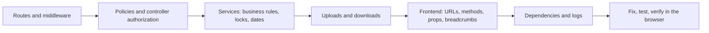
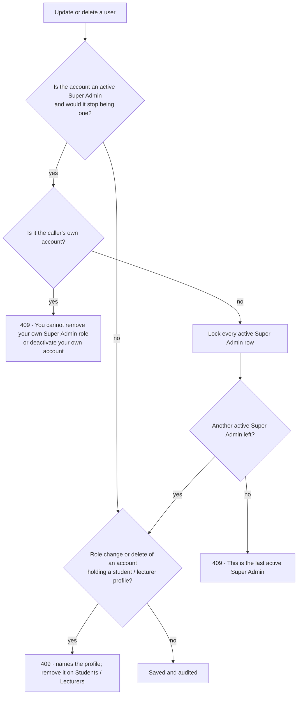
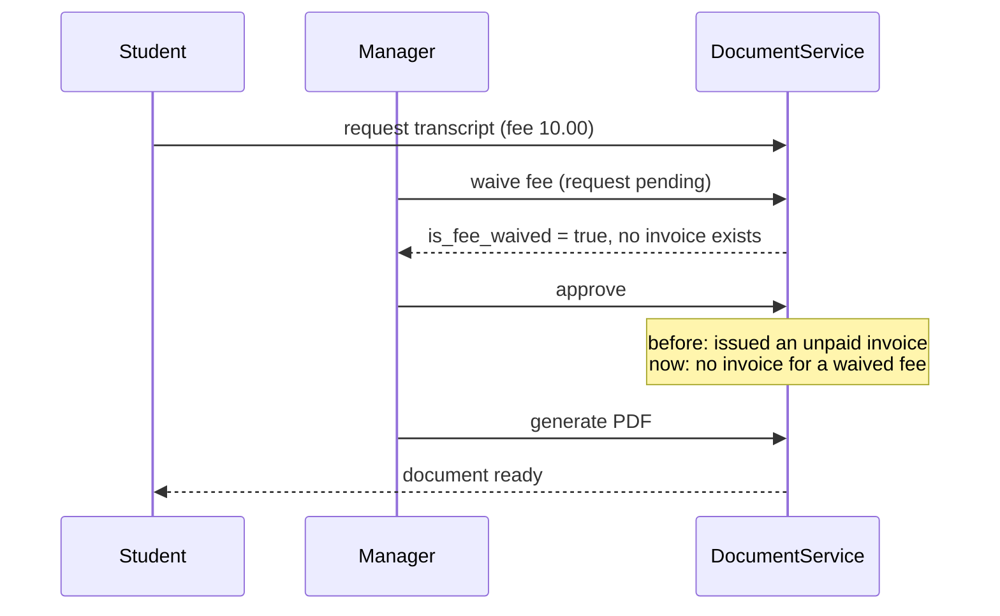
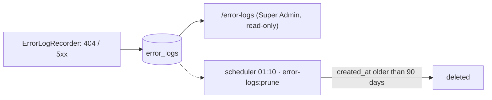

# 50 — Project Audit and Hardening Report

- **Date:** 2026-10-13
- **Modules:** cross-cutting audit — Users management (9.1), Documents (9.16),
  Attendance (9.11), Enrollment (9.9), Examinations (9.13), Assignments (9.12),
  Course materials (report 44), Internships (9.22), Announcements (9.19),
  System Error Logs (9.25); no business module in
  `docs/3_business-overview.md` §9 changes label
- **Status:** `[Implemented]` (fixes and error-log retention)
- **Schema change:** none

## 1. Scope

A whole-project audit of the backend (routes, middleware, every policy,
every service with business rules), the frontend (every page's calls against
the route table, breadcrumbs, XSS sinks) and the dependencies, followed by
fixes for every defect confirmed and one missing operational piece
(error-log retention).

Starting point: suite green (493 tests), Pint clean, `composer audit` clean,
`npm audit` one high advisory.

### How it was checked

| Check | Method | Result |
|---|---|---|
| Route protection | Read `routes/web.php` and `routes/api.php` (431 routes) | Every non-public route has `auth` / `auth:sanctum`; role middleware matches the policies |
| Controller authorization | Script listing controller actions with no `authorize` / `Gate` call | Only self-service actions (own profile, inbox, preferences, password, login) and actions that authorize in a shared helper (`listFor`, `runTransition`, analytics `respond`) |
| Business rules | Read the services with rules (enrollment, grading, GPA, invoices, tuition, documents, attendance, exams, assignments, timetable, announcements, Telegram linking, profile) | Defects F-01 to F-06 below |
| Frontend URLs | Script matching every URL literal and `router` / `form` / `axios` method in `frontend/src` against `route:list` | No missing route or wrong method |
| Frontend props | Script flagging fields read from a resource at the wrong nesting level | Defect F-07 |
| Breadcrumb links | Read `useNavigation` against the role middleware | Defect F-08 |
| XSS sinks | Search for `v-html` / `innerHTML` and external links | None; links are `http(s)` validated and open with `noopener` |
| Logs | Read `laravel.log` errors | Only development-time entries (tinker typos, mid-refactor states) |
| Dependencies | `composer audit`, `npm audit` | One npm advisory (F-09) |

## 2. Findings and fixes

| # | Area | Defect (before) | Fix |
|---|---|---|---|
| F-01 | Users | A Super Admin could remove their own Super Admin role or deactivate their own account, and nothing kept one active Super Admin. Only a Super Admin manages users, so losing the last one locks everyone out of user management. | `UserService` refuses (409) a change that removes the caller's own access and any update or delete that would leave no active Super Admin. It locks every active Super Admin row so two admins demoting each other at once cannot both pass. The edit page disables the role and *Active* fields on your own account and says why. |
| F-02 | Users | Users management could change the role of an account that holds a student or lecturer profile, or delete that account. Either breaks the rule *a student profile belongs to a Student-role account*, and the deleted case made the invoice PDF fail (`$student->user->email` on null, 500). | Both are refused (409) with the profile named. A profile is removed on the Students / Lecturers page, which keeps its own history rules and deactivates the account. |
| F-03 | Documents | A fee waived while the request was still `pending` (allowed by the API) was ignored at approval, which issued an unpaid invoice anyway. | `DocumentService::approve()` issues no invoice for a waived fee. |
| F-04 | Attendance, enrollment, exams | Date rules used the UTC day, not the university's (`ACADEMIC_TIMEZONE`, e.g. `Asia/Phnom_Penh`, UTC+7), so between 00:00 and 07:00 local time: today's attendance was refused as a "future date", today was missing from the register's dates, the enrollment period opened and closed seven hours late, exam results were refused on exam day and upcoming exams included yesterday. | These checks now read `AcademicClock::today()` like the dashboards and reminders (report 48): attendance date rules, expected dates and the default register date, the registration period, the exam-day check for results, upcoming exams, and the `today` the exam pages receive. Finance dates are unchanged (see §5). |
| F-05 | Enrollment | Only the section row was locked, so two students enrolling in **different sections** of the same offering at the same moment could both pass the offering-wide `max_enrollments` check. | `EnrollmentService::enroll()` locks the offering row, then the section row. |
| F-06 | Uploads | Assignment submissions, course materials, internship reports and announcement attachments were stored under the client's file extension (a PDF named `x.html` was stored as `….html` and later served as `text/html`), and announcement attachments stored the client-claimed MIME type. Report 45 had already fixed this for avatars. | Keys take the extension of the validated content (`$file->extension()`); the stored MIME type is the detected one. Downloads send that stored type with `X-Content-Type-Options: nosniff`, and stay attachments. |
| F-07 | Documents UI | `/documents` read `row.requires_fee` / `row.fee_amount`, but `DocumentRequestResource` nests them under `type`. So the fee badge never showed, every request looked *Free*, and the **Waive fee button never appeared**. | The page reads `row.type.*`. The waive action is offered on pending and approved fee-bearing requests whose invoice is not paid, which is the rule the API applies. |
| F-08 | Navigation | The breadcrumb's section link pointed at `/<section>` even when no such list exists for the role. `/coursework/…`, `/exams/…` and `/account/…` led to a 404 (also written to the error log), and `/invoices/{id}` and `/internships/{id}` led a student to a 403. | The crumb is a link only to a list the role can open (its sidebar, plus Announcements, Notifications, Inbox and staff's Internship companies). A student's invoice, internship, coursework and exam pages lead back to *My invoices*, *My internship*, *My assignments* and *My exams*. Other crumbs are plain text. |
| F-09 | Dependencies | `source-map-js` 1.2.1 (via Vite, PostCSS, Vue compiler, Tailwind): high-severity denial-of-service advisory GHSA-68fv-2mgg-jv7q. | Lockfile bumped to 1.2.2 (`npm audit fix`, no `package.json` change). `npm audit` reports 0 vulnerabilities. |

### Super Admin guard

### Document fee with an early waiver

## 3. Added: error-log retention (9.25)

`error_logs` records every 404 and 5xx. A public deployment gets steady 404
traffic from scanners, and report 8 §10 noted that the table had no
retention, so it would grow without bound.

- `ErrorLogService::prune(int $days)` deletes rows recorded more than `$days`
  days ago. `ErrorLogService::RETENTION_DAYS` = 90.
- `php artisan error-logs:prune [--days=90]` (at least one day) runs daily at
  01:10 in the `scheduler` container, next to `notifications:prune` (01:00).
- There is still no delete path over HTTP. Audit logs are a different case:
  they are immutable (append-only trigger, report 28) and are not pruned.

## 4. API changes

No route was added or removed. All 236 API operations are in the OpenAPI spec (`l5-swagger:generate`, compared with `route:list`). Changed behavior:

| Method | URI | Change |
|---|---|---|
| PUT, PATCH | `/api/users/{user}` | New `409`: last active Super Admin, own role or activation, role of an account holding a profile |
| DELETE | `/api/users/{user}` | New `409`: last active Super Admin, account holding a profile |
| POST | `/api/document-requests/{documentRequest}/approve` | No invoice when the fee was waived while pending |
| GET | `/api/submissions/{submission}/file`, `/api/materials/{material}/file`, `/api/internship-reports/{report}/file`, `/api/announcements/{announcement}/attachments/{file}/download` | `Content-Type` is the detected type stored at upload; `X-Content-Type-Options: nosniff` |

The web routes behave the same way: a refusal there is a flash error.

## 5. Decisions

1. **The last-Super-Admin rule lives in the service.** The HTTP self-rule
   already covers every reachable case today, because an inactive account
   cannot act. The service-level rule also covers seeders, tinker and any
   future path, and its row lock covers two admins demoting each other.
2. **Refuse rather than cascade for profiles.** Deleting an account could have
   deleted its profile too. But the Students / Lecturers services already
   decide when a profile may go (no enrollments, grades, invoices or teaching
   history). Pointing the admin there keeps one place for those rules.
3. **Only academic calendar rules moved to the university clock.** Invoice
   dates (issued, due, paid on, overdue) still use the application's day. A
   finance day boundary affects at most an overdue flag set seven hours early
   or late, and changing it would shift every stored invoice's status.
4. **Downloads keep `attachment`.** The content-derived type is extra
   protection; the files are still downloaded, never shown inline.
5. **90 days of error logs.** That keeps a full semester of diagnostics, and
   the period can be shortened per run with `--days`.

## 6. Tests

| Test | Covers |
|---|---|
| `UserManagementTest::test_super_admin_cannot_remove_their_own_access` | F-01: web and API 409; renaming yourself still works |
| `UserManagementTest::test_the_last_active_super_admin_is_never_removed` | F-01: a colleague may be demoted; the last one cannot be demoted, deactivated or deleted |
| `UserManagementTest::test_an_account_holding_a_profile_keeps_its_role_and_is_not_deleted` | F-02: role change and delete refused for student and lecturer accounts; other edits work |
| `DocumentFeeAndTypeTest::test_a_fee_waived_before_approval_is_never_billed` | F-03 |
| `AttendanceTest::test_dates_are_the_university_s_calendar_days` | F-04: 18:30 UTC Sunday = Monday 01:30 local; Monday's register is today's and the default date |
| `EnrollmentTest::test_the_enrollment_period_follows_the_university_s_calendar` | F-04: the period opens and closes on local days |
| `AssignmentTest::test_the_stored_key_and_download_type_come_from_the_content_not_the_file_name` | F-06: a PDF named `work.html` is stored as `.pdf` and served as `application/pdf` with `nosniff` |
| `ErrorLogManagementTest::test_rows_past_the_retention_period_are_pruned_daily` | §3: command, `--days`, schedule entry |

Each new test except the retention one was run against the old code first,
and it failed there. The retention test covers new behavior.

UI checked in headless Chrome at 1366×900 with the seeded accounts and one
temporary request (removed afterwards). `/documents` shows the `$10.00`
badge and the waive action on a pending transcript request. `/users/1/edit`
for yourself shows the role and *Active* fields disabled with the hint, and
another user's are enabled. On `/account/profile` the *Account* crumb is
plain text, and `/users/1/edit` keeps its *Users & roles* link.

## 7. Verification

| Check | Result |
|---|---|
| `php artisan test` | 501 passed |
| `vendor/bin/pint --test` | PASS (623 files) |
| `npm run build` | built |
| `npm audit` / `composer audit` | 0 vulnerabilities / no advisories |
| `l5-swagger:generate` vs `route:list` | 236 / 236 operations documented |
