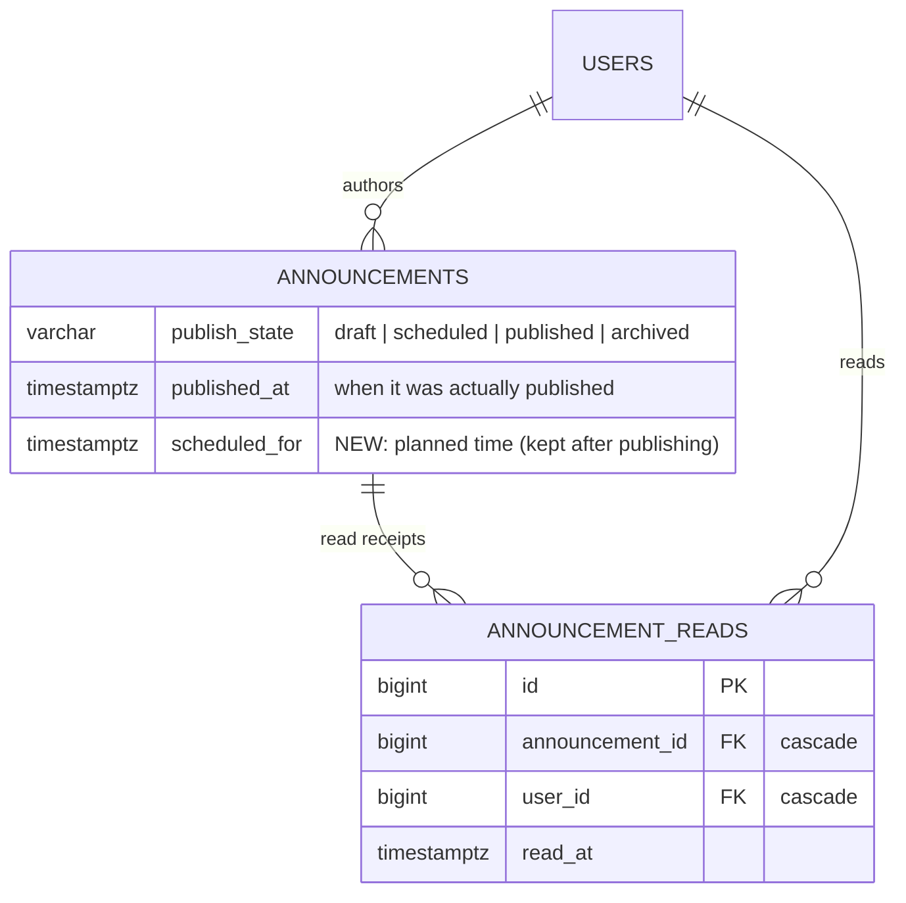
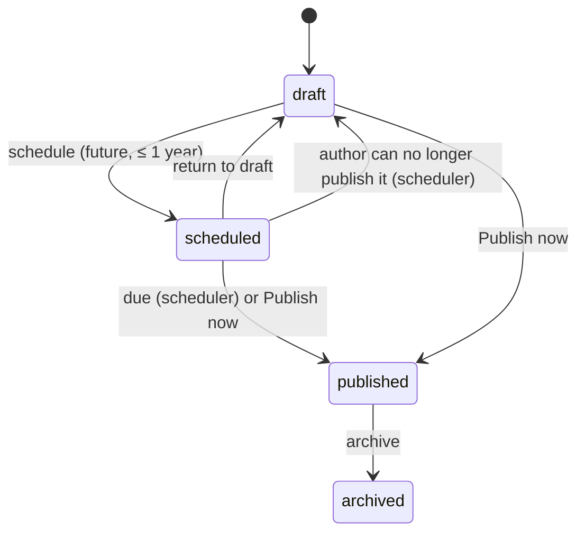
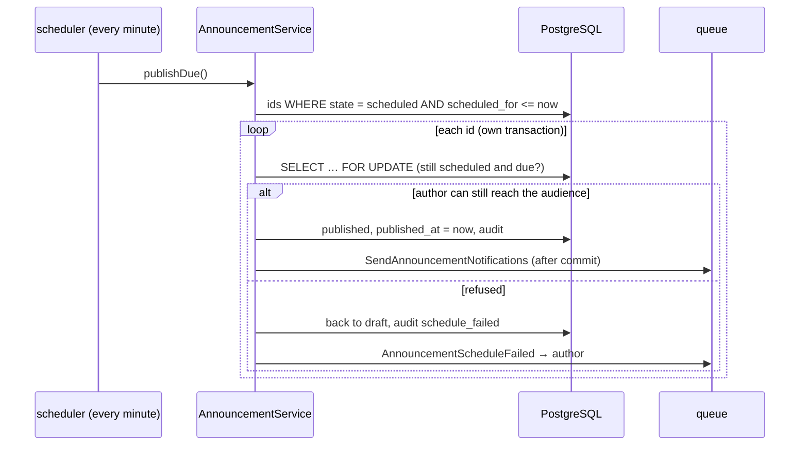

# 51 — Announcement Authoring, Scheduling and Read Receipts Report

- **Date:** 2026-10-13
- **Module:** 9.19 Announcements (business-overview §9.19), extending report 24
- **Status:** `[Implemented]`
- **Depends on:** report 24 (announcements), report 39 (department scoping),
  reports 25 / 42 (notifications and inbox), report 48 (`AcademicClock`)
- **Schema change:** `announcements.scheduled_for` and the `scheduled` state;
  new table `announcement_reads` (migration `2026_10_13_100000`)

## 1. Scope

The three open items of module 9.19 (roadmap §6):

1. **Department Admin authoring.** A Department Admin with an assigned
   department writes announcements to their department, or to one of its
   programs, courses or sections. They see, edit and publish their own
   announcements, like lecturers do.
2. **Scheduled publishing.** A draft can be given a publication time. A
   scheduler command publishes it then, as its author, through the same
   publish step as "Publish now".
3. **Read receipts.** Members of the audience mark announcements read, one
   at a time or all at once. The feed shows what is new, and authors see how
   many of the current audience have read each announcement.

Not built: a list of *who* read an announcement (only counts are shown, §7),
and reading an announcement does not happen automatically when it is
displayed.

## 2. Data model

| Change | Detail |
|---|---|
| `announcements.scheduled_for` | `timestamptz NULL`; index `idx_announcements_scheduled (publish_state, scheduled_for)` for the scheduler's lookup |
| `ck_announcements_publish` | now `draft, scheduled, published, archived` |
| `ck_announcements_scheduled` | new: `publish_state <> 'scheduled' OR scheduled_for IS NOT NULL` |
| `announcement_reads` | unique `uq_announcement_reads (announcement_id, user_id)`; index `idx_announcement_reads_user`; both FKs cascade, because a receipt means nothing without its announcement or user |

The down migration turns any scheduled row back into a draft before
restoring the old CHECK. Both directions were run against the development
database.

## 3. Department Admin authoring

| Audience | Super / University Admin | Department Admin (department D) | Active lecturer |
|---|:-:|:-:|:-:|
| all / students / lecturers / staff | ✓ | 422 | 422 |
| department | any | D only | 422 |
| program | any | programs of D | 422 |
| course | any | courses of D | courses they teach a section of |
| section | any | sections of D's courses | sections they teach |

- The check is the model's own department scope
  (`$target->isVisibleTo($user)`, `BelongsToDepartment`), the same rule that
  limits every Department Admin read (report 39).
- A Department Admin with **no** department writes nothing: `manageAny` is
  false, so the manage page and API answer 403.
- **Department audiences include their Department Admins.** In the feed
  (`memberships`) and in delivery (`recipients`), a department announcement
  now also reaches the Department Admins of that department. That includes
  announcements written by managers, so the people running a department see
  what was sent to it.
- `AnnouncementPolicy::manageAny` delegates to `AnnouncementService::canWrite`,
  which the scheduler also uses to re-check an author.

## 4. Scheduled publishing

- **Schedule:** `POST /announcements/{id}/schedule` with `scheduled_for`.
  On create, send `scheduled_for` instead of `publish` (both together: 422).
  The time must be in the future and at most a year ahead, and the author
  must be able to reach the audience at that moment. An ISO 8601 time with an
  offset is taken as is; one without an offset is read on the university's
  clock (`ACADEMIC_TIMEZONE`). The web form sends the browser's local time as
  an ISO instant, so every user picks and reads times on their own clock.
- **While scheduled** it is in no feed and cannot be edited, deleted or
  scheduled again (409). *Return to draft* (`/unschedule`) clears the time,
  and *Publish now* publishes it at once.
- **Publishing when due:** `php artisan announcements:publish-scheduled`
  runs every minute in the `scheduler` container (`withoutOverlapping`). It
  takes the ids due at that moment, then publishes each one in its own
  transaction under a row lock. Inside the lock it re-checks that the row is
  still scheduled and due, because the author may have just returned it to
  draft. The publish step is shared with *Publish now*: same audience
  re-check, `announcement.published` audit entry and queued delivery
  (`SendAnnouncementNotifications`). `published_at` is the real publication
  time; `scheduled_for` is kept as the planned time.
- **If the author can no longer publish it** (account deactivated, no longer
  teaching the section, moved to another department, lecturer profile
  inactive), the announcement goes back to draft, `announcement.schedule_failed`
  is audited with the reason, and the author receives
  `AnnouncementScheduleFailed`: in the inbox always, and by email or Telegram
  per their preferences. Nothing is published under a role its author no
  longer holds.
- *Publish now* also takes a row lock, so it and the scheduler can never both
  publish the same announcement.

## 5. Read receipts

- `POST /announcements/{id}/read` (web and API) records a receipt. It is
  idempotent (`insertOrIgnore` on the unique pair). The new policy ability
  `read` allows only a **published** announcement that is in the caller's
  own feed; anything else answers 403.
- `POST /announcements/read-all` marks everything unread in the caller's
  feed with one `INSERT … SELECT … ON CONFLICT DO NOTHING`, and returns
  `{data: {marked}}`.
- The feed returns `is_read` per item (`withExists`, no extra query per row),
  and `meta.unread` (API) or the `unreadCount` page prop (web).
- The managed list returns `audience_size`, the active users the announcement
  reaches **now**, and `read_count`, how many **of them** marked it read. Both
  come from one grouped query per row on the page (at most 15). Because they
  are live, someone who left the audience no longer counts, so the counts
  never pass 100 %. Drafts and scheduled announcements show their reach
  ("reaches 3 people").

## 6. Endpoints

| Method | Path | Who | Purpose |
|---|---|---|---|
| POST | `/api/announcements/{announcement}/schedule` | author or manager | Schedule a draft (`scheduled_for`) |
| POST | `/api/announcements/{announcement}/unschedule` | author or manager | Back to draft |
| POST | `/api/announcements/{announcement}/read` | audience member | Read receipt (204) |
| POST | `/api/announcements/read-all` | any signed-in user | Mark the whole feed read |
| POST | `/api/announcements` | + Department Admin | `scheduled_for` accepted on create |
| POST | `/api/announcements/{announcement}/publish` | | Also publishes a scheduled one |
| GET | `/api/announcements/feed` | | + `is_read`, `meta.unread` |
| GET | `/api/announcements` | + Department Admin (own) | + `audience_size`, `read_count`; filter `scheduled` |

Web: `POST /announcements/{id}/schedule`, `/unschedule`, `/read`,
`POST /announcements/read-all`. The manage group now admits
`department-admin`. OpenAPI: 240 / 240 operations documented.

## 7. UI

- **Feed:** unread announcements have a *New* marker, a bolder title and a
  primary ring, plus a *Mark as read* action (`Check`). The header has
  *Mark all as read* (`CheckCheck`) and the description shows the unread
  count. Same icons and treatment as the inbox (report 42).
- **Manage:** a *Scheduled* filter and status badge (`primary`). On drafts,
  *Schedule* (`Clock`) opens a time picker. On scheduled ones, *Publish now*
  (`Send`) and *Return to draft* (`Undo2`). Each row shows "publishes …",
  "reaches N people" or "read by X of N people". The compose dialog has an
  optional *Publish later* time, and its main button switches from
  *Publish now* to *Schedule* once a time is picked; *Save draft* always
  saves a draft. A Department Admin sees "Write to your department and its
  programs, courses and sections." and only those targets.
- The breadcrumb on `/announcements/manage` reads *Manage* (was *Details*).

Checked in headless Chrome at 1366×900 against temporary sample rows (since
removed):

- as a student: three *New* markers, then two after *Mark as read*;
- as Super Admin: the scheduled row with its time, "reaches 7 people" and
  "read by 1 of 2 people";
- as a Department Admin: the department-only description and targets, and
  the *Schedule* button once a time is set.

## 8. Decisions

1. **Scheduling is a state, not a field on drafts.** A `scheduled` row is
   locked like a published one. That makes "what will go out, and when"
   unambiguous, and the scheduler's query is a simple index lookup.
2. **Publish as the author, re-checked at that moment.** Scheduling does not
   freeze the author's rights. A lecturer removed from a section before the
   time falls due does not publish to it. They are told, and the
   announcement waits in their drafts.
3. **Counts, not reader lists.** Authors see how many people read an
   announcement, not who did. That answers "did it land?" without a
   per-person surveillance list. Reader lists can be added later if the
   university asks for them.
4. **Explicit read, no auto-read on display.** Showing a feed page does not
   mark everything read, so the *New* markers mean something.
5. **Times on the reader's clock.** The picker uses the browser's time zone
   and sends an instant. API callers without an offset get the university's
   time zone, which matches the class reminders (report 48).

## 9. Tests

`tests/Feature/Announcements/AnnouncementWorkflowTest.php`, 7 tests:

| Test | Covers |
|---|---|
| `test_a_department_admin_writes_to_their_own_department_only` | all four unit audiences of their department; another department, outside program or section → 422; groups → 422 with the Department Admin message; own list only; manage page targets; no department → 403 |
| `test_a_department_audience_includes_its_department_admins` | feed and `recipients()` include the department's admins, not another department's |
| `test_a_scheduled_announcement_is_published_when_due` | wall-clock time in `Asia/Phnom_Penh`; hidden, not editable or re-schedulable while scheduled; command publishes nothing early, then once at the time (audit, queued delivery, feed) |
| `test_schedule_rules_unschedule_and_publish_now` | create scheduled; `publish` + `scheduled_for` → 422; past, over a year, missing → 422; unschedule rules; publish now; students 403; web routes |
| `test_a_scheduled_announcement_whose_author_lost_access_returns_to_draft` | back to draft, `schedule_failed` audit, `AnnouncementScheduleFailed` to the author, nothing in the feed |
| `test_members_mark_announcements_read_and_authors_see_the_count` | `is_read`, `meta.unread`, idempotent read, 403 outside the feed and on drafts, `audience_size` / `read_count`, read-all |
| `test_web_feed_shows_read_state_and_marks_it` | `unreadCount`, web read and read-all, manage page counts |

`AnnouncementTest` (7) and `InboxTest` (the new notification has an inbox
message) still pass. One existing test was renamed to
`test_students_and_an_unassigned_department_admin_cannot_write`: the rule it
pins is unchanged, but only an *unassigned* Department Admin is refused now.

## 10. Verification

| Check | Result |
|---|---|
| `php artisan test` | 508 passed (501 before + 7) |
| `vendor/bin/pint --test` | PASS (627 files) |
| `npm run build` | built |
| `php artisan migrate` / `migrate:rollback --step=1` / `migrate` | up, down and up again on the development database |
| `l5-swagger:generate` vs `route:list` | 240 / 240 operations documented |
