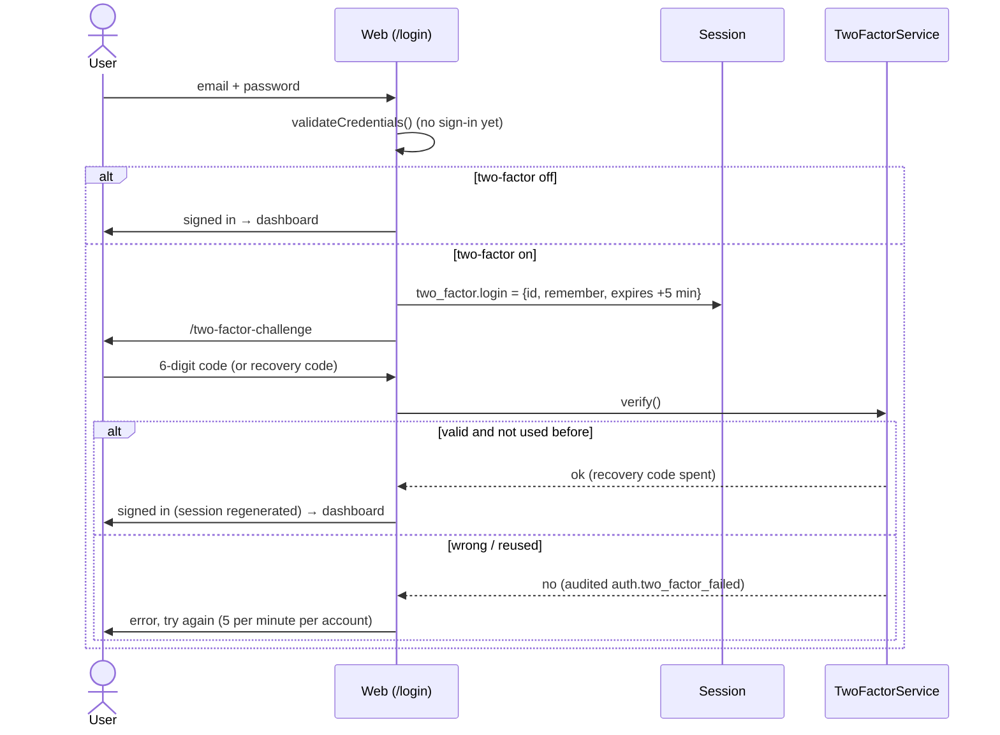
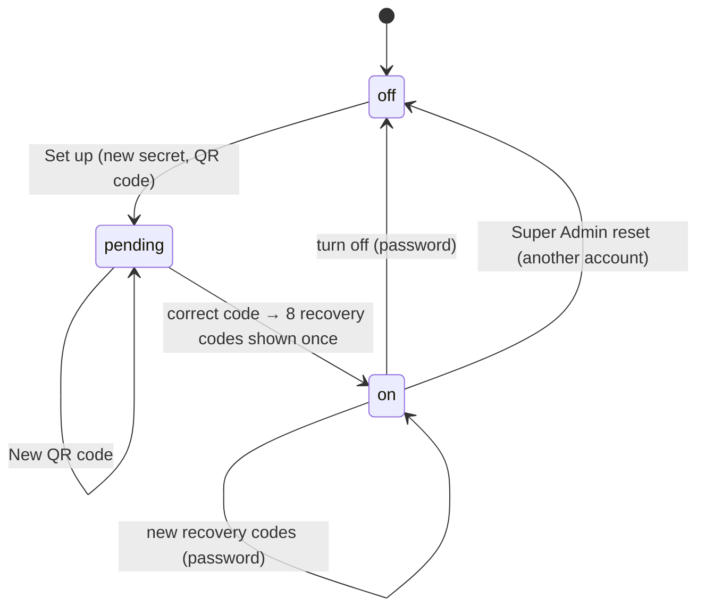

# 52 — Two-Factor Sign-In Report

- **Date:** 2026-10-13
- **Module:** 9.1 Authentication & Authorization (business-overview §9.1),
  and the 9.24 open item "two-factor sign-in"
- **Status:** `[Implemented]`
- **Depends on:** report 28 (audit trail), report 29 (password change and
  reset), report 42 (inbox notices)
- **Schema change:** three nullable columns on `users` (migration
  `2026_10_13_110000`)
- **New dependency:** none (TOTP written in-house, QR codes from the existing
  `bacon/bacon-qr-code`)

## 1. Scope

Optional two-factor sign-in for every role. With it on, signing in needs the
password **and** a 6-digit code from an authenticator app (Google
Authenticator, Microsoft Authenticator, Authy and others: TOTP, RFC 6238).
Eight single-use recovery codes cover a lost phone, and a Super Admin can
reset an account whose owner lost both. It applies to web and API sign-in.

Not in scope: making two-factor mandatory for a role, SMS or email codes,
"remember this device", and WebAuthn / passkeys (see §8).

## 2. How it works

- **No session before the second factor.** `LoginRequest::validateCredentials()`
  checks the password without signing in. The web sign-in signs in only after
  the code passes. Wrong passwords keep the generic error and still count
  toward the existing 5-per-minute limit.
- **The code page** (`/two-factor-challenge`) lasts five minutes. After that,
  or without a pending sign-in, it goes back to the password form. It allows
  5 wrong codes per minute per account (plus 10 requests per minute per
  session and address, `throttle:two-factor`).
- **API:** `POST /api/login` takes `two_factor_code` or `recovery_code` in
  the same request. Without one, it answers 422 on `two_factor_code`, which
  does not count as a failure. A wrong one counts toward the sign-in limit
  like a wrong password, and no token is issued until it passes.
- **Each code works once.** A matched code's time step is recorded per
  account (`Cache::add`, 2 minutes), so replaying it inside its window is
  refused. A clock drift of one step (±30 s) is accepted.

## 3. Setting it up and managing it

| Action | Web | API | Needs | Audit | Owner told |
|---|---|---|---|---|---|
| Start setup | `POST /account/two-factor` | `POST /api/two-factor` | — | — | — |
| Turn on | `POST /account/two-factor/confirm` | `POST /api/two-factor/confirm` | a code from the app | `auth.two_factor_enabled` | ✓ |
| New recovery codes | `POST /account/two-factor/recovery-codes` | `POST /api/two-factor/recovery-codes` | password | `auth.two_factor_recovery_codes_regenerated` | ✓ |
| Turn off | `DELETE /account/two-factor` | `DELETE /api/two-factor` | password | `auth.two_factor_disabled` | ✓ |
| Reset (Super Admin, not own) | `DELETE /users/{user}/two-factor` | `DELETE /api/users/{user}/two-factor` | — | `auth.two_factor_reset` (actor = admin) | ✓ |
| Status | `GET /account/two-factor` | `GET /api/two-factor` | — | — | — |

Sign-in adds two audit actions: `auth.two_factor_failed` (a wrong code or
recovery code) and `auth.recovery_code_used` (with the number left). "Owner
told" is `TwoFactorChanged`, a critical notice: email even when email notices
are off, plus the inbox and Telegram if linked.

## 4. Storage and secrets

| Column on `users` | Type | Content |
|---|---|---|
| `two_factor_secret` | text, null | The base32 TOTP secret, **encrypted** with the app key (`encrypted` cast) |
| `two_factor_recovery_codes` | text, null | **Encrypted** JSON list of **SHA-256 hashes** of the unused recovery codes; a code is removed when used |
| `two_factor_confirmed_at` | timestamptz, null | Set when turned on; two-factor is on only with this and a secret |

- Both secret columns are in `User::$hidden`, so they never appear in
  `/api/user`, resources or audit snapshots (`AuditLogger` drops hidden
  attributes).
- Recovery codes are random (`xxxxx-xxxxx`, about 50 bits each). They are
  shown once: right after turning on or regenerating, in the API response, or
  on the web page through an **encrypted** one-time flash. They are never
  stored readable. Spending a code takes a row lock, so the same code cannot
  be used twice at once.
- The QR code is generated server-side (`App\Support\QrCode`, also used for
  document verification) and shown as an `` data URI, never as
  injected HTML.

## 5. TOTP implementation

`App\Support\Totp`: HMAC-SHA1 over a 30-second counter, 6 digits, 160-bit
random secrets, base32, `otpauth://` provisioning URIs, and constant-time
comparison (`hash_equals`). It is about 40 lines rather than a new package
(`skills/architecture`: no new dependencies without a need). It is held to
the standard by `tests/Unit/TotpTest.php`, which runs the six RFC 6238
Appendix B SHA-1 vectors, the RFC 4648 base32 vectors, the ±1-step window
and the URI format. In the browser check, a code computed by a separate
Node.js implementation was accepted by the server.

## 6. UI

- **`/account/two-factor`** (account menu → *Two-factor sign-in*,
  `Smartphone`):
  - Off: a *Set up* button.
  - Setup: QR code, the key in groups of four for typing in, a code field,
    and *Turn on* / *New QR code*.
  - On: *On since …*, recovery codes left (a warning at 2 or fewer), and
    the actions *New recovery codes* (`RefreshCw`) and *Turn off*
    (`ShieldOff`), both in a password dialog.
  - New codes appear once, with *Copy* and *Download (.txt)*.
- **`/two-factor-challenge`:** the sign-in card with a code field
  (`one-time-code` autocomplete, numeric keyboard), "Lost your phone? Use a
  recovery code", and *Back to sign in*.
- **Users → Edit:** a *Two-factor sign-in On / Off* row. When it is on and
  the user is not you, a *Reset two-factor sign-in* action (`ShieldOff`,
  confirmation dialog).

Checked in headless Chrome at 1366×900:

- The seeded lecturer, given two-factor with a test secret: password, then
  the code page; a wrong code shows "That code is not valid…"; the right
  code reaches the dashboard.
- As Super Admin: the *Off* state, then *Set up* shows the QR image (loaded)
  and the breadcrumb *Dashboard › Account › Two-factor sign-in*; the
  lecturer's edit page shows *On* and the reset action.

The test state was cleared afterwards (three sign-in audit rows remain;
the audit log is append-only).

## 7. Tests

| File | Tests | Covers |
|---|---|---|
| `tests/Unit/TotpTest.php` | 9 | RFC 6238 and RFC 4648 vectors, drift window, input checks, URI |
| `tests/Feature/Auth/TwoFactorTest.php` | 7 | setup with a wrong then a right code, codes shown once, encrypted storage, nothing in `/api/user`, audit and notice; web sign-in with code page, wrong code, **replay refused**, next code accepted; recovery code once (case and dash insensitive); page expiry, no pending sign-in, rate limit; API sign-in without, wrong and right code and with a recovery code; password needed to turn off or regenerate, old codes invalid; Super Admin reset, not own, not by others, 409 when off |

A mutation check confirmed the replay test fails when single use is
removed. `UserManagementTest::test_api_delete_soft_deletes_user_and_revokes_tokens`
was corrected: it passed the Bearer token as the request body, not as a
header. It only passed because the old API login also signed the admin into
the web guard inside the test process. API sign-in no longer touches the web
guard; it fires `Login` for the `sanctum` guard, so `auth.login` is still
audited.

## 8. Decisions

1. **Optional, for everyone.** Making it mandatory (for example for Super
   Admins) is a policy choice for the university. The page recommends it for
   administrators, and enforcing it per role later needs only a sign-in check
   on `hasTwoFactorEnabled()`.
2. **TOTP, not SMS or email codes.** It works offline, costs nothing, and is
   not exposed to SIM swaps. Passkeys (WebAuthn) would need a browser
   library outside the fixed stack.
3. **The password first, then the code.** This is the standard flow. A
   correct password reveals that the code is needed, which is acceptable
   because the code still has to be guessed under a 5-per-minute limit.
4. **API in one request.** Clients send the code with the credentials, with
   no intermediate challenge token to store. The existing per-email and
   per-address sign-in limit already covers it.
5. **Turning it off needs the password; an admin reset does not.** A stolen
   session alone cannot remove the second factor. An owner who lost
   everything has a documented path, and each reset is audited and emailed
   to them.

## 9. Verification

| Check | Result |
|---|---|
| `php artisan test` | 524 passed (508 before + 9 unit + 7 feature) |
| `vendor/bin/pint --test` | PASS (637 files) |
| `npm run build` | built |
| `l5-swagger:generate` vs `route:list` | 246 / 246 operations documented |
