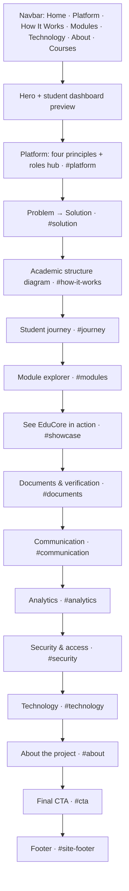
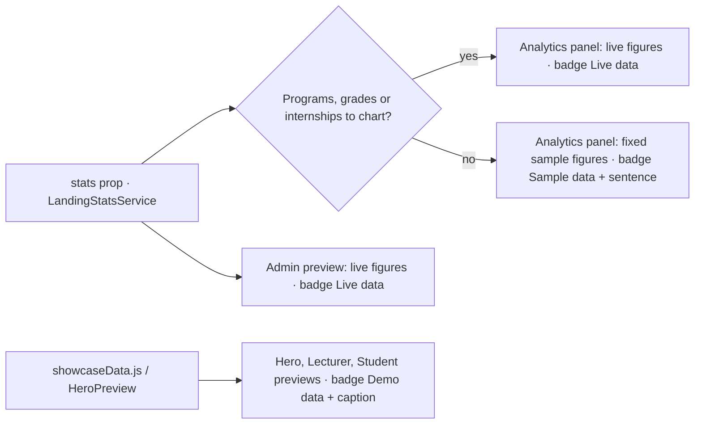
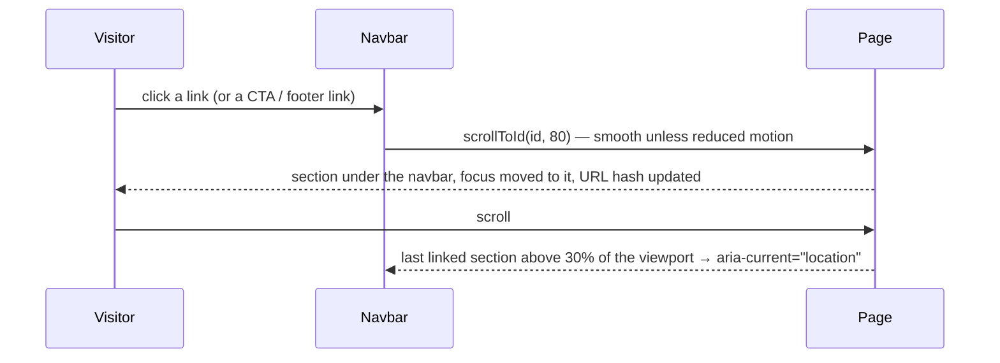

# 54 — Landing Page Product Showcase Report

- **Date:** 2026-10-14
- **Scope:** the public landing page (`/`) rebuilt as a product showcase: new story order, hero
  product preview, roles hub, department-first structure diagram, phased student journey, module
  explorer with "not yet" items, demo-data role previews, real document workflow, channel fan-out,
  analytics with labelled sample fallback, accurate security and technology sections, full footer,
  crawler-visible Open Graph tags
- **Status:** `[Implemented]`
- **Schema:** no change. **API:** no route, prop or response change (`docs/api/api-audit.md`
  note). **Dashboard / auth / RBAC:** untouched
- **Design system:** `docs/branding/UI-COMPONENTS.md` §15 updated first
- **Supersedes:** the structure and motion sections of `docs/37_Landing-Page-Redesign-Report.md`
  (its live figures, clickable rows and seeding still hold)

## 1. Audit of the previous page

| Problem | Where | Fix |
|---|---|---|
| The faculty level was removed in report 39, but the page still showed it | Ecosystem ("Faculty" level), modules ("Faculties", "Faculty Admin"), communication flow, sample notice "Faculty of Engineering", admin preview sidebar | Department-first structure everywhere |
| Shipped features missing or described as absent | In-app inbox (report 42) described as "announcements on the feed"; trends (report 47) and two-factor sign-in (report 52) absent | Described in Modules, Communication, Analytics and Security |
| Unsupported or ageing claims | "runs a university on one secure platform"; hero terminal with a fixed "411 passed" test count; "Secure by design" | Brief's copy; terminal removed; "Designed with Access Control in Mind" plus a no-certification note |
| Technology listed that is not used | Pinia shown as "State" (registered, no store exists) | Removed; TypeScript not listed either (plain JavaScript) |
| Hero showed developer tooling, not the product | `HeroTerminal` | `HeroPreview`: a student dashboard with labelled demo data |
| Lecturer / Student previews were grey skeletons | `DashboardPreview` | Realistic demo rows, badged `Demo data` |
| Analytics was four empty states on a fresh installation | `AnalyticsSection` | Whole-panel fallback to labelled sample figures |
| A real team member's name on the sample transcript, with a "Verified" badge | `DocumentVerification` | "Demo Student", "Example University", SAMPLE watermark, the public page's real answer wording |
| Repetition | "What is EduCore?" six pillars repeated the module list | Four principles + a roles hub ("who is it for") |
| Only infinite animation in the product | Technology marquee | Compact four-group grid |
| Footer had no links | ASCII "EDUCORE" banner only | Logo, tagline, three link groups, team, copyright |
| Navbar too wide for the spec's links at `lg`; mobile menu left the page tabbable | `LandingNavbar` | Links from `xl`, menu below; `inert` page behind the open menu |
| Duplicate `<meta name="description">`; no tags for crawlers (no SSR) | `app.blade.php` + `<Head>` | Keyed tags in Blade, replaced by the page's `<Head>` |
| 500 kB team photo | `lyhor.png` | 192 px JPEG crops (6 kB each) |

## 2. Feature accuracy

Copy was checked against `docs/3_business-overview.md` §9, the reports and the code before writing.

| Class | Items shown on the page |
|---|---|
| Implemented and working | All modules in the explorer (structure, programs, calendar, courses & sections, enrollment, timetables, profiles, attendance, assignments & materials, exams, grades & GPA, document requests / generation / QR verification, invoices & payments incl. tuition, announcements with scheduling and read receipts, internships, in-app inbox, email, Telegram incl. class reminders, analytics with department filter and six-semester trends, audit logs); two-factor sign-in; rate-limited sign-in (`LoginRequest`, `AuthenticatedSessionController`); append-only audit table (migration `2026_10_02_090000`); private document storage |
| Implemented but incomplete | Notifications: no live push — the unread count refreshes on each page visit (shown as `Not yet`) |
| Planned / Future | Internship opportunity postings (shown as `Future`) |
| Not supported | Online payment gateway, predictive analytics (shown as `Out of scope`) |
| In development (not described) | Public course catalog (report 53, uncommitted): only its existing navbar link is kept |

## 3. Page structure

The order tells the story: what EduCore is → why → how the university is modelled → what it
covers → what it looks like → key workflows → trust → who built it. "How It Works" comes before
"Modules" so the navbar's active link only ever moves forward while scrolling.

| Section | Component(s) | Content | Data |
|---|---|---|---|
| Hero | `HeroSection`, `HeroPreview` | Brief's headline and copy; *Explore EduCore* → `#showcase`, *Discover the Platform* → `#platform`, Sign in link; "Designed for" four audiences; student dashboard (GPA, attendance, credits, today's classes, assignments due) with two notices | Demo, badged + captioned |
| Platform | `PlatformIntro`, `PlatformRoles` | Four principles (centralized information, connected workflows, role-based access, digital administration); roles hub: Super Admin, University Admin, Department Admin, Lecturer, Student, anyone verifying a document, around "one shared set of academic records" | Static |
| Problem → Solution | `ProblemSolution` | Five challenge → EduCore pairs, "problems EduCore is designed to address" | Static |
| Academic structure | `AcademicEcosystem` | University → Department → Program / Course; University → Academic year → Semester; Course + Semester → Section; Program → Student, *enrolls in* Section. Diagram from `lg`, indented tree below | Static |
| Student journey | `StudentJourney` | 10 stages in 4 phases (Admission · Every semester · Results · Beyond class); students' and staff's view | Static |
| Modules | `ModuleExplorer`, `moduleData.js` | 4 areas, 22 modules, "used by" roles, "Not part of EduCore yet" list | Static |
| See EduCore in action | `ProductShowcase`, `DashboardPreview`, `showcaseData.js` | University administration / Lecturer workspace / Student workspace: summary, three capabilities, preview | Admin live; Lecturer / Student demo |
| Documents | `DocumentVerification`, `QrMark` | Request → Review → Fee (if any) → Generate → Verify; sample transcript + the public page's *Valid document* answer | Illustrative, captioned |
| Communication | `CommunicationSection` | Audiences (everyone, role group, department, program, section, course); inbox, email, Telegram; one announcement fanning out to three channels | Illustrative, captioned |
| Analytics | `AnalyticsSection` (lazy) | Capabilities; KPIs, enrollment by program (donut), grade bands (bar), internships by status | Live, or sample as a whole |
| Security | `SecuritySection` | Authentication, RBAC, protected API, audit logging, controlled document access; no-certification note | Static |
| Technology | `TechnologyStack`, `techLogos.js` | Frontend · Backend · Data & storage · Infrastructure | Static |
| About | `ProjectStory` | Purpose, university-focused design, Cambodian workflows; team Rin Nairith and Yong Lyhor | Static |
| Final CTA / Footer | `FinalCTA`, `LandingFooter` | Brief's heading and copy; footer link groups, team, © year | Static |

## 4. Live, demo and sample data

| Rule | Implementation |
|---|---|
| Never mix live and sample numbers | `AnalyticsSection` picks one data set for the whole panel (`hasLive`) |
| Label at the point of display | Badges inside each preview's title bar or panel header, plus captions |
| No real people on sample records | "Demo Student", "Example University"; no names in demo dashboards |
| Personal dashboards stay personal | Lecturer / Student previews never use live data |

## 5. Components

| Change | Files |
|---|---|
| New | `HeroPreview.vue`, `PlatformIntro.vue`, `PlatformRoles.vue`, `moduleData.js` |
| Rewritten | `HeroSection`, `ProblemSolution`, `AcademicEcosystem`, `StudentJourney`, `ModuleExplorer`, `ProductShowcase`, `DashboardPreview`, `showcaseData.js`, `DocumentVerification`, `CommunicationSection`, `AnalyticsSection`, `SecuritySection`, `TechnologyStack`, `ProjectStory`, `FinalCTA`, `LandingFooter`, `LandingNavbar`, `pages/Landing.vue` |
| Extended | `LandingTabs`: `vertical` variant (side list from `lg`, 2 × 2 grid below, Up / Down keys, `aria-orientation`) and `short` labels for phones |
| Removed (no references left) | `HeroTerminal.vue`, `WhatIsEduCore.vue`; Pinia entry in `techLogos.js` |
| Kept | `Reveal`, `SectionHeading`, `useInView`, `scrollTo`, `QrMark`, `LandingLayout`, `CampusMap` |
| Styles (`style.css`) | Added `.edu-pop`, `.landing-grid-fade`; removed `.edu-float(-slow)`, `.edu-drift`, `.edu-blink`, `.edu-travel`, `.edu-marquee*`, `.landing-banner`, `.bg-grid-doc` (no users left) |
| Assets | `public/assets/images/people/nairith-192.jpg`, `lyhor-192.jpg` (originals kept) |
| Shell | `backend/resources/views/app.blade.php`: description, Open Graph and Twitter tags keyed with `data-inertia` |

Every component stays under the 200–300-line split threshold (largest: `LandingNavbar`, 216 lines); content lives in data arrays (`moduleData.js`,
`showcaseData.js`) so copy edits do not touch markup.

## 6. Navigation and interaction

| Control | Behaviour |
|---|---|
| Navbar | Links from `xl` (1280); below, a menu button: opens a panel, focuses its first item, locks scroll, sets `inert` on `main` and the footer; Esc closes and returns focus; closes itself when the viewport reaches `xl` |
| Module tabs | Vertical tablist from `lg` (Up / Down / Home / End), 2 × 2 button grid below (Left / Right); panel transitions with `edu-panel` |
| Showcase tabs | Underline tabs, `short` labels on phones ("Admin · Lecturer · Student") |
| Theme | Sun / Moon toggle, shared `educore_theme` preference |

## 7. Motion and responsive behaviour

Motion is once-only and in-view-triggered; no infinite animation remains (§15 of UI-COMPONENTS lists
each utility). Under `prefers-reduced-motion` every reveal is visible at once, the hero entrance is
settled and the verification result is shown without the scan.

| Width | Layout |
|---|---|
| 1920 / 1440 / 1280 | Hero two columns with overlapping notice cards; full navbar; diagram; horizontal journey; side-by-side showcase |
| 1024 | Hero two columns with `h1` headline; menu button + Sign In / Explore; diagram; showcase copy above the preview |
| 768 | Hero stacked (preview under the copy); modules as a 2 × 2 tab grid; showcase summary and capabilities side by side |
| 430 / 390 / 375 | Single column; CTAs full-width; vertical journey; structure as an indented tree; short tab labels; technology two groups per row; footer two columns |

## 8. SEO, accessibility and performance

| Area | Result |
|---|---|
| Title / description | "EduCore — One Platform. Smarter Education." and the brief's description; one description tag (was two) |
| Open Graph / Twitter | In the served HTML (crawlers do not run JavaScript) with an absolute image URL from the request host; no canonical URL invented |
| Headings | One `h1`; `h2` per section, `h3` blocks, no skipped level (checked) |
| Images | All with `alt`; decorative previews `aria-hidden` with a visible caption; portraits lazy-loaded |
| Keyboard | Every control reachable; visible focus rings; tabs follow WAI-ARIA; skip link kept |
| Performance | Portraits 590 kB → 13 kB; the analytics section stays a lazy chunk; no new dependency |

## 9. Verification

| Check | Result |
|---|---|
| `npm run build` (frontend container) | Pass; only the existing > 500 kB app chunk warning |
| Interaction suite (headless Chrome, scratch script) | 48 / 48 checks pass: title and meta, single `h1`, heading order, `alt`, each navbar link scrolls and lights up, hero / navbar / footer CTAs, module and showcase tab keyboard control, theme toggle, `/login` `/forgot-password` `/catalog` respond 200, mobile menu (focus, `inert`, scroll lock, Esc, link closes), no overflow at 390, reduced-motion states, no console errors |
| Screenshots | 1920, 1440, 1280, 1024, 768, 430, 390, 375; light and dark; every section and every tab: no horizontal overflow, no console errors or failed requests |
| `php artisan test` (backend container) | 529 passed (5,436 assertions), including `LandingStatsTest`; the run also covered the uncommitted catalog tests already in the working tree. No PHP class changed; `app.blade.php` renders every page |

## 10. Decisions and deviations from the brief

| Brief | Decision | Why |
|---|---|---|
| Vue 3 + TypeScript + Vue Router | Plain JavaScript, Inertia routing | The project's stack (`skills/vue`, `skills/architecture`) |
| Hierarchy with a Faculty level | Department-first diagram, "no separate faculty level" stated | Report 39 removed faculties |
| Nav order Home · Platform · Modules · How It Works · … | Home · Platform · How It Works · Modules · … | Matches page order, so the active link never jumps back |
| TypeScript and Pinia in Technology | Not listed | Not used (no `.ts`; Pinia has no store) |
| Team "Lyhor" | "Yong Lyhor" | Full name used across the project |
| "Explore Platform" target | `#showcase` (the product tour) | The CTA should show the product |
| Sample analytics | Only when the installation has nothing to chart, as a whole, badged | Brief allows labelled sample data; report 37's "no invented numbers" kept for live data |

## 11. Not done / follow-ups

- `app.js` imports every page eagerly, so the landing page downloads the whole application
  (1.08 MB, 305 kB gzip). Resolving pages lazily (`import.meta.glob` without `eager`) would split
  it, but it changes how every signed-in page loads, which was out of scope here.
- `stats.courses` is still computed by `LandingStatsService` but no longer shown.
- The Open Graph image is the 1.2 MB brand PNG, not a 1200 × 630 card.
- The theme is still applied after Vue mounts (report 37): a dark-mode visitor can see a brief
  light frame on first load.
- Checked in headless Chrome only; not on physical phones or screen readers.
