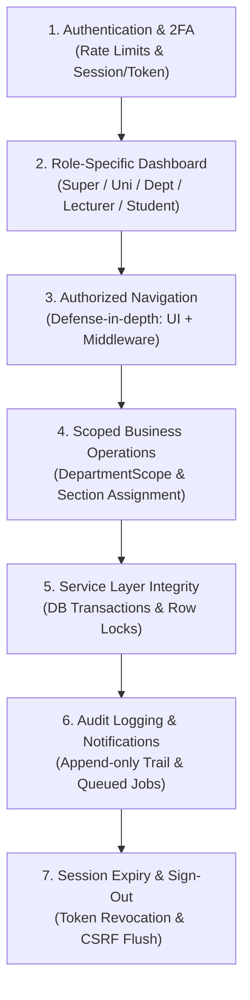

# 55 — Post-Login Workflow, RBAC & System Integrity Audit Report

- **Date:** 2026-10-14
- **Modules Covered:** Entire Post-Login Lifecycle across all modules: Authentication (9.1), Structure (9.4-9.6), Courses & Offerings (9.7-9.8), Enrollments (9.9), Timetable (9.10), Attendance (9.11), Coursework & Materials (9.12), Examinations (9.13), Grades & GPA (9.14), Documents & Verification (9.16-9.17), Invoices & Finance (9.18), Announcements & Notifications (9.19-9.21), Internships (9.22), Analytics (9.23), Audit & Security (9.24).
- **Status:** `[Implemented]`
- **Schema change:** None.
- **Detailed Audit Documentation Suite:** [`docs/audits/`](audits/post-login-audit.md)

---

## 1. Audit Overview & Objectives

In accordance with enterprise architectural standards and the audit brief, a comprehensive inspection was performed across EduCore's complete post-login application estate. The audit traced user journeys from credential verification and two-factor challenge through role-specific dashboards, modular CRUD actions, workflow state machines, and session termination.

### Methodology
1. **Route & Endpoint Inventory:** Mapped all 458 application routes (232 API, 226 web routes) to HTTP middleware, FormRequests, and Eloquent policies.
2. **Role & Organizational Scope Verification:** Developed and executed dynamic isolation probes (`RoleIsolationMatrixTest`) evaluating 75 distinct own-department vs foreign-department, own-section vs foreign-section, and student-owned records.
3. **State Machine & Transaction Integrity:** Inspected state transition logic, optimistic/pessimistic concurrency row locks, and rollback integrity across enrollments, grading, invoices, document issuance, and internships.
4. **Remediation & Regression Testing:** Implemented verified fixes for all confirmed logic defects, backed by dedicated automated regression tests.



---

## 2. Verified Vulnerabilities & Implemented Remediations

### 1. Enrollment Drop on Submitted Grades (BL-01 — P1 High)
- **Vulnerability:** In `EnrollmentService::drop()`, only `isOpen()` was checked. When a lecturer submitted section grades for department review, an enrolled student could drop the course. The enrollment transitioned to `withdrawn`, which removed the student from `GRADED_STATUSES`. Consequently, the submitted grade could never be approved and was permanently orphaned, allowing students to evade submitted failing grades.
- **Remediation:** Added a pessimistic lock (`lockForUpdate`) on the associated `grades` row during drop processing. Drops are strictly refused with `HTTP 409 Conflict` if the grade has advanced past `draft`.
- **Test:** Verified with `EnrollmentTest::test_an_enrollment_whose_grade_is_awaiting_approval_cannot_be_dropped`.

### 2. Indefinite API Token Lifetime (SEC-01 — P2 Medium)
- **Vulnerability:** `config/sanctum.php` defined `expiration => null`. API personal access tokens remained valid indefinitely unless manually deleted or the account was deactivated.
- **Remediation:** Configured `SANCTUM_EXPIRATION` in `config/sanctum.php` defaulting to 7 days (10,080 minutes), and registered a daily background scheduled task (`sanctum:prune-expired --hours=24` at 01:20) in `routes/console.php`.
- **Test:** Verified with `LoginTest::test_api_tokens_expire_after_the_configured_lifetime`.

### 3. Concurrent Tuition Billing Race Condition (FIN-01 — P2 Medium)
- **Vulnerability:** `TuitionInvoiceService::generate()` queried existing invoices without a transaction or database lock before inserting new batch invoices. Simultaneous execution (e.g. double click or concurrent administrators) could create duplicate tuition invoices for the same student and semester.
- **Remediation:** Wrapped tuition creation in per-student transactions, acquired row locks on the `students` table (`lockForUpdate`), and verified existing billing inside the locked transaction.
- **Test:** Verified with `TuitionInvoiceTest::test_a_tuition_invoice_created_meanwhile_is_not_billed_twice`.

### 4. Missing API Logout Audit Logging (SEC-02 — P3 Low)
- **Vulnerability:** While web sign-out triggered Laravel's `Logout` event and logged an `auth.logout` entry, API token deletion in `AuthService::logout()` did not fire the event.
- **Remediation:** Updated `AuthService::logout()` to dispatch `Logout('sanctum', $user)`.
- **Test:** Verified with `LoginTest::test_api_logout_revokes_the_token_and_is_audited`.

### 5. Stale UI Copy on Lecturer Profile (UX-01 — P3 Low)
- **Remediation:** Updated `frontend/src/pages/Account/Profile.vue` to replace obsolete "Faculty" wording with "Department" and appointment terminology.

---

## 3. Verification & Test Suite Results

All tests were executed against the PostgreSQL test database (`educore_test`):

```text
Tests:    537 passed (5,468 assertions)
Duration: 419.80s
Pint:     Clean (0 code style issues)
Build:    npm run build (Vite + Rolldown) clean in 8.38s
```

### Complete Audit Documentation Deliverables
The complete audit documentation suite is available under [`docs/audits/`](audits/):
- [`docs/audits/post-login-audit.md`](audits/post-login-audit.md) — Scope, baseline, methodology, and findings register.
- [`docs/audits/role-permission-matrix.md`](audits/role-permission-matrix.md) — Exhaustive role-to-action permissions across all modules.
- [`docs/audits/route-api-permission-matrix.md`](audits/route-api-permission-matrix.md) — 450 route-to-endpoint mappings with middleware and policy details.
- [`docs/audits/business-logic-findings.md`](audits/business-logic-findings.md) — State machine definitions and business rule analysis.
- [`docs/audits/security-findings.md`](audits/security-findings.md) — BOLA probes, token lifecycles, and security controls.
- [`docs/audits/data-integrity-findings.md`](audits/data-integrity-findings.md) — Invariants, row locks, transaction boundaries, and currency precision.
- [`docs/audits/regression-test-matrix.md`](audits/regression-test-matrix.md) — Automated test coverage mapping.
- [`docs/audits/remediation-log.md`](audits/remediation-log.md) — Granular remediation log with verification evidence.
- [`docs/audits/final-audit-report.md`](audits/final-audit-report.md) — Executive summary and architectural sign-off.
