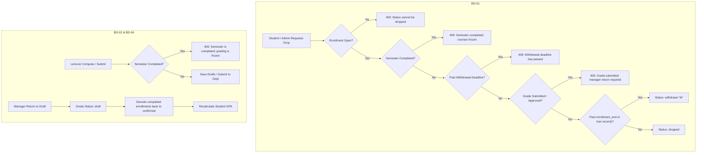

# 56 — Academic Business Rules & Database Integrity Hardening Report

- **Date:** 2026-10-15
- **Modules Covered:** Academic Year & Semester Management (9.6), Course Registration / Enrollment (9.9), Grades & GPA (9.14), Invoices & Finance (9.18).
- **Status:** `[Implemented]`
- **Schema Change:** Migration `2026_10_14_180441_add_unique_active_tuition_invoice_and_withdrawal_deadline.php` (added `withdrawal_deadline` to `semesters`, partial unique index `uq_invoices_student_semester_active` to `invoices`).

---

## 1. Overview & Objectives

Following the post-login audit (Report 55) and the documented business decisions (`BD-01`, `BD-02`, `BD-04`, and `FIN-01` follow-up), this release hardens the core academic business state machines and financial data integrity:

1. **BD-01 (Course Drop & Withdrawal Window):**
   - Enforce an institutional withdrawal deadline window per semester (`withdrawal_deadline` column or fallback to semester `end_date`).
   - Refuse any drop attempts after the effective withdrawal deadline or after a semester has completed (`HTTP 409 Conflict`).
   - Record drops occurring after the regular registration period (`enrollment_end`) as academic withdrawals (`withdrawn` / `W`) rather than clean drops (`dropped`).

2. **BD-02 (Grading in Completed Semesters):**
   - Hard-freeze lecturer score computation and grade submission once a semester status moves to `completed`.
   - Protects completed semester records from late modifications, requiring Super Admin formal reopen workflows for historical corrections.

3. **BD-04 (Rollback of Approved Grades):**
   - In `GradingService::returnToDraft()`, automatically demote student enrollment statuses from `completed` back to `confirmed` if an approved grade is returned to draft for re-evaluation.

4. **FIN-01 Follow-up (Database-Level Partial Unique Index for Tuition Invoicing):**
   - Back up the software pessimistic lock in `TuitionInvoiceService` with a PostgreSQL partial unique index (`uq_invoices_student_semester_active`), ensuring database-level prevention of duplicate active tuition invoices per student per semester.

---

## 2. Changes Implemented

### Backend Services & Models
1. **`app/Models/Semester.php`:**
   - Added `withdrawal_deadline` (`date|null`) to `$fillable` and `$casts`.
   - Added `effectiveWithdrawalDeadline(): ?Carbon` helper returning explicit `withdrawal_deadline` or fallback to `end_date`.
2. **`app/Services/SemesterService.php`:**
   - Enforced calendar span check for `withdrawal_deadline` inside `assertDatesWithinYear()`.
3. **`app/Services/EnrollmentService.php`:**
   - Added validation against `effectiveWithdrawalDeadline()` and semester `completed` status in `drop()`.
   - Updated drop logic so that drops occurring after `enrollment_end` are recorded as `withdrawn` (`W`) status.
4. **`app/Services/GradingService.php`:**
   - In `compute()` and `submit()`: added guards throwing `BusinessRuleException` (`HTTP 409`) when `semester->status === SemesterStatus::Completed`.
   - In `returnToDraft()`: automatically reverts `Enrollment::STATUS_COMPLETED` back to `Enrollment::STATUS_CONFIRMED` for returned approved grades.
5. **Database Migration:**
   - Created `2026_10_14_180441_add_unique_active_tuition_invoice_and_withdrawal_deadline.php`.
   - Added column `withdrawal_deadline` to table `semesters`.
   - Added PostgreSQL partial unique index `uq_invoices_student_semester_active` on `invoices (student_id, semester_id)` where `semester_id IS NOT NULL AND status != 'cancelled' AND deleted_at IS NULL`.

---

## 3. Automated Test Verification

All changes are backed by automated regression tests in the test suite:

| Test Case | File | Assertions / Verification |
|---|---|---|
| `test_course_drop_rules_with_withdrawal_deadline_and_semester_completion` | `EnrollmentTest.php` | Verifies refusal of drops in completed semester and past deadline, and verifies `withdrawn` status past `enrollment_end`. |
| `test_grading_is_frozen_in_completed_semester` | `GradingTest.php` | Verifies that computing drafts and submitting grades is refused with 409 when the semester is completed. |
| `test_compute_submit_approve_and_return` | `GradingTest.php` | Verifies that returning approved grades to draft demotes `completed` enrollment back to `confirmed` and recalculates GPA. |
| `test_database_unique_index_prevents_duplicate_active_tuition_invoices` | `TuitionInvoiceTest.php` | Verifies PostgreSQL partial unique index enforces uniqueness at database layer upon direct SQL insert. |

### Suite Results
- **PHP Unit / Feature Tests:** **540 tests passed (5,480 assertions)**, 0 failures.
- **Laravel Pint:** 644 files clean.
- **Frontend Production Build:** Vite production build clean (0 errors, 17.73s).
