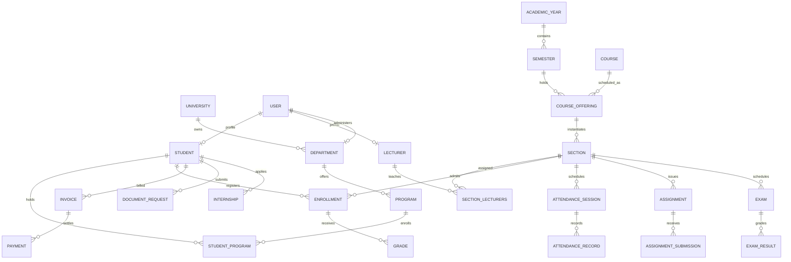
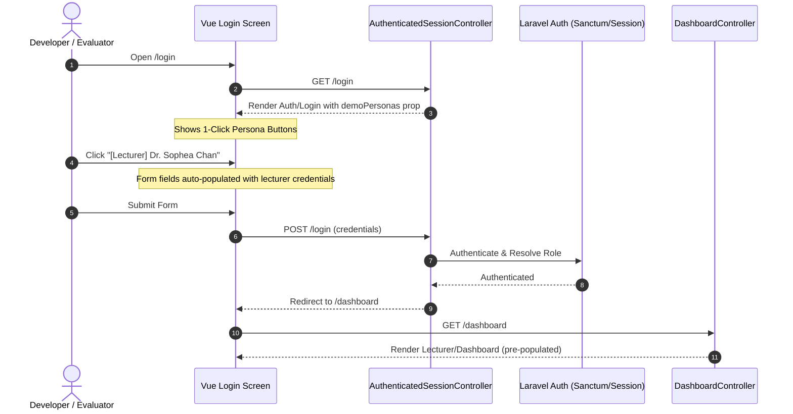

# 57 — Demo Persona Seeding and Quick-Login Role Switcher Report

- **Date:** 2026-10-15
- **Modules Covered:** Authentication & Authorization (9.1), Student Management (9.2), Lecturer Management (9.3), Department Management (9.4), Program Management (9.5), Academic Calendar (9.6), Courses & Classes (9.7, 9.8), Enrollment (9.9), Timetable (9.10), Attendance (9.11), Assignments (9.12), Examinations (9.13), Grades & GPA (9.14), Documents (9.16), Invoices & Payments (9.18), Announcements (9.19), Internships (9.22), Dashboards (9.15, 9.23, Reports 34-36).
- **Status:** `[Implemented]`
- **Artisan Command:** `php artisan demo:seed`
- **Seeder:** `backend/database/seeders/DemoPersonaSeeder.php`
- **Feature Tests:** `backend/tests/Feature/Seeders/DemoPersonaSeederTest.php` (9 tests, 94 assertions, 100% pass)

---

## 1. Overview & Business Objectives

EduCore provides specialized experiences across five authorized institutional roles: Super Admin, University Admin, Department Admin, Lecturer, and Student. Prior to this release, empty installations and standard seeders either left certain roles without profile attachments (e.g. Department Admin accounts without a `department_id`, Lecturer accounts without assigned sections, or Student accounts without active enrollments) or lacked interconnected cross-module records. Consequently, testing or demonstrating the platform required tedious manual data entry across multiple administrative screens.

This release delivers:
1. **Realistic, Interconnected Multi-Role Academic Environment:** A comprehensive, idempotent seeder (`DemoPersonaSeeder`) populating realistic Cambodian university academic data (Institute of Technology of Cambodia — ITC, Department of Computer Science and Engineering — CSE, Department of Electrical and Electronics Engineering — EEE).
2. **All 5 Core Personas Fully Configured:**
   - **Super Admin (`admin@educore.kh`):** System-wide administration, tenant configuration, and platform overview.
   - **University Admin (`university@educore.kh`):** Institutional registrar, academic calendar management, university analytics, and fee oversight.
   - **Department Admin (`department@educore.kh`):** Head of CSE department (`Dr. Dara Lim`), managing CSE degree programs, course offerings, departmental announcements, and approval queues.
   - **Lecturer (`lecturer@educore.kh`):** Dr. Sophea Chan, teaching CS201A and CS202A, with active registers to take, assignments to grade, and exam schedules.
   - **Student (`student@educore.kh`):** Sokha Meng (BSCS Year 1), actively enrolled in CS201A and CS202A, historical grade A in CS101 (4.0 GPA), tuition invoice with partial payment, attendance record, midterm exam, pending document request, and submitted internship application.
3. **One-Click Quick Login Persona Switcher:** An interactive UI panel on `/login` that appears in `local` and `testing` environments, allowing developers, auditors, and demonstrators to switch between roles with a single click.
4. **Dedicated Artisan Console Command:** `php artisan demo:seed` for on-demand demo data initialization in any development environment.

---

## 2. Seeded Persona Directory

| Role | Email | Password | Display Name / Persona Details | Primary Scoped View |
| :--- | :--- | :--- | :--- | :--- |
| **Super Admin** | `admin@educore.kh` | `admin@123` | System Super Admin | `/admin/dashboard` (Platform metrics, logs, tenants) |
| **University Admin** | `university@educore.kh` | `university@123` | Academic Affairs Registrar | `/dashboard` (University action queues, institutional overview) |
| **Department Admin** | `department@educore.kh` | `department@123` | Dr. Dara Lim (CSE Head) | `/dashboard` (CSE department stats, student requests, programs) |
| **Lecturer** | `lecturer@educore.kh` | `lecturer@123` | Dr. Sophea Chan | `/dashboard` (Today's classes, registers, grading queue, sections) |
| **Student** | `student@educore.kh` | `student@123` | Sokha Meng (ID: STU-2025-001) | `/dashboard` (Enrolled courses, GPA, attendance, documents, invoices) |

*(Note: In addition, a peer student `peer.student@educore.kh` is seeded to populate realistic multi-student class rosters and grade distributions).*

---

## 3. Data Architecture & Entity Relationship Graph

The seeder connects all core business entities through authentic academic relationships:



---

## 4. One-Click Quick Login Workflow

In `local` and `testing` environments, `AuthenticatedSessionController::create()` queries the environment and passes a `demoPersonas` array prop to `Inertia::render('Auth/Login')`. When present, a modern card grid is rendered below the main login form:



---

## 5. Technical Implementation Details

### 5.1 Idempotency & Conflict-Free Execution
`DemoPersonaSeeder` uses Eloquent `updateOrCreate` and `firstOrCreate` across every entity using natural primary / unique composite keys:
- Institutions: `code`
- Departments: `code`
- Degree Programs: `code`
- Academic Calendar: `code` and `[academic_year_id, sequence]`
- Users: `email`
- Student Profiles: `student_number`
- Lecturer Profiles: `staff_number`
- Sections: `[course_offering_id, code]`
- Enrollments: `[student_id, section_id]`
- Invoices: `invoice_number`
- Payments: `[invoice_id, reference]`

This guarantees that re-running `php artisan demo:seed` or running `php artisan test` repeatedly produces predictable, deterministic results without duplicate key collisions.

### 5.2 Seeder Command Integration
In `backend/routes/console.php`, the command `demo:seed` is registered:
```php
Artisan::command('demo:seed', function () {
    $this->info('Seeding realistic demo personas and interconnected academic records...');
    $this->call('db:seed', ['--class' => 'Database\Seeders\DemoPersonaSeeder']);
    $this->info('Demo persona seeding complete. Seeded personas:');
    $this->table(
        ['Role', 'Email', 'Password', 'Profile / Department'],
        [
            ['Super Admin', 'admin@educore.kh', 'admin@123', 'System Super Admin'],
            ['University Admin', 'university@educore.kh', 'university@123', 'Academic Affairs Registrar'],
            ['Department Admin', 'department@educore.kh', 'department@123', 'Dr. Dara Lim (CSE Head)'],
            ['Lecturer', 'lecturer@educore.kh', 'lecturer@123', 'Dr. Sophea Chan (CSE) - 2 active sections'],
            ['Student', 'student@educore.kh', 'student@123', 'Sokha Meng (BSCS Year 1) - enrolled & invoiced'],
        ]
    );

    return 0;
})->purpose('Seed interconnected demo personas and records for all 5 roles');
```

---

## 6. Verification & Test Suite

The implementation is verified by automated PHPUnit feature tests in `Tests\Feature\Seeders\DemoPersonaSeederTest`:

| Test Name | Assertions | Result | Notes |
| :--- | :--- | :--- | :--- |
| `test_demo_persona_seeder_executes_and_populates_all_personas` | 13 | PASS | Asserts all users, profiles, sections, enrollments, and invoices exist. |
| `test_demo_persona_seeder_is_idempotent` | 3 | PASS | Asserts running seeder twice does not increment entity counts. |
| `test_all_demo_personas_can_authenticate` | 10 | PASS | Authenticates each persona with their demo password. |
| `test_super_admin_sees_admin_dashboard` | 2 | PASS | Asserts `/admin/dashboard` returns 200 with platform stats. |
| `test_university_admin_sees_university_dashboard` | 3 | PASS | Asserts `/dashboard` returns `UniversityAdmin/Dashboard` with waiting queues. |
| `test_department_admin_sees_populated_cse_department_dashboard` | 2 | PASS | Asserts `/dashboard` returns `DepartmentAdmin/Dashboard` scoped to CSE. |
| `test_lecturer_sees_populated_teaching_dashboard` | 2 | PASS | Asserts `/dashboard` returns `Lecturer/Dashboard` with 2 active sections. |
| `test_student_sees_populated_academic_dashboard` | 2 | PASS | Asserts `/dashboard` returns `Student/Dashboard` with active enrollments. |
| `test_artisan_demo_seed_command_succeeds` | 3 | PASS | Asserts `php artisan demo:seed` runs with exit code 0. |

In addition, `LoginTest` (16 passed) and frontend Vite build (`npm run build`, 0 errors) were verified.
