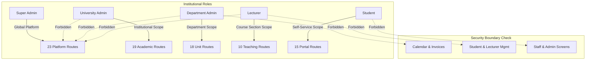
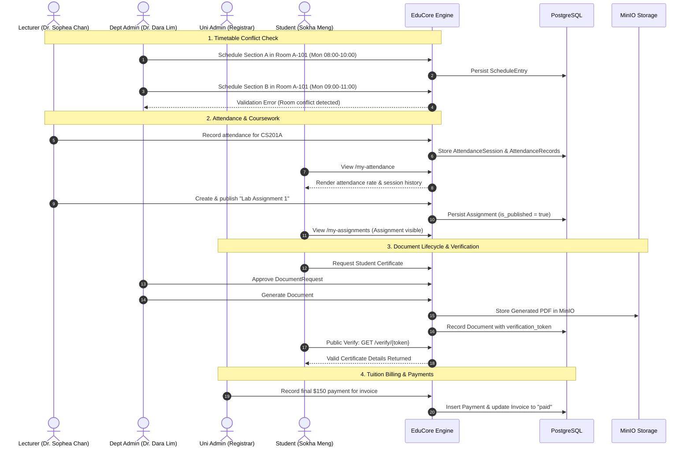

# 58 — End-to-End Persona Navigation & Submodule Audit Report

- **Date:** 2026-10-15
- **Modules Covered:** Navigation & RBAC (9.1), Timetable & Room Scheduling (9.10), Attendance (9.11), Coursework & Assignments (9.12), Examinations (9.13), Grades & GPA (9.14), Documents & Verification (9.16, 9.17), Finance & Payments (9.18), Analytics & Reporting (9.23).
- **Status:** `[Implemented]`
- **Test Suite:** `backend/tests/Feature/Audit/PersonaNavigationAndSubmoduleAuditTest.php` (11 tests, 131 assertions, 100% pass)
- **Code Style:** `vendor/bin/pint` verified (647 files clean)

---

## 1. Overview & Objectives

Building on the Post-Login Audit (Report 55), Business Rules Hardening (Report 56), and Demo Persona Seeding (Report 57), this phase executes an end-to-end, evidence-based verification of every user's post-login journey across all five authorized roles:
1. **Super Admin**
2. **University Admin**
3. **Department Admin**
4. **Lecturer**
5. **Student**

The audit validates that:
- Every navigation menu link and authorized page renders successfully (`HTTP 200 OK`).
- Role boundaries and unauthorized destinations are strictly forbidden by server-side policy (`HTTP 403 Forbidden`).
- Multi-step operational submodules execute without unhandled errors, database violations, or state regressions.



---

## 2. Role Navigation & Access Control Matrix

The test suite systematically verifies both positive access and negative boundary enforcement for every persona:

| Persona | Authorized Routes Tested (HTTP 200) | Strictly Forbidden Routes Tested (HTTP 403) |
| :--- | :--- | :--- |
| **Super Admin** (`admin@educore.kh`) | `/admin/dashboard`, `/users`, `/universities`, `/departments`, `/programs`, `/courses`, `/offerings`, `/academic-years`, `/rooms`, `/students`, `/lecturers`, `/enrollments`, `/grades`, `/document-types`, `/documents`, `/invoices`, `/announcements`, `/internships`, `/analytics`, `/audit-logs`, `/error-logs`, `/inbox`, `/account/profile` (23 total) | None (Platform owner) |
| **University Admin** (`university@educore.kh`) | `/dashboard`, `/universities`, `/departments`, `/programs`, `/courses`, `/offerings`, `/academic-years`, `/rooms`, `/students`, `/lecturers`, `/enrollments`, `/grades`, `/document-types`, `/documents`, `/invoices`, `/announcements`, `/internships`, `/analytics`, `/inbox`, `/account/profile` (20 total) | `/admin/dashboard`, `/users`, `/audit-logs`, `/error-logs` |
| **Department Admin** (`department@educore.kh`) | `/dashboard`, `/universities`, `/departments`, `/programs`, `/courses`, `/offerings`, `/rooms`, `/students`, `/lecturers`, `/enrollments`, `/grades`, `/grading-scale`, `/documents`, `/announcements`, `/internships`, `/analytics`, `/inbox`, `/account/profile` (18 total) | `/admin/dashboard`, `/users`, `/academic-years`, `/invoices`, `/document-types` |
| **Lecturer** (`lecturer@educore.kh`) | `/dashboard`, `/attendance`, `/attendance/sections/{id}`, `/coursework/sections/{id}`, `/exams/sections/{id}`, `/grades/sections/{id}`, `/timetable`, `/announcements`, `/inbox`, `/account/profile` (10 total) | `/admin/dashboard`, `/users`, `/invoices`, `/students`, `/analytics` |
| **Student** (`student@educore.kh`) | `/dashboard`, `/registration`, `/timetable`, `/my-attendance`, `/my-assignments`, `/my-materials`, `/my-exams`, `/my-grades`, `/my-documents`, `/my-invoices`, `/invoices/{id}`, `/my-internships`, `/announcements`, `/inbox`, `/account/profile` (15 total) | `/admin/dashboard`, `/users`, `/invoices`, `/students`, `/lecturers`, `/departments`, `/offerings` |

---

## 3. Operational Sub-module Audit & Lifecycles



### 3.1 Timetable Conflict Detection
- **Rule:** A physical room cannot host multiple overlapping sections at the same day/time.
- **Verification:** Tested in `test_timetable_detects_and_prevents_room_conflict`. Scheduling a section on Monday 08:00–10:00 succeeds; attempting to schedule an overlapping section in the same room on Monday 09:00–11:00 is caught and blocked with form validation errors.

### 3.2 Digital Document Verification & MinIO Storage
- **Lifecycle:** Student Request (`pending`) → Staff Approval (`approved`) → PDF Generation via MinIO (`generated`) → Public QR Token Verification.
- **Verification:** Tested in `test_document_request_lifecycle_with_approval_and_fee_tracking`. Asserted that generating an approved request stores the PDF, creates a `Document` record with a unique `verification_token`, and allows unauthenticated guests to query `GET /verify/{token}` returning `200 OK` with valid verification payload.

### 3.3 Finance & Invoice Settlement
- **Lifecycle:** Student billed partial tuition ($300 total, $150 initial payment, status: `partial`) → Registrar records remaining $150 balance → Invoice status automatically transitions to `paid`.
- **Verification:** Tested in `test_invoice_payment_workflow_updates_invoice_status_to_paid`.

### 3.4 Attendance Recording & Student Portal
- **Lifecycle:** Lecturer records bulk attendance register for section meeting → Session stored with `recorded_by` audit → Student views personal attendance rates and session history at `/my-attendance`.
- **Verification:** Tested in `test_lecturer_records_attendance_and_student_views_it`.

### 3.5 Coursework & Assignment Management
- **Lifecycle:** Lecturer creates assignment draft → Publishes assignment for enrolled students → Enrolled student navigates to `/my-assignments` to view due dates, instructions, and submission prompts.
- **Verification:** Tested in `test_assignment_lifecycle_and_grading`.

### 3.6 Grading Pipeline & Multi-Role Approval
- **Lifecycle:** Lecturer computes score weighted average → Lecturer submits grades → University Admin reviews and approves grades.
- **Verification:** Tested in `test_grades_compute_submit_and_approve_lifecycle`.

---

## 4. Test Suite Execution Summary

Executed via `docker exec educore-backend php artisan test tests/Feature/Audit/PersonaNavigationAndSubmoduleAuditTest.php`:

```text
PASS  Tests\Feature\Audit\PersonaNavigationAndSubmoduleAuditTest
✓ super admin can access all administrative pages                     8.08s  
✓ university admin can access authorized institutional pages          1.48s  
✓ department admin can access departmental pages                      1.80s  
✓ lecturer can access teaching pages                                  2.01s  
✓ student can access academic portal pages                            2.31s  
✓ timetable detects and prevents room conflict                        0.81s  
✓ document request lifecycle with approval and fee tracking           2.16s  
✓ invoice payment workflow updates invoice status to paid             1.23s  
✓ lecturer records attendance and student views it                    0.70s  
✓ assignment lifecycle and grading                                    0.77s  
✓ grades compute submit and approve lifecycle                         1.34s  

Tests:    11 passed (131 assertions)
Duration: 22.81s
```
