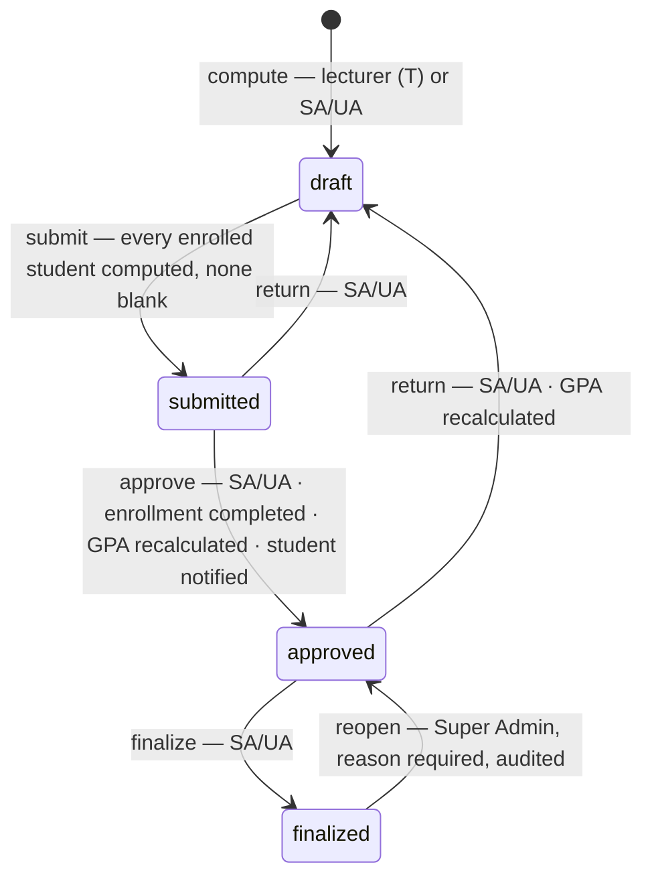
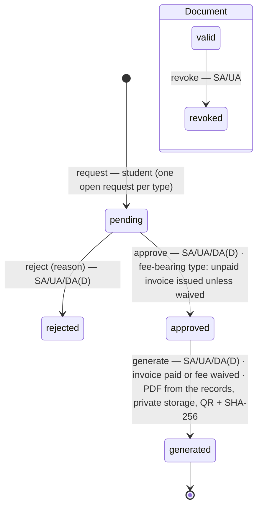
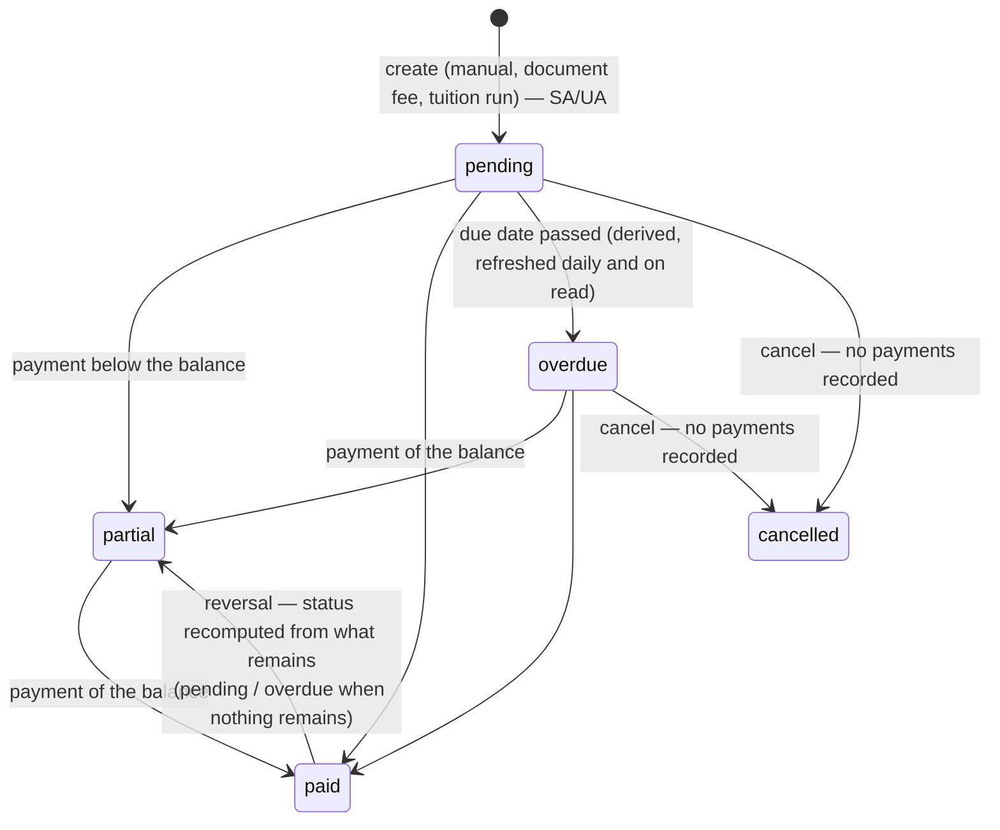
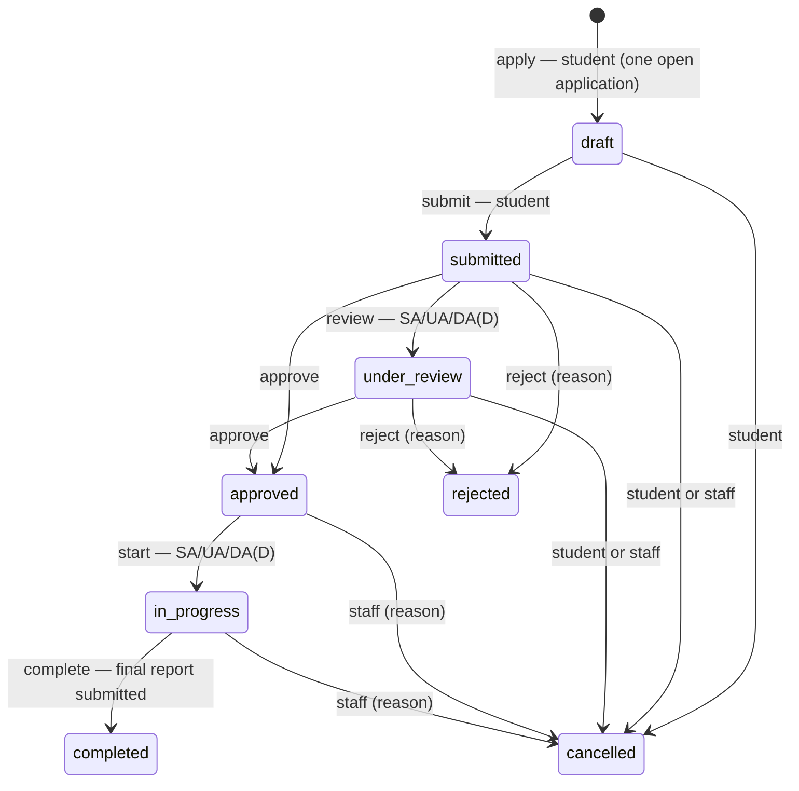
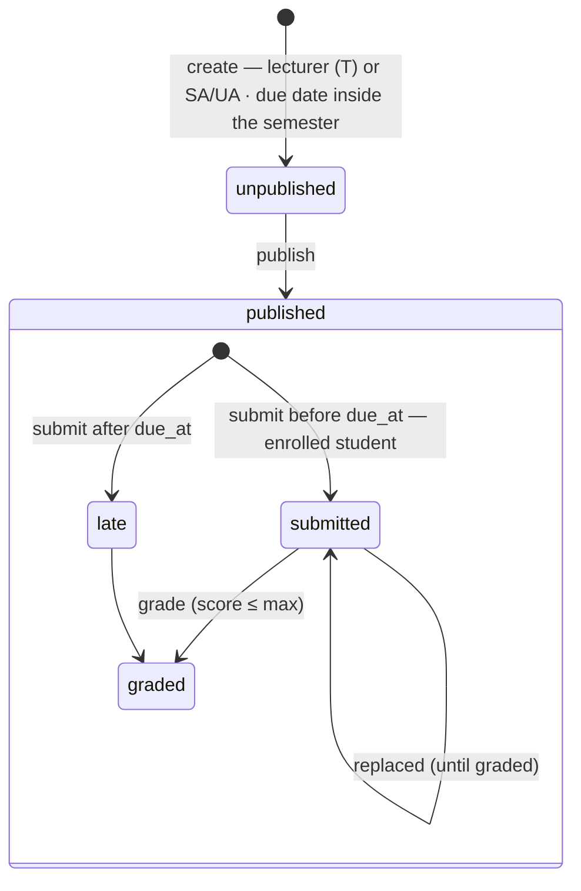
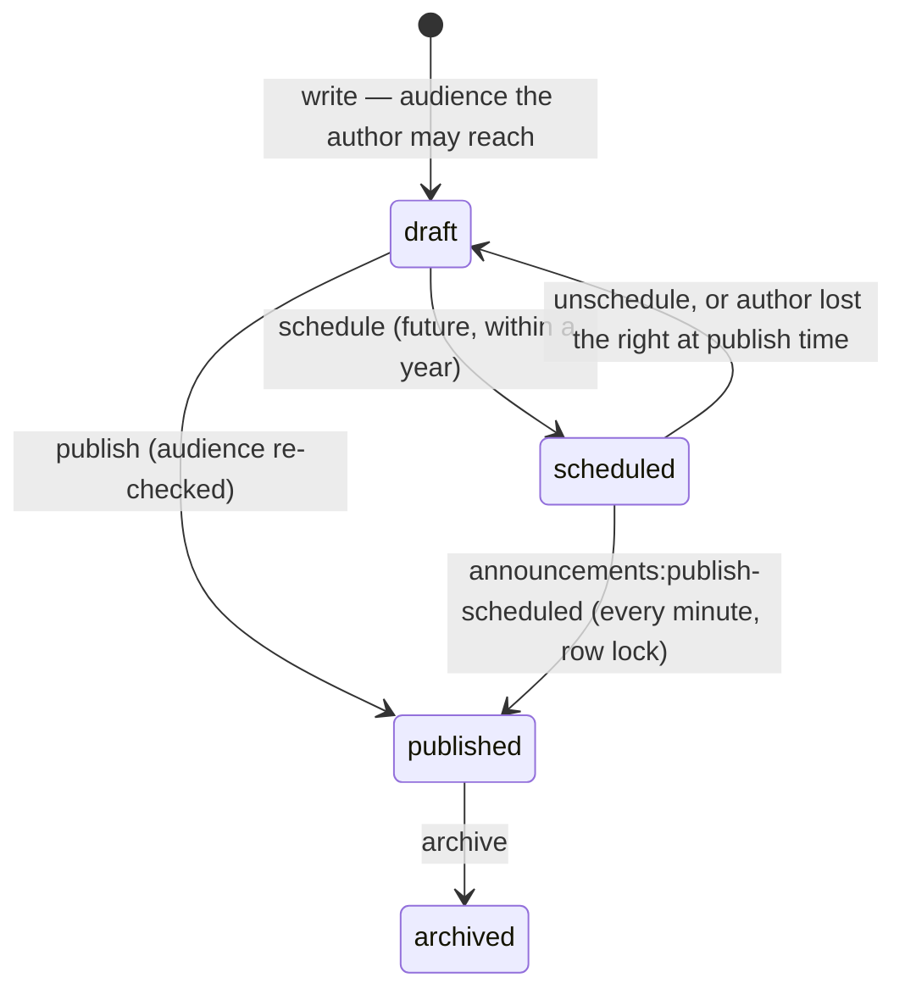

# Business Logic Findings and Verified State Machines (2026-10-14)

Part of the [post-login audit](post-login-audit.md). Each workflow below was read in its service and
compared with the reports that define it. States, actors and guards are the implemented ones — no
state was added by this audit. **Fixed** findings have a regression test
([regression matrix](regression-test-matrix.md)); **Documented** ones need a business decision
([final report](final-audit-report.md) §6).

## 1. Findings

### BL-01 — Withdrawal after the grade was submitted (P1, Fixed)

| | |
|---|---|
| Where | `EnrollmentService::drop()` (API `DELETE /api/enrollments/{id}`, web `POST /enrollments/{id}/drop`, student `POST /registration/{id}/drop`) |
| Before | Only `isOpen()` was checked. A confirmed enrollment whose grade was `submitted` could be dropped: it became `withdrawn` (records exist), which removes it from the grade sheet (`GradingService::GRADED_STATUSES` = confirmed, completed). The submitted grade could then never be approved, and the course result vanished — a student could withdraw after the lecturer submitted a failing grade. |
| Rule applied | The drop rules of report 15 stay (dropped without records, withdrawn with attendance or a draft grade). New: once the grade has left `draft` (submitted; approved / finalized enrollments are already `completed` and not droppable) the drop is refused with 409 and the message says a manager can return the section's grades to draft first. The grade row is read under `lockForUpdate`, like grade submission. |
| Test | `EnrollmentTest::test_an_enrollment_whose_grade_is_awaiting_approval_cannot_be_dropped` (failed on the old code: 200) |

### BL-02 — No drop / withdrawal deadline (P2, Documented → BD-01)

A student may drop or withdraw any confirmed enrollment at any time — after the registration period,
after the semester closed, before grading. Report 15 defines *how* a drop is recorded, not *until when*
it is allowed, and `skills/enrollment` asks for an explicit, configurable policy. Choosing the window
(e.g. registration period only, or a withdrawal deadline per semester) is an institutional decision.

### BL-03 — Grading in a completed semester (P2, Documented → BD-02)

Attendance (report 17), coursework (18), exams and results (19), the timetable (16) and section
lecturers (46) are frozen once a semester is `completed`; `SemesterStatus` states "completed freezes
grading". `GradingService` has no such check: drafts can be computed and submitted, and managers can
approve, return and finalize in a completed semester. Report 30's audited correction path (Super Admin
reopens → manager returns → lecturer recomputes) currently depends on that. Options: freeze lecturer
compute/submit but keep manager actions; or freeze all and route corrections through reopen only.

### BL-04 — Returned grades leave the enrollment `completed` (P3, Documented → BD-04)

Approval moves `confirmed` enrollments to `completed`; `returnToDraft()` does not move them back, so a
`completed` enrollment can carry a draft grade. Prerequisites are not affected (they need an approved,
non-F grade), and re-approval is idempotent. Reverting automatically would also undo manual
completions (`EnrollmentService::complete()`), so the rule needs a decision.

### BL-05 — Unused states (P3, Documented)

`assignment_submissions.status = 'returned'` and `enrollments.status = 'pending'` are valid values
that no service sets. Students see a coursework score as soon as it is graded (report 18).

## 2. State machines (as implemented)

### Enrollment

```mermaid
stateDiagram-v2
    [*] --> confirmed : enroll — SA/UA or the student<br/>active student · semester open and in period · offering open<br/>not already in the offering · strict prerequisites passed<br/>credit limit · no timetable clash · seats (offering + section locked)
    dropped --> confirmed : re-enroll the same section (row revived)
    confirmed --> dropped : drop — no attendance, no grade
    confirmed --> withdrawn : drop — attendance or a draft grade exists
    confirmed --> completed : SA/UA complete, or grade approval
    note right of confirmed : BL-01: refused (409) once the grade is submitted
    withdrawn --> [*] : the section cannot be re-entered
    completed --> [*]
```

### Grades (per section)



Students see a grade, and GPA counts it, once it is **approved** (also finalized). Lecturers can no
longer change a submitted grade (compute skips non-draft rows).

### Document request and document



A fee can be waived (SA/UA) while the request is pending or approved and its invoice is unpaid; the
open invoice is cancelled. Every transition locks the request row and re-checks its state.

### Invoice



Amounts are integer cents; payments never exceed the balance; the invoice row is locked for every
payment, reversal, edit or cancellation. Edits are refused once a payment exists.

### Internship



Reports: initial / progress once approved, final once in progress. Evaluations (supervisor /
academic) once in progress.

### Assignment and submission



Nothing changes once the semester is completed (409).

### Announcement



### Semester and academic year

`planned → open → closed → completed` and `planned → active → completed`, forward only.
Registration needs an **open** semester inside its enrollment window; `completed` freezes attendance,
coursework, exams, timetable and section lecturers (not grading — BL-03).

## 3. Invariants and where they are enforced

| Invariant | Database | Service | Policy | Test |
|---|---|---|---|---|
| One enrollment row per student and section | `uq_enrollments_student_section` | revive on re-enroll | — | `EnrollmentTest` |
| Seats never oversold | — | offering + section `lockForUpdate` | — | `EnrollmentTest` |
| Attendance only for markable enrollments of that section | FK | `AttendanceService::record` | `record` (T / SA / UA) | `AttendanceTest`, isolation matrix |
| Exam results only for enrolled students of that section | FK | `ExamService::record` | `update` exam | `ExamTest`, isolation matrix |
| A submission belongs to the student's enrollment in the section | FK | `AssignmentService::submit` | `submit` | `AssignmentTest`, isolation matrix |
| A grade follows draft → submitted → approved → finalized | — | `GradingService` (row locks) | `grade` / `approve` / `reopen` | `GradingTest` |
| No withdrawal once a grade is submitted | — | `EnrollmentService::drop` (BL-01) | — | `EnrollmentTest` |
| One open document request per type and student | — | `DocumentService::request` (lock) | `create` | `DocumentTest` |
| One active tuition invoice per student and semester | — | `TuitionInvoiceService` (FIN-01 lock) | `manage` invoice | `TuitionInvoiceTest` |
| Payments never exceed the balance; reversals append-only | — | `InvoiceService` (row lock) | `manage` invoice | `InvoiceTest` |
| One open internship application per student | — | `InternshipService::apply` | `apply` | `InternshipTest` |
| Audit trail cannot be edited | append-only trigger (report 28) | `AuditLogger` | `AuditLogPolicy` | `AuditTest` |
