# Post-Login Workflow, RBAC and Integrity Audit — Scope, Baseline and Findings Register

- **Date:** 2026-10-14
- **Scope:** every role's journey after a successful sign-in — dashboards, navigation, module actions,
  state transitions, authorization, data isolation, database integrity, notifications — up to sign-out
- **Report:** `docs/55_Post-Login-Workflow-and-RBAC-Audit-Report.md` (summary for the numbered series)
- **Related:** [role-permission-matrix](role-permission-matrix.md) ·
  [route-api-permission-matrix](route-api-permission-matrix.md) ·
  [business-logic-findings](business-logic-findings.md) · [security-findings](security-findings.md) ·
  [data-integrity-findings](data-integrity-findings.md) · [regression-test-matrix](regression-test-matrix.md) ·
  [remediation-log](remediation-log.md) · [final-audit-report](final-audit-report.md)

## 1. Baseline

| Item | Value |
|---|---|
| Branch / HEAD | `main` at `4af0289` (two-factor sign-in, report 52) |
| Working tree at start | Uncommitted, not part of this audit and preserved: public course catalog (report 53, in progress), landing page refresh (report 54), `docs/user-flows/` (new), an untracked `educore-recovery-codes.txt` in the repository root (not opened; must never be committed) |
| Stack (verified) | Laravel 12 · PHP 8.4 · PostgreSQL 16 · Redis 7 · MinIO · Nginx · Docker Compose; Vue 3 in **plain JavaScript** with Inertia.js (no TypeScript, no Vue Router — pages are server routes), Pinia registered but holding no store, Axios service modules, Tailwind CSS 4, Chart.js |
| Roles (verified) | `super-admin`, `university-admin`, `department-admin` (the faculty level was removed in report 39), `lecturer`, `student` — no other role exists |
| Academic model (verified) | University → Department → Program / Course; University → Academic year → Semester; Course + Semester → Course offering → Section; Student (program history in `student_programs`) → Enrollment in a section → attendance, submissions, exam results, grade |
| Tenancy | One institution: a single `is_current` university. University Admins are not bound to a university; there is no per-university data isolation to enforce (see BD-03) |
| Test command | `docker exec educore-backend php artisan test` (PostgreSQL test database `educore_test`, `RefreshDatabase`) |
| Baseline result | **529 passed** (5,436 assertions, 478 s) — run on this working tree before any audit change |
| Other checks available | `vendor/bin/pint --test`; `docker exec educore-frontend npm run build`; `php artisan route:list` |
| Not available | No frontend unit/component tests, no ESLint configuration, no TypeScript, no end-to-end suite in the repository |
| Routes | 458 (232 API, 226 web); 450 audited (documentation / Sanctum / health internals excluded) |

## 2. Method

```mermaid
flowchart LR
    A[Instructions, skills,<br/>reports 1–53] --> B[Route table<br/>route:list --json]
    B --> C[Middleware + controller<br/>authorization per action]
    C --> D[25 policies,<br/>DepartmentScope, BelongsToDepartment]
    D --> E[Services: state machines,<br/>locks, transactions]
    E --> F[Dynamic probes:<br/>RoleIsolationMatrixTest]
    F --> G[Frontend: URLs vs routes,<br/>sidebar vs role middleware]
    G --> H[docs/user-flows<br/>checked against code]
    H --> I[Fix, regression test,<br/>full suite, docs]
```

| Check | How | Result |
|---|---|---|
| Route protection | Every route's middleware from `route:list --json`; public routes listed and read | All non-public routes need a session or token; public ones are login, password reset, two-factor challenge, catalog, verification, avatar, Telegram webhook (secret header), health |
| Function-level authorization | Script extracting the `authorize` / `Gate` / `can` call of every controller action ([route matrix](route-api-permission-matrix.md)) | Every protected action authorizes or is self-service on the request user |
| Object-level authorization | All 25 policies read; `ChecksSectionTeaching`, `DepartmentScope`, `BelongsToDepartment`; nested routes checked for parent ownership | Consistent; nested children are checked (`attachments/{file}` 404s for another announcement's file) |
| Cross-boundary behavior | New `RoleIsolationMatrixTest`: two departments with a full semester of records; 75 probes sent with own ids (must pass) and the other department's ids (must be 403), plus 27 function-level refusals and 4 guest requests | All pass — no BOLA found |
| Business rules | Services read: enrollment, grading, GPA, attendance, assignments, exams, documents, invoices, tuition, internships, announcements, profile | Findings BL-01..BL-05, FIN-01 |
| Authentication lifecycle | Login (web/API), 2FA, rate limits, inactive accounts, logout, token lifetime | Findings SEC-01, SEC-02 |
| Frontend contract | Every URL literal in `frontend/src` matched against the route table; sidebar per role against role middleware; permission-gated buttons | No dead URL, no sidebar link to a forbidden page; one stale wording (UX-01) |
| Mass assignment | `$guarded = []`, `$request->all()` into models, profile self-service fields | None |
| Documentation | `docs/user-flows/*.md` read against the verified behavior | Many statements contradicted the code (DOC-01) — corrected |

## 3. Findings register

Severity: **P0** critical · **P1** high · **P2** medium · **P3** low. Status: **Fixed** (with regression test) ·
**Documented** (business decision needed — see the [final report](final-audit-report.md) §6) · **Accepted** (by design).

| ID | Role | Module | Location | Observed | Expected | Evidence | Sev. | Fix | Verification | Status |
|---|---|---|---|---|---|---|---|---|---|---|
| BL-01 | Student, managers | Enrollment × Grades | `EnrollmentService::drop()` | An enrollment whose grade was **submitted** for approval could be dropped. It became `withdrawn`, left the grade sheet (`GRADED_STATUSES`), so the submitted grade could never be approved — a student could withdraw from a course after the lecturer submitted a failing grade | Withdrawal refused once the grade left `draft`; the manager returns the sheet to draft first | Test failed on the old code (200 instead of 409) | P1 | Locked grade check in `drop()` → 409 | `EnrollmentTest::test_an_enrollment_whose_grade_is_awaiting_approval_cannot_be_dropped` | Fixed |
| SEC-01 | All (API) | Authentication | `config/sanctum.php` | `expiration => null`: API tokens never expired | Tokens expire; lifetime configurable | Test failed on the old code | P2 | `SANCTUM_EXPIRATION` (default 10 080 min = 7 days, `0` = never) + daily `sanctum:prune-expired` | `LoginTest::test_api_tokens_expire_after_the_configured_lifetime` | Fixed |
| SEC-02 | All (API) | Audit | `AuthService::logout()` | API sign-out deleted the token but wrote no `auth.logout` entry (only web sign-out fires `Logout`) | Same audit trail as the web | Test failed on the old code | P3 | Dispatch `Logout('sanctum', $user)` | `LoginTest::test_api_logout_revokes_the_token_and_is_audited` | Fixed |
| FIN-01 | University Admin | Tuition invoices | `TuitionInvoiceService::generate()` | "Already invoiced?" checked without a lock, outside a transaction: two runs at once (double submit, two admins) could both bill a student | One active tuition invoice per student and semester | Code review (a true concurrent race cannot run in the single-connection test runner) | P2 | Per-student transaction, row lock on the student, check repeated under the lock | `TuitionInvoiceTest::test_a_tuition_invoice_created_meanwhile_is_not_billed_twice` (simulates the other run at the lock) | Fixed |
| BL-02 | Student | Enrollment | `EnrollmentService::drop()` | No drop / withdrawal deadline: a confirmed enrollment can be dropped at any time, also after the registration period and after the semester closed | Institutional add/drop policy | Code | P2 | — | — | Documented (BD-01) |
| BL-03 | Lecturer, managers | Grades | `GradingService` | Grading is not frozen in a **completed** semester, while attendance, coursework, exams, timetable and lecturer assignment are (reports 16–19, 46) and `SemesterStatus` says "completed freezes grading". Report 30's audited correction path (reopen → return → recompute) relies on grading staying possible | One explicit rule | Code + docs | P2 | — | — | Documented (BD-02) |
| BL-04 | Managers | Grades × Enrollment | `GradingService::returnToDraft()` | Approval moves `confirmed` → `completed`; returning approved grades to draft leaves the enrollment `completed` with a draft grade. Prerequisites stay correct (they need an approved non-F grade) | Status and data agree | Code | P3 | — | — | Documented (BD-04) |
| BL-05 | Lecturer | Assignments | `AssignmentSubmission::STATUSES` | `returned` is a valid status that nothing ever sets; scores are visible to the student as soon as a submission is graded | Unused states removed or implemented | Code | P3 | — | — | Documented |
| SCOPE-01 | Department Admin | Scoping | `DepartmentScope::studentIds()` | A department's students are those with **any** program record in it (report 32), so after a transfer the former department still sees — and can process requests and internships of — the student | Institutional decision | Report 32 §3 | P2 | — | — | Documented (BD-05) |
| SEC-03 | Public | Profile | `GET /users/{user}/avatar` | Uploaded avatars are public and addressed by sequential user id (report 45 decision) | Institutional privacy decision | Report 45 | P3 | — | — | Documented (BD-06) |
| SEC-04 | All | Validation order | Form Requests | Validation runs before the policy, so an unauthorized but malformed request gets 422 field errors instead of 403 (no record data is exposed) | 403 first | `RoleIsolationMatrixTest` first run | P3 | — | — | Accepted |
| UX-01 | Lecturer | Profile | `pages/Account/Profile.vue` | "Faculty & Position Details", "Faculty Status", "Active Faculty" after the faculty level was removed | Department wording | UI | P3 | Reworded | Build + view | Fixed |
| DOC-01 | All | Docs | `docs/user-flows/` | TypeScript/Pinia stack; Department Admins approving grades and waiving fees; grades hidden until finalized; GPA on finalization; weekly internship reports; cancelling paid invoices; Spatie-style `model_has_roles`; invented audit actions and fields | Docs match code | This audit | P3 | Core role / auth / RBAC / cross-role / overview docs rewritten; module docs corrected; PlantUML marked not revalidated | Review | Fixed |

No P0 finding: no authentication bypass, privilege escalation, cross-department exposure or data loss was found.
