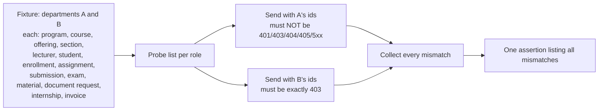

# Role-Based Regression Test Matrix (2026-10-14)

Part of the [post-login audit](post-login-audit.md). Every row names the automated test that holds the
behavior; "manual" rows say what still needs a person. All tests run with
`docker exec educore-backend php artisan test` on the PostgreSQL test database.

## 1. Scenarios from the audit brief

| Scenario | Expected | Test(s) | Status |
|---|---|---|---|
| Valid login | Correct dashboard opens per role | `LoginTest::test_super_admin_authenticates_and_is_redirected_to_admin_dashboard`, `…university_admin_is_redirected_to_role_dashboard`, `StudentDashboardTest`, `LecturerDashboardTest`, `DepartmentAdminDashboardTest`, `UniversityAdminDashboardTest` | Pass |
| Invalid credentials | Generic refusal, no enumeration | `LoginTest::test_wrong_credentials_are_rejected_with_a_generic_message`, `…unknown_email_does_not_reveal_existence` | Pass |
| Inactive account | Sign-in refused; signed-in session / token revoked | `LoginTest::test_inactive_account_cannot_sign_in…`, `…cannot_obtain_an_api_token`, `AuditTest` (access revoked) | Pass |
| Unauthenticated API request | 401 | `RoleIsolationMatrixTest::test_no_role_reaches_actions_above_it` (guest requests), `DepartmentManagementTest::test_unauthenticated_api_request_is_rejected` | Pass |
| Role without permission | 403 | `RoleIsolationMatrixTest::test_no_role_reaches_actions_above_it` (27 function-level probes), module role-matrix tests | Pass |
| Direct access to a protected route | Server refuses regardless of the UI | `RoleIsolationMatrixTest` (all probes call the API directly), `GradingTest::test_role_matrix` | Pass |
| Cross-university record access | Not applicable: one institution, no university-bound accounts | — | BD-03 |
| Cross-department record access | 403 | `RoleIsolationMatrixTest::test_department_admins_stay_inside_their_department` (34 endpoints), `DepartmentAdminScopingTest` | Pass |
| Student accesses another student's record | 403 | `RoleIsolationMatrixTest::test_students_reach_only_their_own_records` (20 endpoints + file, drop) | Pass |
| Lecturer accesses an unassigned class | 403 | `RoleIsolationMatrixTest::test_lecturers_reach_only_the_sections_they_teach` (21 endpoints + file) | Pass |
| Invalid input | 422 with field errors | module tests (`EnrollmentTest`, `InvoiceTest::test_invoice_validation`, `AssignmentTest`, `ExamTest`, …) | Pass |
| Duplicate critical operation | Handled once | `EnrollmentTest::test_duplicate_and_second_section_of_same_offering_are_refused`, `TuitionInvoiceTest::test_tuition_generation_skips_students_already_invoiced…`, **`…a_tuition_invoice_created_meanwhile_is_not_billed_twice`** (FIN-01), `DocumentTest` (one open request per type) | Pass |
| Failure during a transaction | No partial state | Partial: no test forces a database failure mid-transaction; atomicity rests on `DB::transaction` in every multi-step service (code review, [data-integrity](data-integrity-findings.md) §2). `TuitionInvoiceTest` (lost race skips cleanly), `DocumentTest::test_generation_uses_authoritative_data_and_stays_retryable` (a failed generation leaves the request approved and retryable), `DocumentTest::test_reject_requires_a_reason_and_allows_a_new_request` (wrong-state transitions answer 409) | Partial |
| Failed notification | Delivery failure does not undo the action | `NotificationTest` (3 tries; Telegram API errors reach the queue worker for retry, `test_telegram_api_errors_surface_for_retry`) | Pass — real SMTP / Telegram delivery: manual |
| Successful authorized mutation | Database and response agree | every `RoleIsolationMatrixTest` own-side probe; module tests | Pass |
| Session expires | Reauthentication required | **`LoginTest::test_api_tokens_expire_after_the_configured_lifetime`** (SEC-01); web: Laravel session lifetime (manual) | Pass |
| Grade publication | Only the right role, valid transitions | `GradingTest` (submit / approve / return / finalize / reopen, `test_finalize_locks_grades_and_only_super_admin_reopens`, `test_students_see_only_approved_grades`) | Pass |
| Document publication | Only the right role, valid transitions | `DocumentTest`, `DocumentFeeAndTypeTest`, `DepartmentAdminRequestHandlingTest` | Pass |

## 2. Tests added by this audit

| Test | Finding | Failed on the old code? |
|---|---|---|
| `Audit\RoleIsolationMatrixTest::test_department_admins_stay_inside_their_department` | coverage | n/a (passes: no BOLA) |
| `Audit\RoleIsolationMatrixTest::test_lecturers_reach_only_the_sections_they_teach` | coverage | n/a |
| `Audit\RoleIsolationMatrixTest::test_students_reach_only_their_own_records` | coverage | n/a |
| `Audit\RoleIsolationMatrixTest::test_no_role_reaches_actions_above_it` | coverage | n/a |
| `Enrollments\EnrollmentTest::test_an_enrollment_whose_grade_is_awaiting_approval_cannot_be_dropped` | BL-01 | yes — 200 instead of 409 |
| `Auth\LoginTest::test_api_tokens_expire_after_the_configured_lifetime` | SEC-01 | yes — no expiry configured |
| `Auth\LoginTest::test_api_logout_revokes_the_token_and_is_audited` | SEC-02 | yes — no `auth.logout` row |
| `Finance\TuitionInvoiceTest::test_a_tuition_invoice_created_meanwhile_is_not_billed_twice` | FIN-01 | simulated race (see data-integrity FIN-01) |

## 3. How the isolation matrix works

The own-side request proves the URL and payload are valid, so a 403 on the other side cannot come
from a typo (a wrong URL would 404 and fail the own side).

## 4. Manual verification still needed

- Real email and Telegram delivery with production credentials (bot token, SMTP).
- Web session expiry in a browser (`SESSION_LIFETIME`, idle sign-out) and the two-factor challenge
  timing (five minutes).
- Concurrent tuition runs from two real sessions (FIN-01 was simulated in one connection).
- Screen-reader and keyboard pass over the role dashboards (not part of this backend audit).
