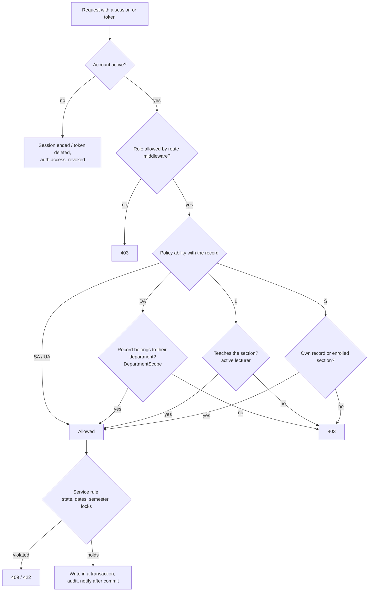

# Role × Module Permission Matrix (verified 2026-10-14)

Derived from the route middleware, the 25 policies and the service guards — not from the UI. The UI
hides what a role cannot do; the server refuses it (403) regardless. Part of the
[post-login audit](post-login-audit.md); endpoint-level detail in the
[route matrix](route-api-permission-matrix.md).

**Legend** — ✓ everything in the institution · **D** own department only (`users.department_id`,
`App\Support\DepartmentScope`) · **T** sections they teach (`section_lecturers`, active lecturer) ·
**E** sections they are enrolled in (pending / confirmed / completed) · **O** own record only · — refused.

SA Super Admin · UA University Admin · DA Department Admin · L Lecturer · S Student.

## Structure and people

| Module | Action | SA | UA | DA | L | S |
|---|---|---|---|---|---|---|
| Users & roles | read, create, update, deactivate, delete, reset two-factor | ✓ (never their own access, never the last active SA) | — | — | — | — |
| Universities | read | ✓ | ✓ | ✓ | — | — |
| | create, update, make current, delete | ✓ | ✓ | — | — | — |
| Departments | read | ✓ | ✓ | D | — | — |
| | create, update, archive, delete | ✓ | ✓ | — | — | — |
| Programs, courses (incl. prerequisites, curriculum) | read | ✓ | ✓ | D | — | — |
| | create, update, archive, delete | ✓ | ✓ | — | — | — |
| Course grading weights | read | ✓ | ✓ | D | — | — |
| | update | ✓ | ✓ | — | — | — |
| Academic years & semesters | all actions | ✓ | ✓ | — | — | — |
| Rooms | read | ✓ | ✓ | ✓ | — | — |
| | create, update, delete | ✓ | ✓ | — | — | — |
| Offerings, sections, weekly schedule | read | ✓ | ✓ | D | — | — |
| | create, update, delete | ✓ | ✓ | D | — | — |
| Section lecturers | assign, remove | ✓ | ✓ | D (their department's lecturers) | — | — |
| Students | read | ✓ | ✓ | D | — | O |
| | create, update, status, program transfer, delete | ✓ | ✓ | — | — | — |
| Lecturers | read | ✓ | ✓ | D | O | — |
| | create, update, deactivate, delete | ✓ | ✓ | — | — | — |

## Teaching and learning

| Module | Action | SA | UA | DA | L | S |
|---|---|---|---|---|---|---|
| Enrollment | read, export | ✓ | ✓ | D | — | O (read) |
| | enroll | ✓ | ✓ | — | — | O (self-registration) |
| | drop / withdraw | ✓ | ✓ | — | — | O |
| | complete | ✓ | ✓ | — | — | — |
| Timetable | read a student's / lecturer's | ✓ | ✓ | D | O | O |
| Attendance | read a section's register | ✓ | ✓ | D | T | — |
| | record, cancel / restore a session | ✓ | ✓ | — | T | — |
| | read a student's rates | ✓ | ✓ | D | — | O |
| Assignments | read | ✓ | ✓ | D | T | E (published only) |
| | create, update, publish, delete, grade | ✓ | ✓ | — | T | — |
| | read all submissions | ✓ | ✓ | D | T | — |
| | submit | — | — | — | — | E (published, semester not completed) |
| | download a submission | ✓ | ✓ | D | T | O |
| Course materials | read, download | ✓ | ✓ | D | T | E |
| | create, update, delete | ✓ | ✓ | — | T | — |
| Exams | read | ✓ | ✓ | D | T | E (own result once published) |
| | create, update, publish, delete, record / correct results | ✓ | ✓ | — | T | — |
| | read all results | ✓ | ✓ | D | T | — |
| Grades | read a section's sheet | ✓ | ✓ | D | T | — |
| | compute, submit | ✓ | ✓ | — | T | — |
| | approve, return to draft, finalize | ✓ | ✓ | — | — | — |
| | reopen finalized (with reason) | ✓ | — | — | — | — |
| | read a student's grades and GPA | ✓ | ✓ | D | — | O (approved / finalized only) |
| Grading scale | read | ✓ | ✓ | ✓ | ✓ | ✓ |
| | update | ✓ | ✓ | — | — | — |

## Administration and communication

| Module | Action | SA | UA | DA | L | S |
|---|---|---|---|---|---|---|
| Document requests | request | — | — | — | — | O |
| | read, download issued PDF | ✓ | ✓ | D | — | O |
| | approve, reject, generate | ✓ | ✓ | D | — | — |
| | revoke a document, waive a fee | ✓ | ✓ | — | — | — |
| Document types | read | ✓ | ✓ | ✓ | ✓ | ✓ |
| | create, update, delete | ✓ | ✓ | — | — | — |
| Public verification | look up a code | anyone, no account (rate limited, logged) | | | | |
| Invoices & payments | read, download | ✓ | ✓ | — | — | O |
| | create, edit, cancel, record / reverse payments, tuition run, export | ✓ | ✓ | — | — | — |
| Internships | apply, edit draft, submit, cancel own open application, add reports | — | — | — | — | O |
| | read | ✓ | ✓ | D | — | O |
| | review, approve, reject, start, complete, cancel, evaluate, review reports | ✓ | ✓ | D | — | — |
| | companies: read / manage | ✓ / ✓ | ✓ / ✓ | ✓ / — | — | ✓ / — |
| Announcements | write and publish | any audience | any audience | department and its programs, courses, sections | sections / courses taught | — |
| | read the feed, mark read | audience-resolved for every role | | | | |
| Notifications (inbox, preferences, Telegram link) | own | O | O | O | O | O |
| Analytics & CSV / PDF export | read | ✓ (or one department) | ✓ (or one department) | D | — | — |
| Audit logs (read, export) | | ✓ | — | — | — | — |
| Error logs | | ✓ | — | — | — | — |
| Dashboard | | `/admin/dashboard` | `/dashboard` (university) | `/dashboard` (department) | `/dashboard` (teaching) | `/dashboard` (student) |
| Profile, password, two-factor | own | O | O | O | O | O |

## Scope rules in one place

