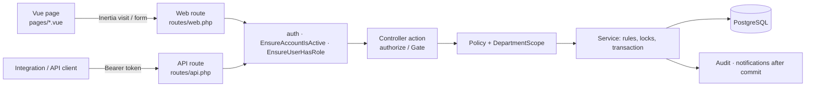

# Route → Authorization → Scope → Test Matrix (generated 2026-10-14)

Part of the [post-login audit](post-login-audit.md). Role-level summary:
[role-permission-matrix](role-permission-matrix.md).

## How the frontend reaches the backend

EduCore pages are **Inertia** pages: each page is a **web route** (`routes/web.php`) whose controller
loads the page's data server-side and returns `Inertia::render('Page', props)`; forms post back to web
routes. No page calls the REST API through `services/api.js` today. The REST API (`routes/api.php`)
is a parallel surface (documented in OpenAPI) that reuses the **same policies and services**, so a
rule enforced on one surface holds on the other. The frontend route → backend endpoint mapping is
therefore the web table below; the API table is the integration contract.

## Reading the tables

- **Roles (middleware)** — `EnsureUserHasRole` on the route: SA Super Admin, UA University Admin,
  DA Department Admin, L Lecturer, S Student. Several API routes admit every role at the middleware and
  leave the decision to the policy (the action column), which is where scope is enforced.
- **Authorization in the action** — the `authorize()` / `Gate::authorize()` / `->can()` calls found in
  the controller method (`ability Model` for class-level checks). `via listFor()` / `via respond()` /
  `via runTransition()` mean the action authorizes in a shared helper of the same controller (read in
  this audit). `own record (request user)` = self-service on the signed-in user, no id in the path.
- **Scope** follows from the ability: see the scope legend of the
  [role matrix](role-permission-matrix.md) (D own department, T sections taught, E enrolled, O own).
- **Tests** — test classes that request this URI **literally** (heuristic: URLs composed in a test,
  such as `"{$base}/submit"`, are not detected, so `—` means "no literal reference", not "untested").
  `RoleIsolationMatrixTest` adds own-vs-other-department probes for 75 scoped endpoints
  ([regression matrix](regression-test-matrix.md)).
- Generated from `php artisan route:list --json` and the controller sources; Swagger UI, Sanctum CSRF,
  `up` and `storage/{path}` (Laravel's signed local-disk route) are left out.

### API · academic-years

| Method | URI | Roles (middleware) | Authorization in the action | Tests |
|---|---|---|---|---|
| GET | `/api/academic-years` | SA UA | viewAny AcademicYear | AcademicYearManagementTest |
| POST | `/api/academic-years` | SA UA | create AcademicYear | AcademicYearManagementTest |
| GET | `/api/academic-years/{academicYear}` | SA UA | view | AcademicYearManagementTest |
| PUT|PATCH | `/api/academic-years/{academicYear}` | SA UA | update | AcademicYearManagementTest |
| DELETE | `/api/academic-years/{academicYear}` | SA UA | delete | AcademicYearManagementTest |
| GET | `/api/academic-years/{academicYear}/semesters` | SA UA | view | AcademicYearManagementTest |
| POST | `/api/academic-years/{academicYear}/semesters` | SA UA | create Semester | AcademicYearManagementTest |
| DELETE | `/api/academic-years/{academicYear}/semesters/{semester}` | SA UA | delete | AcademicYearManagementTest |
| POST | `/api/academic-years/{academicYear}/semesters/{semester}/status` | SA UA | update | AcademicYearManagementTest |
| POST | `/api/academic-years/{academicYear}/status` | SA UA | update | AcademicYearManagementTest |

### API · analytics

| Method | URI | Roles (middleware) | Authorization in the action | Tests |
|---|---|---|---|---|
| GET | `/api/analytics/academic` | SA UA DA | via respond() | AnalyticsTest, DepartmentAnalyticsTest |
| GET | `/api/analytics/administrative` | SA UA DA | view-analytics; gate view-analytics | AnalyticsTest, DepartmentAnalyticsTest |
| GET | `/api/analytics/enrollment` | SA UA DA | via respond() | AnalyticsTest, DepartmentAnalyticsTest |
| GET | `/api/analytics/export` | SA UA DA | view-analytics; gate view-analytics | DepartmentAnalyticsTest, CsvExportTest |
| GET | `/api/analytics/export/pdf` | SA UA DA | view-analytics; gate view-analytics | CsvExportTest |
| GET | `/api/analytics/overview` | SA UA DA | via respond() | AnalyticsTest, DepartmentAnalyticsTest |
| GET | `/api/analytics/trends` | SA UA DA | view-analytics; gate view-analytics | DepartmentAnalyticsTest |

### API · announcements

| Method | URI | Roles (middleware) | Authorization in the action | Tests |
|---|---|---|---|---|
| GET | `/api/announcements` | SA UA DA L S | manageAny Announcement | AnnouncementTest, AnnouncementWorkflowTest |
| POST | `/api/announcements` | SA UA DA L S | create Announcement | AnnouncementTest, AnnouncementWorkflowTest |
| GET | `/api/announcements/{announcement}` | SA UA DA L S | view | AnnouncementTest, AnnouncementWorkflowTest |
| PUT|PATCH | `/api/announcements/{announcement}` | SA UA DA L S | update | AnnouncementTest, AnnouncementWorkflowTest |
| DELETE | `/api/announcements/{announcement}` | SA UA DA L S | update | AnnouncementTest, AnnouncementWorkflowTest |
| POST | `/api/announcements/{announcement}/archive` | SA UA DA L S | update | AnnouncementTest |
| GET | `/api/announcements/{announcement}/attachments/{file}/download` | SA UA DA L S | view | AnnouncementTest |
| POST | `/api/announcements/{announcement}/publish` | SA UA DA L S | update | AnnouncementTest, AnnouncementWorkflowTest |
| POST | `/api/announcements/{announcement}/read` | SA UA DA L S | read | AnnouncementWorkflowTest |
| POST | `/api/announcements/{announcement}/schedule` | SA UA DA L S | update | AnnouncementWorkflowTest |
| POST | `/api/announcements/{announcement}/unschedule` | SA UA DA L S | update | AnnouncementWorkflowTest |
| GET | `/api/announcements/feed` | SA UA DA L S | own record (request user) | AnnouncementTest, AnnouncementWorkflowTest |
| POST | `/api/announcements/read-all` | SA UA DA L S | own record (request user) | AnnouncementWorkflowTest |

### API · assignments

| Method | URI | Roles (middleware) | Authorization in the action | Tests |
|---|---|---|---|---|
| GET | `/api/assignments/{assignment}` | SA UA DA L S | view | AssignmentTest, RoleIsolationMatrixTest |
| PUT|PATCH | `/api/assignments/{assignment}` | SA UA DA L S | update | AssignmentTest, RoleIsolationMatrixTest |
| DELETE | `/api/assignments/{assignment}` | SA UA DA L S | delete | AssignmentTest, RoleIsolationMatrixTest |
| POST | `/api/assignments/{assignment}/publish` | SA UA DA L S | update | AssignmentTest |
| GET | `/api/assignments/{assignment}/submissions` | SA UA DA L S | viewSubmissions | AssignmentTest, RoleIsolationMatrixTest |
| POST | `/api/assignments/{assignment}/submissions` | SA UA DA L S | submit | AssignmentTest, RoleIsolationMatrixTest |

### API · attendance-sessions

| Method | URI | Roles (middleware) | Authorization in the action | Tests |
|---|---|---|---|---|
| POST | `/api/attendance-sessions/{session}/cancel` | SA UA DA L S | record AttendanceSession | AttendanceTest |

### API · audit-logs

| Method | URI | Roles (middleware) | Authorization in the action | Tests |
|---|---|---|---|---|
| GET | `/api/audit-logs` | SA | viewAny AuditLog | AuditTest, RoleIsolationMatrixTest |
| GET | `/api/audit-logs/{auditLog}` | SA | view | AuditTest, CsvExportTest |
| GET | `/api/audit-logs/export` | SA | viewAny AuditLog | CsvExportTest |

### API · catalog

| Method | URI | Roles (middleware) | Authorization in the action | Tests |
|---|---|---|---|---|
| GET | `/api/catalog/courses` | public | role middleware only | CatalogTest |
| GET | `/api/catalog/courses/{course}` | public | role middleware only | CatalogTest |
| GET | `/api/catalog/departments` | public | role middleware only | CatalogTest |

### API · courses

| Method | URI | Roles (middleware) | Authorization in the action | Tests |
|---|---|---|---|---|
| GET | `/api/courses` | SA UA DA | viewAny Course | CourseManagementTest, DepartmentAdminScopingTest |
| POST | `/api/courses` | SA UA | create Course | CourseManagementTest, DepartmentAdminScopingTest |
| GET | `/api/courses/{course}` | SA UA DA | view | RoleIsolationMatrixTest, CourseManagementTest, DepartmentAdminScopingTest +2 |
| PUT|PATCH | `/api/courses/{course}` | SA UA | update | RoleIsolationMatrixTest, CourseManagementTest, DepartmentAdminScopingTest +2 |
| DELETE | `/api/courses/{course}` | SA UA | delete | RoleIsolationMatrixTest, CourseManagementTest, DepartmentAdminScopingTest +2 |
| POST | `/api/courses/{course}/archive` | SA UA | archive | CourseManagementTest |
| GET | `/api/courses/{course}/grading-config` | SA UA DA L S | viewConfig Grade | RoleIsolationMatrixTest, DepartmentAdminScopingTest, GradingTest |
| PUT | `/api/courses/{course}/grading-config` | SA UA DA L S | configure Grade | RoleIsolationMatrixTest, DepartmentAdminScopingTest, GradingTest |
| POST | `/api/courses/{course}/prerequisites` | SA UA | update | CourseManagementTest |
| DELETE | `/api/courses/{course}/prerequisites/{prerequisite}` | SA UA | update | CourseManagementTest |
| POST | `/api/courses/{course}/reactivate` | SA UA | archive | CourseManagementTest |

### API · departments

| Method | URI | Roles (middleware) | Authorization in the action | Tests |
|---|---|---|---|---|
| GET | `/api/departments` | SA UA DA | viewAny Department | DepartmentAdminScopingTest, DepartmentManagementTest |
| POST | `/api/departments` | SA UA | create Department | DepartmentAdminScopingTest, DepartmentManagementTest |
| GET | `/api/departments/{department}` | SA UA DA | view | RoleIsolationMatrixTest, CourseManagementTest, DepartmentAdminScopingTest +3 |
| PUT|PATCH | `/api/departments/{department}` | SA UA | update | RoleIsolationMatrixTest, CourseManagementTest, DepartmentAdminScopingTest +3 |
| DELETE | `/api/departments/{department}` | SA UA | delete | RoleIsolationMatrixTest, CourseManagementTest, DepartmentAdminScopingTest +3 |
| POST | `/api/departments/{department}/archive` | SA UA | archive | DepartmentManagementTest |
| GET | `/api/departments/{department}/dashboard` | SA UA DA | view | RoleIsolationMatrixTest, DepartmentAdminDashboardTest, DepartmentAdminScopingTest |
| POST | `/api/departments/{department}/reactivate` | SA UA | archive | DepartmentManagementTest |

### API · document-requests

| Method | URI | Roles (middleware) | Authorization in the action | Tests |
|---|---|---|---|---|
| GET | `/api/document-requests` | SA UA DA L S | via listFor() | DepartmentAdminRequestHandlingTest, DocumentFeeAndTypeTest, DocumentTest +1 |
| POST | `/api/document-requests` | SA UA DA L S | create DocumentRequest | DepartmentAdminRequestHandlingTest, DocumentFeeAndTypeTest, DocumentTest +1 |
| GET | `/api/document-requests/{documentRequest}` | SA UA DA L S | view | RoleIsolationMatrixTest, DocumentTest |
| POST | `/api/document-requests/{documentRequest}/approve` | SA UA DA L S | process | DepartmentAdminRequestHandlingTest, DocumentFeeAndTypeTest, DocumentTest |
| POST | `/api/document-requests/{documentRequest}/generate` | SA UA DA L S | process | DepartmentAdminRequestHandlingTest, DocumentFeeAndTypeTest, DocumentTest |
| POST | `/api/document-requests/{documentRequest}/reject` | SA UA DA L S | process | RoleIsolationMatrixTest, DepartmentAdminRequestHandlingTest, DocumentTest |
| POST | `/api/document-requests/{documentRequest}/waive-fee` | SA UA DA L S | waiveFee | DocumentFeeAndTypeTest |

### API · document-types

| Method | URI | Roles (middleware) | Authorization in the action | Tests |
|---|---|---|---|---|
| GET | `/api/document-types` | SA UA DA L S | role middleware only | DocumentFeeAndTypeTest |
| POST | `/api/document-types` | SA UA DA L S | create DocumentType | DocumentFeeAndTypeTest |
| GET | `/api/document-types/{documentType}` | SA UA DA L S | view | DocumentFeeAndTypeTest |
| PUT|PATCH | `/api/document-types/{documentType}` | SA UA DA L S | update | DocumentFeeAndTypeTest |
| DELETE | `/api/document-types/{documentType}` | SA UA DA L S | delete | DocumentFeeAndTypeTest |

### API · documents

| Method | URI | Roles (middleware) | Authorization in the action | Tests |
|---|---|---|---|---|
| GET | `/api/documents/{document}/download` | SA UA DA L S | view | DocumentTest |
| POST | `/api/documents/{document}/revoke` | SA UA DA L S | revoke DocumentRequest | DepartmentAdminRequestHandlingTest, DocumentTest |

### API · enrollments

| Method | URI | Roles (middleware) | Authorization in the action | Tests |
|---|---|---|---|---|
| GET | `/api/enrollments` | SA UA DA S | viewAny Enrollment | DepartmentAdminScopingTest, EnrollmentTest, TimetableTest |
| POST | `/api/enrollments` | SA UA DA S | create Enrollment | DepartmentAdminScopingTest, EnrollmentTest, TimetableTest |
| GET | `/api/enrollments/{enrollment}` | SA UA DA S | view | AttendanceTest, RoleIsolationMatrixTest, DepartmentAdminScopingTest +2 |
| DELETE | `/api/enrollments/{enrollment}` | SA UA DA S | drop | AttendanceTest, RoleIsolationMatrixTest, DepartmentAdminScopingTest +2 |
| POST | `/api/enrollments/{enrollment}/complete` | SA UA DA S | complete | EnrollmentTest |
| GET | `/api/enrollments/export` | SA UA DA S | viewAny Enrollment | CsvExportTest |

### API · error-logs

| Method | URI | Roles (middleware) | Authorization in the action | Tests |
|---|---|---|---|---|
| GET | `/api/error-logs` | SA | viewAny ErrorLog | RoleIsolationMatrixTest, ErrorLogManagementTest |
| GET | `/api/error-logs/{errorLog}` | SA | view | ErrorLogManagementTest |

### API · exam-results

| Method | URI | Roles (middleware) | Authorization in the action | Tests |
|---|---|---|---|---|
| PATCH | `/api/exam-results/{result}` | SA UA DA L S | update | AuditTest, ExamTest |

### API · exams

| Method | URI | Roles (middleware) | Authorization in the action | Tests |
|---|---|---|---|---|
| GET | `/api/exams/{exam}` | SA UA DA L S | view; can viewResults | RoleIsolationMatrixTest, ExamTest |
| PUT|PATCH | `/api/exams/{exam}` | SA UA DA L S | update | RoleIsolationMatrixTest, ExamTest |
| DELETE | `/api/exams/{exam}` | SA UA DA L S | delete | RoleIsolationMatrixTest, ExamTest |
| POST | `/api/exams/{exam}/publish` | SA UA DA L S | update | ExamTest |
| POST | `/api/exams/{exam}/results` | SA UA DA L S | update | RoleIsolationMatrixTest, ExamTest |

### API · forgot-password

| Method | URI | Roles (middleware) | Authorization in the action | Tests |
|---|---|---|---|---|
| POST | `/api/forgot-password` | public | role middleware only | PasswordTest |

### API · grading-scale

| Method | URI | Roles (middleware) | Authorization in the action | Tests |
|---|---|---|---|---|
| GET | `/api/grading-scale` | SA UA DA L S | viewScale Grade | GradingTest |
| PUT | `/api/grading-scale` | SA UA DA L S | configure Grade | GradingTest |

### API · health

| Method | URI | Roles (middleware) | Authorization in the action | Tests |
|---|---|---|---|---|
| GET | `/api/health` | public | closure | — |

### API · internship-companies

| Method | URI | Roles (middleware) | Authorization in the action | Tests |
|---|---|---|---|---|
| GET | `/api/internship-companies` | SA UA DA L S | viewCompanies Internship; can viewAny | DepartmentAdminRequestHandlingTest, InternshipTest |
| POST | `/api/internship-companies` | SA UA DA L S | manageCompanies Internship | DepartmentAdminRequestHandlingTest, InternshipTest |
| PUT|PATCH | `/api/internship-companies/{company}` | SA UA DA L S | manageCompanies Internship | — |

### API · internship-reports

| Method | URI | Roles (middleware) | Authorization in the action | Tests |
|---|---|---|---|---|
| GET | `/api/internship-reports/{report}/file` | SA UA DA L S | view | — |
| POST | `/api/internship-reports/{report}/review` | SA UA DA L S | process | DepartmentAdminRequestHandlingTest |

### API · internships

| Method | URI | Roles (middleware) | Authorization in the action | Tests |
|---|---|---|---|---|
| GET | `/api/internships` | SA UA DA L S | via listFor() | DepartmentAdminRequestHandlingTest, InternshipTest, StaffRequestNoticeTest |
| POST | `/api/internships` | SA UA DA L S | apply Internship | DepartmentAdminRequestHandlingTest, InternshipTest, StaffRequestNoticeTest |
| GET | `/api/internships/{internship}` | SA UA DA L S | view | RoleIsolationMatrixTest, DepartmentAdminRequestHandlingTest, InternshipTest |
| PUT|PATCH | `/api/internships/{internship}` | SA UA DA L S | can process; can act | RoleIsolationMatrixTest, DepartmentAdminRequestHandlingTest, InternshipTest |
| POST | `/api/internships/{internship}/{action}` | SA UA DA L S | via runTransition() | RoleIsolationMatrixTest, DepartmentAdminRequestHandlingTest, InternshipTest +1 |
| POST | `/api/internships/{internship}/evaluations` | SA UA DA L S | process | DepartmentAdminRequestHandlingTest |
| POST | `/api/internships/{internship}/reports` | SA UA DA L S | act | InternshipTest |

### API · invoices

| Method | URI | Roles (middleware) | Authorization in the action | Tests |
|---|---|---|---|---|
| GET | `/api/invoices` | SA UA DA L S | viewAny Invoice | RoleIsolationMatrixTest, InvoiceTest |
| POST | `/api/invoices` | SA UA DA L S | manage Invoice | RoleIsolationMatrixTest, InvoiceTest |
| GET | `/api/invoices/{invoice}` | SA UA DA L S | view | RoleIsolationMatrixTest, CsvExportTest, InvoiceTest +1 |
| PUT|PATCH | `/api/invoices/{invoice}` | SA UA DA L S | manage Invoice | RoleIsolationMatrixTest, CsvExportTest, InvoiceTest +1 |
| POST | `/api/invoices/{invoice}/cancel` | SA UA DA L S | manage Invoice | InvoiceTest |
| GET | `/api/invoices/{invoice}/download` | SA UA DA L S | view | RoleIsolationMatrixTest, InvoiceTest |
| POST | `/api/invoices/{invoice}/payments` | SA UA DA L S | manage Invoice | AuditTest, InvoiceTest |
| GET | `/api/invoices/export` | SA UA DA L S | viewAny Invoice | CsvExportTest |
| POST | `/api/invoices/generate-tuition` | SA UA DA L S | manage Invoice | TuitionInvoiceTest |

### API · lecturers

| Method | URI | Roles (middleware) | Authorization in the action | Tests |
|---|---|---|---|---|
| GET | `/api/lecturers` | SA UA DA | viewAny Lecturer | DepartmentAdminScopingTest, LecturerManagementTest |
| POST | `/api/lecturers` | SA UA | create Lecturer | DepartmentAdminScopingTest, LecturerManagementTest |
| GET | `/api/lecturers/{lecturer}` | SA UA DA L | view | RoleIsolationMatrixTest, DepartmentAdminScopingTest, LecturerManagementTest +1 |
| PUT|PATCH | `/api/lecturers/{lecturer}` | SA UA | update | RoleIsolationMatrixTest, DepartmentAdminScopingTest, LecturerManagementTest +1 |
| DELETE | `/api/lecturers/{lecturer}` | SA UA | delete | RoleIsolationMatrixTest, DepartmentAdminScopingTest, LecturerManagementTest +1 |
| GET | `/api/lecturers/{lecturer}/dashboard` | SA UA DA L | view | RoleIsolationMatrixTest, LecturerDashboardTest, ClassRemindersTest |
| POST | `/api/lecturers/{lecturer}/deactivate` | SA UA | deactivate | LecturerManagementTest |
| POST | `/api/lecturers/{lecturer}/reactivate` | SA UA | deactivate | LecturerManagementTest |
| GET | `/api/lecturers/{lecturer}/sections` | SA UA DA L | view | RoleIsolationMatrixTest, CourseOfferingManagementTest |

### API · login

| Method | URI | Roles (middleware) | Authorization in the action | Tests |
|---|---|---|---|---|
| POST | `/api/login` | public | role middleware only | LoginTest, TwoFactorTest, UserManagementTest |

### API · logout

| Method | URI | Roles (middleware) | Authorization in the action | Tests |
|---|---|---|---|---|
| POST | `/api/logout` | any signed-in | role middleware only | LoginTest |

### API · materials

| Method | URI | Roles (middleware) | Authorization in the action | Tests |
|---|---|---|---|---|
| PUT|PATCH | `/api/materials/{material}` | SA UA DA L S | update | CourseMaterialTest |
| DELETE | `/api/materials/{material}` | SA UA DA L S | delete | CourseMaterialTest |
| GET | `/api/materials/{material}/file` | SA UA DA L S | view | CourseMaterialTest |

### API · notification-preferences

| Method | URI | Roles (middleware) | Authorization in the action | Tests |
|---|---|---|---|---|
| GET | `/api/notification-preferences` | any signed-in | own record (request user) | NotificationTest, TelegramLinkingTest |
| PUT | `/api/notification-preferences` | any signed-in | own record (request user) | NotificationTest, TelegramLinkingTest |
| DELETE | `/api/notification-preferences/telegram` | any signed-in | own record (request user) | — |
| POST | `/api/notification-preferences/telegram-link` | any signed-in | own record (request user) | TelegramLinkingTest |
| POST | `/api/notification-preferences/test` | any signed-in | own record (request user) | NotificationTest |

### API · notifications

| Method | URI | Roles (middleware) | Authorization in the action | Tests |
|---|---|---|---|---|
| GET | `/api/notifications` | any signed-in | own record (request user) | InboxTest |
| POST | `/api/notifications/{notification}/read` | any signed-in | own record (request user) | InboxTest |
| POST | `/api/notifications/read-all` | any signed-in | own record (request user) | InboxTest |

### API · offerings

| Method | URI | Roles (middleware) | Authorization in the action | Tests |
|---|---|---|---|---|
| GET | `/api/offerings` | SA UA DA | viewAny CourseOffering | DepartmentAdminScopingTest, CourseOfferingManagementTest, DepartmentAdminSectionManagementTest |
| POST | `/api/offerings` | SA UA DA | create CourseOffering | DepartmentAdminScopingTest, CourseOfferingManagementTest, DepartmentAdminSectionManagementTest |
| GET | `/api/offerings/{offering}` | SA UA DA | view | RoleIsolationMatrixTest, CourseOfferingManagementTest, DepartmentAdminSectionManagementTest |
| PUT|PATCH | `/api/offerings/{offering}` | SA UA DA | update | RoleIsolationMatrixTest, CourseOfferingManagementTest, DepartmentAdminSectionManagementTest |
| DELETE | `/api/offerings/{offering}` | SA UA DA | delete | RoleIsolationMatrixTest, CourseOfferingManagementTest, DepartmentAdminSectionManagementTest |
| POST | `/api/offerings/{offering}/sections` | SA UA DA | update | CourseOfferingManagementTest, DepartmentAdminSectionManagementTest |

### API · password

| Method | URI | Roles (middleware) | Authorization in the action | Tests |
|---|---|---|---|---|
| PUT | `/api/password` | any signed-in | own record (request user) | PasswordTest |

### API · payments

| Method | URI | Roles (middleware) | Authorization in the action | Tests |
|---|---|---|---|---|
| POST | `/api/payments/{payment}/reverse` | SA UA DA L S | manage Invoice | InvoiceTest |

### API · profile

| Method | URI | Roles (middleware) | Authorization in the action | Tests |
|---|---|---|---|---|
| GET | `/api/profile` | any signed-in | own record (request user) | ProfileTest |
| PUT|POST | `/api/profile` | any signed-in | own record (request user) | ProfileTest |

### API · programs

| Method | URI | Roles (middleware) | Authorization in the action | Tests |
|---|---|---|---|---|
| GET | `/api/programs` | SA UA DA | viewAny Program | DepartmentAdminScopingTest, ProgramManagementTest |
| POST | `/api/programs` | SA UA | create Program | DepartmentAdminScopingTest, ProgramManagementTest |
| GET | `/api/programs/{program}` | SA UA DA | view | RoleIsolationMatrixTest, CourseManagementTest, ProgramManagementTest +1 |
| PUT|PATCH | `/api/programs/{program}` | SA UA | update | RoleIsolationMatrixTest, CourseManagementTest, ProgramManagementTest +1 |
| DELETE | `/api/programs/{program}` | SA UA | delete | RoleIsolationMatrixTest, CourseManagementTest, ProgramManagementTest +1 |
| POST | `/api/programs/{program}/archive` | SA UA | archive | ProgramManagementTest |
| POST | `/api/programs/{program}/courses` | SA UA | update | CourseManagementTest |
| PATCH | `/api/programs/{program}/courses/{course}` | SA UA | update | CourseManagementTest |
| DELETE | `/api/programs/{program}/courses/{course}` | SA UA | update | CourseManagementTest |
| POST | `/api/programs/{program}/reactivate` | SA UA | archive | ProgramManagementTest |

### API · reset-password

| Method | URI | Roles (middleware) | Authorization in the action | Tests |
|---|---|---|---|---|
| POST | `/api/reset-password` | public | role middleware only | PasswordTest |

### API · rooms

| Method | URI | Roles (middleware) | Authorization in the action | Tests |
|---|---|---|---|---|
| GET | `/api/rooms` | SA UA DA | viewAny Room | DepartmentAdminScopingTest, DepartmentAdminSectionManagementTest, TimetableTest |
| POST | `/api/rooms` | SA UA | create Room | DepartmentAdminScopingTest, DepartmentAdminSectionManagementTest, TimetableTest |
| GET | `/api/rooms/{room}` | SA UA DA | view | ExceptionReportingTest, DepartmentAdminSectionManagementTest, TimetableTest |
| PUT|PATCH | `/api/rooms/{room}` | SA UA | update | ExceptionReportingTest, DepartmentAdminSectionManagementTest, TimetableTest |
| DELETE | `/api/rooms/{room}` | SA UA | delete | ExceptionReportingTest, DepartmentAdminSectionManagementTest, TimetableTest |

### API · schedule-entries

| Method | URI | Roles (middleware) | Authorization in the action | Tests |
|---|---|---|---|---|
| PUT|PATCH | `/api/schedule-entries/{entry}` | SA UA DA | update | DepartmentAdminSectionManagementTest, TimetableTest |
| DELETE | `/api/schedule-entries/{entry}` | SA UA DA | update | DepartmentAdminSectionManagementTest, TimetableTest |

### API · sections

| Method | URI | Roles (middleware) | Authorization in the action | Tests |
|---|---|---|---|---|
| GET | `/api/sections/{section}` | SA UA DA | view | RoleIsolationMatrixTest, DepartmentAdminScopingTest, CourseOfferingManagementTest +1 |
| PUT|PATCH | `/api/sections/{section}` | SA UA DA | update | RoleIsolationMatrixTest, DepartmentAdminScopingTest, CourseOfferingManagementTest +1 |
| DELETE | `/api/sections/{section}` | SA UA DA | update | RoleIsolationMatrixTest, DepartmentAdminScopingTest, CourseOfferingManagementTest +1 |
| GET | `/api/sections/{section}/assignments` | SA UA DA L S | viewSection Assignment; via listFor() | AssignmentTest, RoleIsolationMatrixTest |
| POST | `/api/sections/{section}/assignments` | SA UA DA L S | create Assignment | AssignmentTest, RoleIsolationMatrixTest |
| GET | `/api/sections/{section}/attendance` | SA UA DA L S | viewSection AttendanceSession; via rosterResponse() | AttendanceTest, RoleIsolationMatrixTest |
| POST | `/api/sections/{section}/attendance` | SA UA DA L S | record AttendanceSession; via rosterResponse() | AttendanceTest, RoleIsolationMatrixTest |
| GET | `/api/sections/{section}/attendance/summary` | SA UA DA L S | viewSection AttendanceSession | AttendanceTest, RoleIsolationMatrixTest |
| GET | `/api/sections/{section}/exams` | SA UA DA L S | viewSection Exam; via listFor() | RoleIsolationMatrixTest, ExamTest |
| POST | `/api/sections/{section}/exams` | SA UA DA L S | create Exam | RoleIsolationMatrixTest, ExamTest |
| GET | `/api/sections/{section}/grades` | SA UA DA L S | viewSection Grade | RoleIsolationMatrixTest, DepartmentAdminScopingTest, GradingTest |
| POST | `/api/sections/{section}/grades` | SA UA DA L S | grade Grade | RoleIsolationMatrixTest, DepartmentAdminScopingTest, GradingTest |
| POST | `/api/sections/{section}/grades/approve` | SA UA DA L S | approve Grade | AuditTest |
| POST | `/api/sections/{section}/grades/finalize` | SA UA DA L S | approve Grade | — |
| POST | `/api/sections/{section}/grades/reopen` | SA UA DA L S | reopen Grade | — |
| POST | `/api/sections/{section}/grades/return` | SA UA DA L S | approve Grade | — |
| POST | `/api/sections/{section}/grades/submit` | SA UA DA L S | grade Grade | — |
| POST | `/api/sections/{section}/lecturers` | SA UA DA | update | CourseOfferingManagementTest, DepartmentAdminSectionManagementTest, TimetableTest |
| DELETE | `/api/sections/{section}/lecturers/{lecturer}` | SA UA DA | update | CourseOfferingManagementTest, DepartmentAdminSectionManagementTest |
| GET | `/api/sections/{section}/materials` | SA UA DA L S | viewSection CourseMaterial; via listFor() | CourseMaterialTest, RoleIsolationMatrixTest |
| POST | `/api/sections/{section}/materials` | SA UA DA L S | create CourseMaterial | CourseMaterialTest, RoleIsolationMatrixTest |
| GET | `/api/sections/{section}/schedule` | SA UA DA | view | RoleIsolationMatrixTest, DepartmentAdminScopingTest, DepartmentAdminSectionManagementTest +1 |
| POST | `/api/sections/{section}/schedule` | SA UA DA | update | RoleIsolationMatrixTest, DepartmentAdminScopingTest, DepartmentAdminSectionManagementTest +1 |

### API · students

| Method | URI | Roles (middleware) | Authorization in the action | Tests |
|---|---|---|---|---|
| GET | `/api/students` | SA UA DA | viewAny Student | RoleIsolationMatrixTest, DepartmentAdminScopingTest, StudentManagementTest |
| POST | `/api/students` | SA UA | create Student | RoleIsolationMatrixTest, DepartmentAdminScopingTest, StudentManagementTest |
| GET | `/api/students/{student}` | SA UA DA S | view | RoleIsolationMatrixTest, DepartmentAdminScopingTest, StudentManagementTest |
| PUT|PATCH | `/api/students/{student}` | SA UA | update | RoleIsolationMatrixTest, DepartmentAdminScopingTest, StudentManagementTest |
| DELETE | `/api/students/{student}` | SA UA | delete | RoleIsolationMatrixTest, DepartmentAdminScopingTest, StudentManagementTest |
| GET | `/api/students/{student}/attendance` | SA UA DA L S | viewStudent AttendanceSession | AttendanceTest, RoleIsolationMatrixTest |
| GET | `/api/students/{student}/dashboard` | SA UA DA S | view | RoleIsolationMatrixTest, StudentDashboardTest |
| GET | `/api/students/{student}/enrollments` | SA UA DA S | view | RoleIsolationMatrixTest, EnrollmentTest |
| GET | `/api/students/{student}/exams` | SA UA DA L S | viewStudent Exam | RoleIsolationMatrixTest, ExamTest |
| GET | `/api/students/{student}/gpa` | SA UA DA L S | viewStudent Grade | RoleIsolationMatrixTest, GradingTest |
| GET | `/api/students/{student}/grades` | SA UA DA L S | viewStudent Grade | RoleIsolationMatrixTest, DepartmentAdminScopingTest, GradingTest |
| GET | `/api/students/{student}/invoices` | SA UA DA L S | viewStudent Invoice | RoleIsolationMatrixTest, InvoiceTest |
| POST | `/api/students/{student}/program` | SA UA | update | StudentManagementTest |
| POST | `/api/students/{student}/status` | SA UA | changeStatus | AuditTest, StudentManagementTest |

### API · submissions

| Method | URI | Roles (middleware) | Authorization in the action | Tests |
|---|---|---|---|---|
| GET | `/api/submissions/{submission}/file` | SA UA DA L S | download | AssignmentTest |
| POST | `/api/submissions/{submission}/grade` | SA UA DA L S | grade | AssignmentTest, RoleIsolationMatrixTest |

### API · telegram

| Method | URI | Roles (middleware) | Authorization in the action | Tests |
|---|---|---|---|---|
| POST | `/api/telegram/webhook` | public | role middleware only | TelegramLinkingTest |

### API · timetable

| Method | URI | Roles (middleware) | Authorization in the action | Tests |
|---|---|---|---|---|
| GET | `/api/timetable/lecturer/{lecturer}` | SA UA DA L | view | RoleIsolationMatrixTest, DepartmentAdminScopingTest, TimetableTest |
| GET | `/api/timetable/student/{student}` | SA UA DA S | view | RoleIsolationMatrixTest, TimetableTest |

### API · two-factor

| Method | URI | Roles (middleware) | Authorization in the action | Tests |
|---|---|---|---|---|
| GET | `/api/two-factor` | any signed-in | own record (request user) | TwoFactorTest |
| POST | `/api/two-factor` | any signed-in | own record (request user) | TwoFactorTest |
| DELETE | `/api/two-factor` | any signed-in | own record (request user) | TwoFactorTest |
| POST | `/api/two-factor/confirm` | any signed-in | own record (request user) | TwoFactorTest |
| POST | `/api/two-factor/recovery-codes` | any signed-in | own record (request user) | TwoFactorTest |

### API · universities

| Method | URI | Roles (middleware) | Authorization in the action | Tests |
|---|---|---|---|---|
| GET | `/api/universities` | SA UA DA | viewAny University | DepartmentAdminScopingTest, DepartmentManagementTest |
| POST | `/api/universities` | SA UA | create University | DepartmentAdminScopingTest, DepartmentManagementTest |
| GET | `/api/universities/{university}` | SA UA DA | view | DepartmentManagementTest |
| PUT|PATCH | `/api/universities/{university}` | SA UA | update | DepartmentManagementTest |
| DELETE | `/api/universities/{university}` | SA UA | delete | DepartmentManagementTest |
| POST | `/api/universities/{university}/current` | SA UA | update | DepartmentManagementTest |

### API · university

| Method | URI | Roles (middleware) | Authorization in the action | Tests |
|---|---|---|---|---|
| GET | `/api/university/dashboard` | SA UA | role middleware only | UniversityAdminDashboardTest |

### API · user

| Method | URI | Roles (middleware) | Authorization in the action | Tests |
|---|---|---|---|---|
| GET | `/api/user` | any signed-in | closure | AuditTest, LoginTest, TwoFactorTest +1 |

### API · users

| Method | URI | Roles (middleware) | Authorization in the action | Tests |
|---|---|---|---|---|
| GET | `/api/users` | SA | viewAny User | RoleIsolationMatrixTest, DepartmentAdminScopingTest, ErrorLogManagementTest +1 |
| POST | `/api/users` | SA | create User | RoleIsolationMatrixTest, DepartmentAdminScopingTest, ErrorLogManagementTest +1 |
| GET | `/api/users/{user}` | SA | view | AuditTest, DepartmentAdminScopingTest, UserManagementTest |
| PUT|PATCH | `/api/users/{user}` | SA | update | AuditTest, DepartmentAdminScopingTest, UserManagementTest |
| DELETE | `/api/users/{user}` | SA | delete | AuditTest, DepartmentAdminScopingTest, UserManagementTest |
| GET | `/api/users/{user}/avatar` | public | role middleware only | ProfileTest |
| DELETE | `/api/users/{user}/two-factor` | SA | resetTwoFactor | TwoFactorTest |

### API · verifications

| Method | URI | Roles (middleware) | Authorization in the action | Tests |
|---|---|---|---|---|
| GET | `/api/verifications/{token}` | public | role middleware only | DocumentTest |

### Web · academic-years

| Method | URI | Roles (middleware) | Authorization in the action | Tests |
|---|---|---|---|---|
| GET | `/academic-years` | SA UA | viewAny AcademicYear | AcademicYearManagementTest, PaginationContractTest |
| POST | `/academic-years` | SA UA | create AcademicYear | AcademicYearManagementTest, PaginationContractTest |
| PUT | `/academic-years/{academicYear}` | SA UA | update | — |
| DELETE | `/academic-years/{academicYear}` | SA UA | delete | — |
| POST | `/academic-years/{academicYear}/current` | SA UA | update | — |
| GET | `/academic-years/{academicYear}/edit` | SA UA | update | AcademicYearManagementTest |
| POST | `/academic-years/{academicYear}/semesters` | SA UA | create Semester | AcademicYearManagementTest |
| DELETE | `/academic-years/{academicYear}/semesters/{semester}` | SA UA | delete | — |
| POST | `/academic-years/{academicYear}/semesters/{semester}/status` | SA UA | update | — |
| POST | `/academic-years/{academicYear}/status` | SA UA | update | — |
| GET | `/academic-years/create` | SA UA | create AcademicYear | — |

### Web · account

| Method | URI | Roles (middleware) | Authorization in the action | Tests |
|---|---|---|---|---|
| GET | `/account/password` | any signed-in | role middleware only | PasswordTest |
| PUT | `/account/password` | any signed-in | own record (request user) | PasswordTest |
| GET | `/account/profile` | any signed-in | own record (request user) | ProfileTest |
| PUT|POST | `/account/profile` | any signed-in | own record (request user) | ProfileTest |
| GET | `/account/two-factor` | any signed-in | own record (request user) | TwoFactorTest |
| POST | `/account/two-factor` | any signed-in | own record (request user) | TwoFactorTest |
| DELETE | `/account/two-factor` | any signed-in | own record (request user) | TwoFactorTest |
| POST | `/account/two-factor/confirm` | any signed-in | own record (request user) | TwoFactorTest |
| POST | `/account/two-factor/recovery-codes` | any signed-in | own record (request user) | — |

### Web · admin

| Method | URI | Roles (middleware) | Authorization in the action | Tests |
|---|---|---|---|---|
| GET | `/admin/dashboard` | SA | viewAdminDashboard User | LoginTest, CampusMapTest, DepartmentAdminScopingTest +1 |

### Web · analytics

| Method | URI | Roles (middleware) | Authorization in the action | Tests |
|---|---|---|---|---|
| GET | `/analytics` | SA UA DA | view-analytics; gate view-analytics | AnalyticsTest, DepartmentAnalyticsTest |
| GET | `/analytics/export` | SA UA DA | view-analytics; gate view-analytics | DepartmentAnalyticsTest, CsvExportTest |
| GET | `/analytics/export/pdf` | SA UA DA | view-analytics; gate view-analytics | DepartmentAnalyticsTest, CsvExportTest |

### Web · announcements

| Method | URI | Roles (middleware) | Authorization in the action | Tests |
|---|---|---|---|---|
| GET | `/announcements` | any signed-in | can manageAny | AnnouncementTest, AnnouncementWorkflowTest |
| POST | `/announcements` | SA UA DA L | create Announcement | AnnouncementTest, AnnouncementWorkflowTest |
| PUT | `/announcements/{announcement}` | SA UA DA L | update | AnnouncementTest, AnnouncementWorkflowTest |
| DELETE | `/announcements/{announcement}` | SA UA DA L | update | AnnouncementTest, AnnouncementWorkflowTest |
| POST | `/announcements/{announcement}/archive` | SA UA DA L | update | — |
| GET | `/announcements/{announcement}/attachments/{file}/download` | any signed-in | view | AnnouncementTest |
| POST | `/announcements/{announcement}/publish` | SA UA DA L | update | — |
| POST | `/announcements/{announcement}/read` | any signed-in | read | AnnouncementWorkflowTest |
| POST | `/announcements/{announcement}/schedule` | SA UA DA L | update | AnnouncementWorkflowTest |
| POST | `/announcements/{announcement}/unschedule` | SA UA DA L | update | AnnouncementWorkflowTest |
| GET | `/announcements/manage` | SA UA DA L | manageAny Announcement | AnnouncementTest, AnnouncementWorkflowTest |
| POST | `/announcements/read-all` | any signed-in | own record (request user) | AnnouncementWorkflowTest |

### Web · assignments

| Method | URI | Roles (middleware) | Authorization in the action | Tests |
|---|---|---|---|---|
| PUT | `/assignments/{assignment}` | SA UA DA L S | update | — |
| DELETE | `/assignments/{assignment}` | SA UA DA L S | delete | — |
| POST | `/assignments/{assignment}/publish` | SA UA DA L S | update | — |
| POST | `/assignments/{assignment}/submit` | SA UA DA L S | submit | — |

### Web · attendance

| Method | URI | Roles (middleware) | Authorization in the action | Tests |
|---|---|---|---|---|
| GET | `/attendance` | L | own record (request user) | AttendanceTest |
| GET | `/attendance/sections/{section}` | SA UA DA L | viewSection AttendanceSession; can record | AttendanceTest |
| POST | `/attendance/sections/{section}` | SA UA DA L | record AttendanceSession | AttendanceTest |

### Web · attendance-sessions

| Method | URI | Roles (middleware) | Authorization in the action | Tests |
|---|---|---|---|---|
| POST | `/attendance-sessions/{session}/cancel` | SA UA DA L | record AttendanceSession | — |

### Web · audit-logs

| Method | URI | Roles (middleware) | Authorization in the action | Tests |
|---|---|---|---|---|
| GET | `/audit-logs` | SA | viewAny AuditLog | AuditTest |
| GET | `/audit-logs/{auditLog}` | SA | view | AuditTest, CsvExportTest |
| GET | `/audit-logs/export` | SA | viewAny AuditLog | CsvExportTest |

### Web · catalog

| Method | URI | Roles (middleware) | Authorization in the action | Tests |
|---|---|---|---|---|
| GET | `/catalog` | public | role middleware only | CatalogTest |
| GET | `/catalog/courses/{course}` | public | role middleware only | CatalogTest |

### Web · courses

| Method | URI | Roles (middleware) | Authorization in the action | Tests |
|---|---|---|---|---|
| GET | `/courses` | SA UA DA | viewAny Course | CourseManagementTest, DepartmentAdminScopingTest, PaginationContractTest |
| POST | `/courses` | SA UA | create Course | CourseManagementTest, DepartmentAdminScopingTest, PaginationContractTest |
| PUT | `/courses/{course}` | SA UA | update | CourseManagementTest |
| DELETE | `/courses/{course}` | SA UA | delete | CourseManagementTest |
| POST | `/courses/{course}/archive` | SA UA | archive | CourseManagementTest |
| GET | `/courses/{course}/edit` | SA UA | update | CourseManagementTest, GradingTest |
| PUT | `/courses/{course}/grading-config` | SA UA | configure Grade | GradingTest |
| POST | `/courses/{course}/prerequisites` | SA UA | update | CourseManagementTest |
| DELETE | `/courses/{course}/prerequisites/{prerequisite}` | SA UA | update | CourseManagementTest |
| POST | `/courses/{course}/reactivate` | SA UA | archive | — |

### Web · coursework

| Method | URI | Roles (middleware) | Authorization in the action | Tests |
|---|---|---|---|---|
| GET | `/coursework/sections/{section}` | SA UA DA L S | viewSection Assignment; can create; can viewSubmissions; via listFor() | AssignmentTest, CourseMaterialTest |
| POST | `/coursework/sections/{section}` | SA UA DA L S | create Assignment | AssignmentTest, CourseMaterialTest |
| POST | `/coursework/sections/{section}/materials` | SA UA DA L S | create CourseMaterial | CourseMaterialTest |

### Web · dashboard

| Method | URI | Roles (middleware) | Authorization in the action | Tests |
|---|---|---|---|---|
| GET | `/dashboard` | UA DA L S | own record (request user) | AnnouncementTest, AuditTest, LoginTest +6 |

### Web · departments

| Method | URI | Roles (middleware) | Authorization in the action | Tests |
|---|---|---|---|---|
| GET | `/departments` | SA UA DA | viewAny Department | DepartmentAdminScopingTest, DepartmentManagementTest, ErrorLogManagementTest +1 |
| POST | `/departments` | SA UA | create Department | DepartmentAdminScopingTest, DepartmentManagementTest, ErrorLogManagementTest +1 |
| PUT | `/departments/{department}` | SA UA | update | DepartmentManagementTest |
| DELETE | `/departments/{department}` | SA UA | delete | DepartmentManagementTest |
| POST | `/departments/{department}/archive` | SA UA | archive | DepartmentManagementTest |
| GET | `/departments/{department}/edit` | SA UA | update | DepartmentManagementTest |
| POST | `/departments/{department}/reactivate` | SA UA | archive | DepartmentManagementTest |

### Web · document-requests

| Method | URI | Roles (middleware) | Authorization in the action | Tests |
|---|---|---|---|---|
| POST | `/document-requests/{documentRequest}/approve` | SA UA DA | process | DepartmentAdminRequestHandlingTest, DocumentTest |
| POST | `/document-requests/{documentRequest}/generate` | SA UA DA | process | DocumentTest |
| POST | `/document-requests/{documentRequest}/reject` | SA UA DA | process | DepartmentAdminRequestHandlingTest |
| POST | `/document-requests/{documentRequest}/waive-fee` | SA UA | waiveFee | DocumentFeeAndTypeTest |

### Web · document-types

| Method | URI | Roles (middleware) | Authorization in the action | Tests |
|---|---|---|---|---|
| GET | `/document-types` | SA UA | viewAny DocumentType; can create | DocumentFeeAndTypeTest |
| POST | `/document-types` | SA UA | create DocumentType | DocumentFeeAndTypeTest |
| PUT | `/document-types/{documentType}` | SA UA | update | DocumentFeeAndTypeTest |
| DELETE | `/document-types/{documentType}` | SA UA | delete | DocumentFeeAndTypeTest |

### Web · documents

| Method | URI | Roles (middleware) | Authorization in the action | Tests |
|---|---|---|---|---|
| GET | `/documents` | SA UA DA | viewAny DocumentRequest; can processAny; can revoke; can waiveFeeAny; via listFor() | DepartmentAdminRequestHandlingTest, DocumentFeeAndTypeTest, DocumentTest +2 |
| GET | `/documents/{document}/download` | SA UA DA S | view | DocumentTest |
| POST | `/documents/{document}/revoke` | SA UA | revoke DocumentRequest | DepartmentAdminRequestHandlingTest |

### Web · enrollments

| Method | URI | Roles (middleware) | Authorization in the action | Tests |
|---|---|---|---|---|
| GET | `/enrollments` | SA UA DA | viewAny Enrollment; can create | DepartmentAdminScopingTest, EnrollmentTest, PaginationContractTest |
| POST | `/enrollments` | SA UA | create Enrollment | DepartmentAdminScopingTest, EnrollmentTest, PaginationContractTest |
| POST | `/enrollments/{enrollment}/complete` | SA UA | complete | — |
| POST | `/enrollments/{enrollment}/drop` | SA UA | drop | — |
| GET | `/enrollments/export` | SA UA DA | viewAny Enrollment | CsvExportTest |

### Web · error-logs

| Method | URI | Roles (middleware) | Authorization in the action | Tests |
|---|---|---|---|---|
| GET | `/error-logs` | SA | viewAny ErrorLog | ErrorLogManagementTest, PaginationContractTest |
| GET | `/error-logs/{errorLog}` | SA | view | ErrorLogManagementTest |

### Web · exams

| Method | URI | Roles (middleware) | Authorization in the action | Tests |
|---|---|---|---|---|
| PUT | `/exams/{exam}` | SA UA DA L S | update | — |
| DELETE | `/exams/{exam}` | SA UA DA L S | delete | — |
| POST | `/exams/{exam}/publish` | SA UA DA L S | update | — |
| POST | `/exams/{exam}/results` | SA UA DA L S | update | ExamTest |
| GET | `/exams/sections/{section}` | SA UA DA L S | viewSection Exam; can create; can viewResults; via listFor() | ExamTest |
| POST | `/exams/sections/{section}` | SA UA DA L S | create Exam | ExamTest |

### Web · faculties

| Method | URI | Roles (middleware) | Authorization in the action | Tests |
|---|---|---|---|---|
| GET|POST|PUT|PATCH|DELETE|OPTIONS | `/faculties/{path?}` | public | — | — |

### Web · forgot-password

| Method | URI | Roles (middleware) | Authorization in the action | Tests |
|---|---|---|---|---|
| GET | `/forgot-password` | public | role middleware only | PasswordTest |
| POST | `/forgot-password` | public | role middleware only | PasswordTest |

### Web · grades

| Method | URI | Roles (middleware) | Authorization in the action | Tests |
|---|---|---|---|---|
| GET | `/grades` | SA UA DA | viewAny Grade; can approve | DepartmentAdminScopingTest, GradingTest |
| GET | `/grades/sections/{section}` | SA UA DA L | viewSection Grade; can grade; can approve; can reopen | GradingTest |
| POST | `/grades/sections/{section}` | SA UA DA L | grade Grade | GradingTest |
| POST | `/grades/sections/{section}/approve` | SA UA | approve Grade | GradingTest |
| POST | `/grades/sections/{section}/finalize` | SA UA | approve Grade | GradingTest |
| POST | `/grades/sections/{section}/reopen` | SA UA | reopen Grade | GradingTest |
| POST | `/grades/sections/{section}/return` | SA UA | approve Grade | — |
| POST | `/grades/sections/{section}/submit` | SA UA DA L | grade Grade | GradingTest |

### Web · grading-scale

| Method | URI | Roles (middleware) | Authorization in the action | Tests |
|---|---|---|---|---|
| GET | `/grading-scale` | SA UA DA L | viewScale Grade; can configure | GradingTest |
| PUT | `/grading-scale` | SA UA | configure Grade | GradingTest |

### Web · inbox

| Method | URI | Roles (middleware) | Authorization in the action | Tests |
|---|---|---|---|---|
| GET | `/inbox` | any signed-in | own record (request user) | InboxTest |
| POST | `/inbox/{notification}/open` | any signed-in | own record (request user) | InboxTest |
| POST | `/inbox/{notification}/read` | any signed-in | own record (request user) | InboxTest |
| POST | `/inbox/read-all` | any signed-in | own record (request user) | InboxTest |

### Web · internship-companies

| Method | URI | Roles (middleware) | Authorization in the action | Tests |
|---|---|---|---|---|
| GET | `/internship-companies` | SA UA DA | viewAny Internship; can manageCompanies | DepartmentAdminRequestHandlingTest, InternshipTest |
| POST | `/internship-companies` | SA UA | manageCompanies Internship | DepartmentAdminRequestHandlingTest, InternshipTest |
| PUT | `/internship-companies/{company}` | SA UA | manageCompanies Internship | — |

### Web · internship-reports

| Method | URI | Roles (middleware) | Authorization in the action | Tests |
|---|---|---|---|---|
| GET | `/internship-reports/{report}/file` | SA UA DA S | view | InternshipTest |
| POST | `/internship-reports/{report}/review` | SA UA DA | process | — |

### Web · internships

| Method | URI | Roles (middleware) | Authorization in the action | Tests |
|---|---|---|---|---|
| GET | `/internships` | SA UA DA | viewAny Internship; via listFor() | InternshipTest |
| GET | `/internships/{internship}` | SA UA DA S | view; can process; can act | DepartmentAdminRequestHandlingTest, InternshipTest, StaffRequestNoticeTest |
| PUT | `/internships/{internship}` | SA UA DA S | can process; can act | DepartmentAdminRequestHandlingTest, InternshipTest, StaffRequestNoticeTest |
| POST | `/internships/{internship}/{action}` | SA UA DA S | via runTransition() | DepartmentAdminRequestHandlingTest, InternshipTest |
| POST | `/internships/{internship}/evaluations` | SA UA DA | process | — |
| POST | `/internships/{internship}/reports` | SA UA DA S | act | — |

### Web · invoices

| Method | URI | Roles (middleware) | Authorization in the action | Tests |
|---|---|---|---|---|
| GET | `/invoices` | SA UA | viewAny Invoice; can manage | InvoiceTest, TuitionInvoiceTest, PaginationContractTest |
| POST | `/invoices` | SA UA | manage Invoice | InvoiceTest, TuitionInvoiceTest, PaginationContractTest |
| PUT | `/invoices/{invoice}` | SA UA | manage Invoice | CsvExportTest, InvoiceTest, TuitionInvoiceTest |
| GET | `/invoices/{invoice}` | SA UA S | view | CsvExportTest, InvoiceTest, TuitionInvoiceTest |
| POST | `/invoices/{invoice}/cancel` | SA UA | manage Invoice | — |
| GET | `/invoices/{invoice}/download` | SA UA S | view | InvoiceTest |
| GET | `/invoices/{invoice}/edit` | SA UA | manage Invoice | InvoiceTest |
| POST | `/invoices/{invoice}/payments` | SA UA | manage Invoice | InvoiceTest |
| GET | `/invoices/create` | SA UA | manage Invoice | InvoiceTest |
| GET | `/invoices/export` | SA UA | viewAny Invoice | CsvExportTest |
| POST | `/invoices/generate-tuition` | SA UA | manage Invoice | TuitionInvoiceTest |

### Web · lecturers

| Method | URI | Roles (middleware) | Authorization in the action | Tests |
|---|---|---|---|---|
| GET | `/lecturers` | SA UA DA | viewAny Lecturer | DepartmentAdminScopingTest, LecturerManagementTest, PaginationContractTest |
| POST | `/lecturers` | SA UA | create Lecturer | DepartmentAdminScopingTest, LecturerManagementTest, PaginationContractTest |
| PUT | `/lecturers/{lecturer}` | SA UA | update | LecturerManagementTest |
| DELETE | `/lecturers/{lecturer}` | SA UA | delete | LecturerManagementTest |
| POST | `/lecturers/{lecturer}/deactivate` | SA UA | deactivate | LecturerManagementTest |
| GET | `/lecturers/{lecturer}/edit` | SA UA | update | LecturerManagementTest, CourseOfferingManagementTest |
| POST | `/lecturers/{lecturer}/reactivate` | SA UA | deactivate | — |

### Web · login

| Method | URI | Roles (middleware) | Authorization in the action | Tests |
|---|---|---|---|---|
| GET | `/login` | public | role middleware only | ProfileTest, AuditTest, LoginTest +11 |
| POST | `/login` | public | role middleware only | ProfileTest, AuditTest, LoginTest +11 |

### Web · logout

| Method | URI | Roles (middleware) | Authorization in the action | Tests |
|---|---|---|---|---|
| POST | `/logout` | any signed-in | role middleware only | AuditTest, LoginTest, TwoFactorTest +1 |

### Web · materials

| Method | URI | Roles (middleware) | Authorization in the action | Tests |
|---|---|---|---|---|
| PUT | `/materials/{material}` | SA UA DA L S | update | — |
| DELETE | `/materials/{material}` | SA UA DA L S | delete | — |
| GET | `/materials/{material}/file` | SA UA DA L S | view | — |

### Web · my-assignments

| Method | URI | Roles (middleware) | Authorization in the action | Tests |
|---|---|---|---|---|
| GET | `/my-assignments` | S | own record (request user) | AssignmentTest |

### Web · my-attendance

| Method | URI | Roles (middleware) | Authorization in the action | Tests |
|---|---|---|---|---|
| GET | `/my-attendance` | S | own record (request user) | AttendanceTest |

### Web · my-documents

| Method | URI | Roles (middleware) | Authorization in the action | Tests |
|---|---|---|---|---|
| GET | `/my-documents` | S | create DocumentRequest; via listFor() | DocumentTest |
| POST | `/my-documents` | S | create DocumentRequest | DocumentTest |

### Web · my-exams

| Method | URI | Roles (middleware) | Authorization in the action | Tests |
|---|---|---|---|---|
| GET | `/my-exams` | S | own record (request user) | ExamTest |

### Web · my-grades

| Method | URI | Roles (middleware) | Authorization in the action | Tests |
|---|---|---|---|---|
| GET | `/my-grades` | S | own record (request user) | GradingTest, InboxTest |

### Web · my-internships

| Method | URI | Roles (middleware) | Authorization in the action | Tests |
|---|---|---|---|---|
| GET | `/my-internships` | S | apply Internship | InternshipTest |
| POST | `/my-internships` | S | apply Internship | InternshipTest |

### Web · my-invoices

| Method | URI | Roles (middleware) | Authorization in the action | Tests |
|---|---|---|---|---|
| GET | `/my-invoices` | S | own record (request user) | InvoiceTest |

### Web · my-materials

| Method | URI | Roles (middleware) | Authorization in the action | Tests |
|---|---|---|---|---|
| GET | `/my-materials` | S | own record (request user) | CourseMaterialTest |

### Web · notifications

| Method | URI | Roles (middleware) | Authorization in the action | Tests |
|---|---|---|---|---|
| GET | `/notifications` | any signed-in | own record (request user) | InboxTest, NotificationTest, TelegramLinkingTest |
| PUT | `/notifications` | any signed-in | own record (request user) | InboxTest, NotificationTest, TelegramLinkingTest |
| DELETE | `/notifications/telegram` | any signed-in | own record (request user) | TelegramLinkingTest |
| POST | `/notifications/telegram/link` | any signed-in | own record (request user) | TelegramLinkingTest |
| POST | `/notifications/test` | any signed-in | own record (request user) | — |

### Web · offerings

| Method | URI | Roles (middleware) | Authorization in the action | Tests |
|---|---|---|---|---|
| GET | `/offerings` | SA UA DA | viewAny CourseOffering; can createAny | CourseOfferingManagementTest, DepartmentAdminSectionManagementTest, PaginationContractTest |
| POST | `/offerings` | SA UA DA | create CourseOffering | CourseOfferingManagementTest, DepartmentAdminSectionManagementTest, PaginationContractTest |
| GET | `/offerings/{offering}` | SA UA DA | view; can update | DepartmentAdminScopingTest, CourseOfferingManagementTest, DepartmentAdminSectionManagementTest |
| PUT | `/offerings/{offering}` | SA UA DA | update | DepartmentAdminScopingTest, CourseOfferingManagementTest, DepartmentAdminSectionManagementTest |
| DELETE | `/offerings/{offering}` | SA UA DA | delete | DepartmentAdminScopingTest, CourseOfferingManagementTest, DepartmentAdminSectionManagementTest |
| POST | `/offerings/{offering}/sections` | SA UA DA | update | CourseOfferingManagementTest, DepartmentAdminSectionManagementTest |

### Web · payments

| Method | URI | Roles (middleware) | Authorization in the action | Tests |
|---|---|---|---|---|
| POST | `/payments/{payment}/reverse` | SA UA | manage Invoice | — |

### Web · profile

| Method | URI | Roles (middleware) | Authorization in the action | Tests |
|---|---|---|---|---|
| GET|POST|PUT|PATCH|DELETE|OPTIONS | `/profile` | any signed-in | — | ProfileTest |

### Web · programs

| Method | URI | Roles (middleware) | Authorization in the action | Tests |
|---|---|---|---|---|
| GET | `/programs` | SA UA DA | viewAny Program | PaginationContractTest, ProgramManagementTest |
| POST | `/programs` | SA UA | create Program | PaginationContractTest, ProgramManagementTest |
| PUT | `/programs/{program}` | SA UA | update | ProgramManagementTest |
| DELETE | `/programs/{program}` | SA UA | delete | ProgramManagementTest |
| POST | `/programs/{program}/archive` | SA UA | archive | ProgramManagementTest |
| POST | `/programs/{program}/courses` | SA UA | update | CourseManagementTest |
| PUT | `/programs/{program}/courses/{course}` | SA UA | update | CourseManagementTest |
| DELETE | `/programs/{program}/courses/{course}` | SA UA | update | CourseManagementTest |
| GET | `/programs/{program}/edit` | SA UA | update | CourseManagementTest, ProgramManagementTest |
| POST | `/programs/{program}/reactivate` | SA UA | archive | — |

### Web · registration

| Method | URI | Roles (middleware) | Authorization in the action | Tests |
|---|---|---|---|---|
| GET | `/registration` | S | own record (request user) | EnrollmentTest |
| POST | `/registration` | S | own record (request user) | EnrollmentTest |
| POST | `/registration/{enrollment}/drop` | S | drop | EnrollmentTest |

### Web · reset-password

| Method | URI | Roles (middleware) | Authorization in the action | Tests |
|---|---|---|---|---|
| POST | `/reset-password` | public | role middleware only | PasswordTest |
| GET | `/reset-password/{token}` | public | role middleware only | PasswordTest |

### Web · rooms

| Method | URI | Roles (middleware) | Authorization in the action | Tests |
|---|---|---|---|---|
| GET | `/rooms` | SA UA DA | viewAny Room | PaginationContractTest, TimetableTest |
| POST | `/rooms` | SA UA | create Room | PaginationContractTest, TimetableTest |
| PUT | `/rooms/{room}` | SA UA | update | — |
| DELETE | `/rooms/{room}` | SA UA | delete | — |

### Web · root

| Method | URI | Roles (middleware) | Authorization in the action | Tests |
|---|---|---|---|---|
| GET | `/` | public | closure | LoginTest, CampusMapTest, ExampleTest +2 |

### Web · schedule-entries

| Method | URI | Roles (middleware) | Authorization in the action | Tests |
|---|---|---|---|---|
| DELETE | `/schedule-entries/{entry}` | SA UA DA | update | DepartmentAdminSectionManagementTest |

### Web · sections

| Method | URI | Roles (middleware) | Authorization in the action | Tests |
|---|---|---|---|---|
| PUT | `/sections/{section}` | SA UA DA | update | CourseOfferingManagementTest, DepartmentAdminSectionManagementTest |
| DELETE | `/sections/{section}` | SA UA DA | update | CourseOfferingManagementTest, DepartmentAdminSectionManagementTest |
| POST | `/sections/{section}/lecturers` | SA UA DA | update | CourseOfferingManagementTest |
| DELETE | `/sections/{section}/lecturers/{lecturer}` | SA UA DA | update | CourseOfferingManagementTest |
| POST | `/sections/{section}/schedule` | SA UA DA | update | DepartmentAdminSectionManagementTest |

### Web · students

| Method | URI | Roles (middleware) | Authorization in the action | Tests |
|---|---|---|---|---|
| GET | `/students` | SA UA DA | viewAny Student | DepartmentAdminScopingTest, PaginationContractTest, StudentManagementTest |
| POST | `/students` | SA UA | create Student | DepartmentAdminScopingTest, PaginationContractTest, StudentManagementTest |
| PUT | `/students/{student}` | SA UA | update | StudentManagementTest |
| DELETE | `/students/{student}` | SA UA | delete | StudentManagementTest |
| GET | `/students/{student}/edit` | SA UA | update | StudentManagementTest |
| POST | `/students/{student}/program` | SA UA | update | — |
| POST | `/students/{student}/status` | SA UA | changeStatus | StudentManagementTest |

### Web · submissions

| Method | URI | Roles (middleware) | Authorization in the action | Tests |
|---|---|---|---|---|
| GET | `/submissions/{submission}/file` | SA UA DA L S | download | AssignmentTest |
| POST | `/submissions/{submission}/grade` | SA UA DA L S | grade | — |

### Web · timetable

| Method | URI | Roles (middleware) | Authorization in the action | Tests |
|---|---|---|---|---|
| GET | `/timetable` | S L | own record (request user) | ClassRemindersTest, TimetableTest |

### Web · two-factor-challenge

| Method | URI | Roles (middleware) | Authorization in the action | Tests |
|---|---|---|---|---|
| GET | `/two-factor-challenge` | public | role middleware only | TwoFactorTest |
| POST | `/two-factor-challenge` | public | role middleware only | TwoFactorTest |

### Web · universities

| Method | URI | Roles (middleware) | Authorization in the action | Tests |
|---|---|---|---|---|
| GET | `/universities` | SA UA DA | viewAny University | DepartmentManagementTest, PaginationContractTest |
| POST | `/universities` | SA UA | create University | DepartmentManagementTest, PaginationContractTest |
| PUT | `/universities/{university}` | SA UA | update | — |
| DELETE | `/universities/{university}` | SA UA | delete | — |
| POST | `/universities/{university}/current` | SA UA | update | — |
| GET | `/universities/{university}/edit` | SA UA | update | DepartmentManagementTest |

### Web · users

| Method | URI | Roles (middleware) | Authorization in the action | Tests |
|---|---|---|---|---|
| GET | `/users` | SA | viewAny User | DepartmentAdminScopingTest, PaginationContractTest, UserManagementTest |
| POST | `/users` | SA | create User | DepartmentAdminScopingTest, PaginationContractTest, UserManagementTest |
| PUT | `/users/{user}` | SA | update | DepartmentAdminScopingTest, UserManagementTest |
| DELETE | `/users/{user}` | SA | delete | DepartmentAdminScopingTest, UserManagementTest |
| GET | `/users/{user}/avatar` | public | role middleware only | ProfileTest |
| GET | `/users/{user}/edit` | SA | update | TwoFactorTest, DepartmentAdminScopingTest, UserManagementTest |
| DELETE | `/users/{user}/two-factor` | SA | resetTwoFactor | TwoFactorTest |
| GET | `/users/create` | SA | create User | DepartmentAdminScopingTest |

### Web · verify

| Method | URI | Roles (middleware) | Authorization in the action | Tests |
|---|---|---|---|---|
| GET | `/verify/{token}` | public | role middleware only | DocumentTest |
