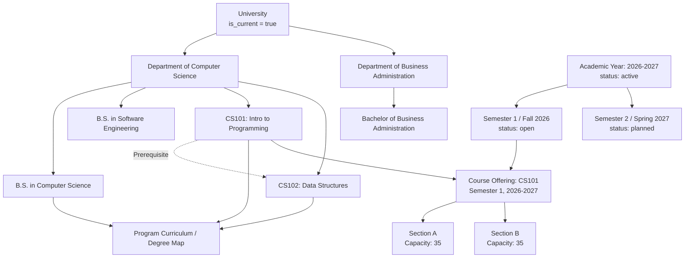

# EduCore — Academic Management Flow

This document details the complete academic organizational hierarchy, curriculum management, course definition, and academic year/semester lifecycle in EduCore.

- **Status:** `[Implemented]`
- **Source Code Reference:** `AcademicYearService.php`, `ProgramService.php`, `CourseController.php`, `CourseOfferingController.php`, `backend/app/Models/`
- **PlantUML Equivalent:** [`puml/academic-management-flow.puml`](puml/academic-management-flow.puml)

---

## 1. Academic Structural Hierarchy

EduCore models university academics using a flattened 3-tier organizational structure (`University → Department → Program`) feeding into course catalogs and academic calendar terms:



---

## 2. Course Creation & Prerequisite Definition Flow

```mermaid
flowchart TD
    StartCourse([Admin opens /courses]) --> ClickNew[Click 'New Course']
    ClickNew --> Form[Enter Course Code e.g. CS201, Title, Credit Hours, Department, Description]
    Form --> Submit[POST /courses]
    Submit --> ValCode{Course Code Unique?}
    ValCode -- Duplicate --> CodeErr[Show 422: Course Code already in use]
    CodeErr --> Form
    ValCode -- Unique --> SaveCourse[Insert Course into courses table]
    SaveCourse --> CourseCreated[Course Created]

    CourseCreated --> PrereqStep{Add Prerequisites?}
    PrereqStep -- No --> EndDone([Course Setup Complete])
    PrereqStep -- Yes --> SelectPrereq[Select Required Prerequisite Course]
    SelectPrereq --> SubmitPrereq[POST /courses/{id}/prerequisites]
    SubmitPrereq --> CycleCheck{Detect Circular Dependency?<br/>e.g. CS101 -> CS102 -> CS101}
    CycleCheck -- Circular Detected --> CycleErr[Abort 422: Circular prerequisite relationship detected]
    CycleErr --> SelectPrereq
    CycleCheck -- Valid --> SavePrereq[Insert into course_prerequisites table]
    SavePrereq --> EndDone
```

---

## 3. Academic Term Lifecycle State Transitions

The system models strict forward-only status progressions for academic years and semesters to preserve historical integrity.

```mermaid
stateDiagram-v2
    [*] --> Planned : Created by University Admin
    Planned --> Active : Activated (only one Academic Year is current)
    Active --> Completed : Term concludes (clears current flag)
    Completed --> [*]

    state Semesters {
        [*] --> Planned_Sem : Initial creation
        Planned_Sem --> Open_Sem : Open for registration & enrollment
        Open_Sem --> Closed_Sem : Registration closes; teaching in progress
        Closed_Sem --> Completed_Sem : Final grades submitted & finalized
        Completed_Sem --> [*]
    }
```


