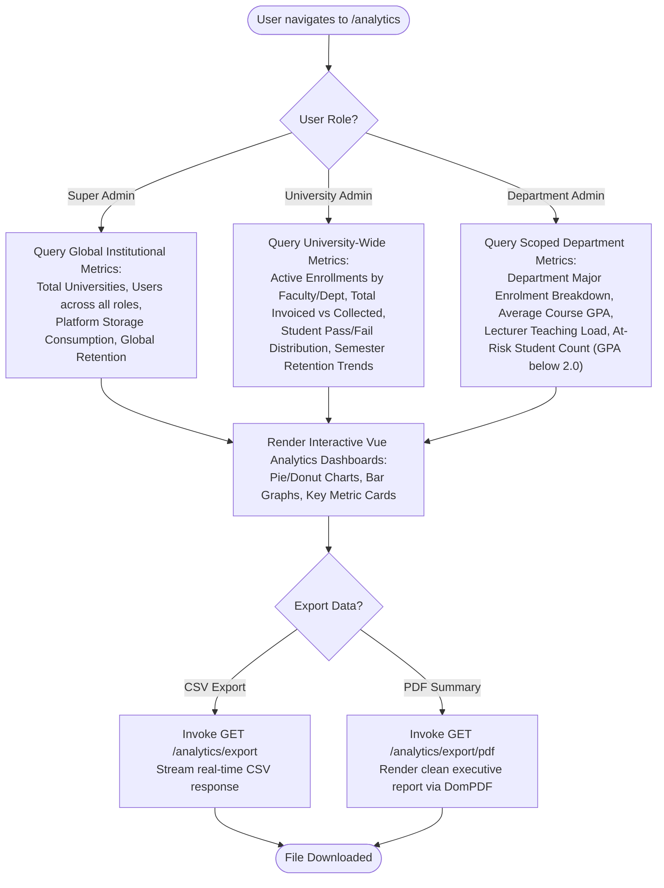
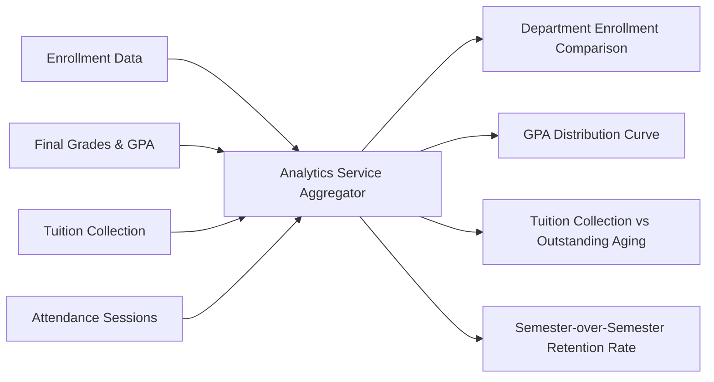

# EduCore — Analytics & Reporting Flow

This document details the analytics data aggregation pipelines, departmental performance metrics, semester trend comparisons, and CSV/PDF export workflows.

- **Status:** `[Implemented]`
- **Source Code Reference:** `AnalyticsPageController.php`, `ExportController.php`, `AnalyticsService.php`, `backend/routes/web.php`
- **PlantUML Equivalent:** [`puml/analytics-and-reporting-flow.puml`](puml/analytics-and-reporting-flow.puml)

---

## 1. Analytics Aggregation & Scoped Reporting Architecture

---

## 2. Department Analytics Comparison & Semester Trends

