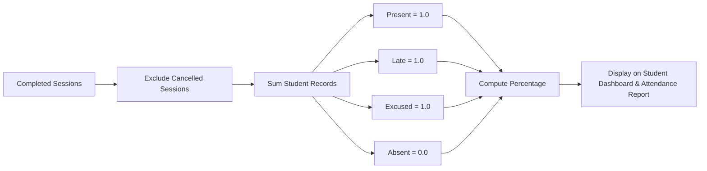

# EduCore — Attendance Tracking & Rate Calculation Flow

This document details how attendance sessions are created, recorded, validated, cancelled, and how student attendance rates are aggregated.

- **Status:** `[Implemented]`
- **Source Code Reference:** `AttendanceController.php`, `AttendanceService.php`, `backend/app/Models/AttendanceSession.php`, `backend/app/Models/AttendanceRecord.php`
- **PlantUML Equivalent:** [`puml/attendance-flow.puml`](puml/attendance-flow.puml)

---

## 1. Attendance Session Recording & Validation Lifecycle

```mermaid
flowchart TD
    Start([Lecturer opens /attendance/sections/{id}]) --> SelectDate[Select Date & Session Number]
    SelectDate --> CheckSession{Existing Session for this date?}

    CheckSession -- No --> CreateSession[Click 'Start Attendance'<br/>Insert row in attendance_sessions]
    CreateSession --> LoadRoster[Fetch Enrolled Students for Section]
    CheckSession -- Yes --> LoadRoster

    LoadRoster --> MarkGrid[Display Attendance Sheet:<br/>Radio buttons per student: Present, Absent, Late, Excused]
    MarkGrid --> SubmitRecord[Submit POST /attendance/sections/{id}]

    SubmitRecord --> ValidationCheck{All active students accounted for?}
    ValidationCheck -- Incomplete --> HighlightMissing[Highlight unmarked student rows]
    HighlightMissing --> MarkGrid

    ValidationCheck -- Complete --> DBTransaction[DB Upsert:<br/>Insert/Update records in attendance_records table<br/>Record remarks if provided]
    DBTransaction --> UpdateAggregates[Recalculate Section Attendance Rate]
    UpdateAggregates --> EndSuccess([Attendance Successfully Stored])

    Start -- Accidental / Erroneous Session --> CancelAction[Click 'Cancel Session']
    CancelAction --> ConfirmCancel{Confirm Cancellation?}
    ConfirmCancel -- Yes --> SubmitCancel[POST /attendance-sessions/{id}/cancel]
    SubmitCancel --> SetCancelled[Set attendance_sessions.status = 'cancelled']
    SetCancelled --> EndCancelled([Session Voided])
```

---

## 2. Student Attendance Rate Computation

Student attendance percentages are computed dynamically:
$$\text{Attendance Rate} = \frac{\text{Present Count} + \text{Late Count} + \text{Excused Count}}{\text{Total Completed Sessions}} \times 100\%$$


