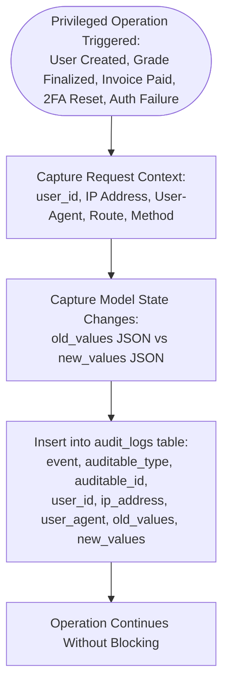
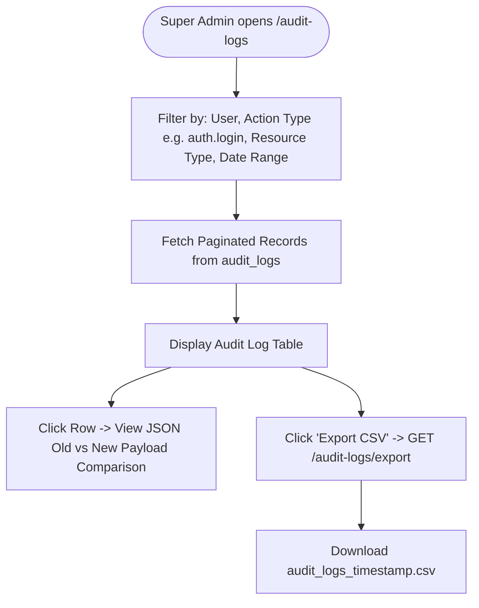

# EduCore — Audit Logging & Security Administration Flow

This document details how privileged operations, sensitive record mutations, and security events are tracked across EduCore, and how Super Admins inspect and export audit records.

- **Status:** `[Implemented]`
- **Source Code Reference:** `AuditLogsController.php`, `AuditLogService.php`, `backend/app/Models/AuditLog.php`, `backend/routes/web.php`
- **PlantUML Equivalent:** [`puml/audit-and-security-flow.puml`](puml/audit-and-security-flow.puml)

---

## 1. Audit Log Generation & Event Capture Pipeline

Every sensitive mutation automatically produces an append-only audit log entry:

---

## 2. Super Admin Audit Inspection & Export Workflow

