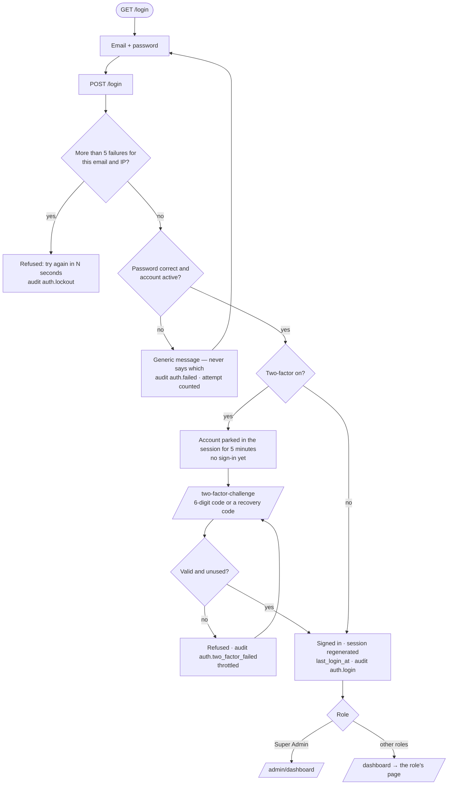
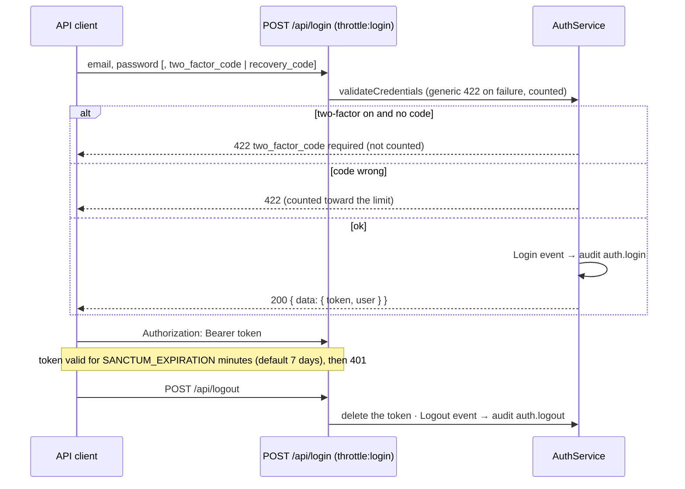
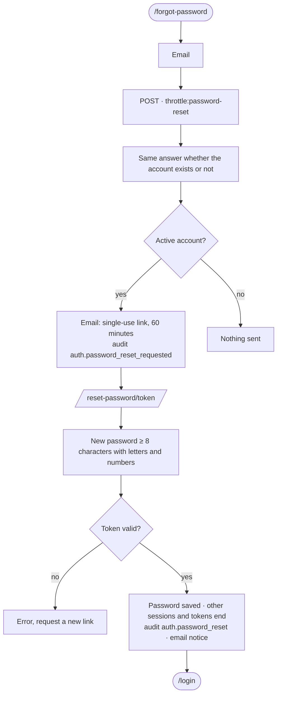

# Authentication Flow

- **Validated against the code:** 2026-10-14 · **Status:** `[Implemented]`
- **Code:** `AuthenticatedSessionController` (web), `Api\AuthController` + `AuthService` (API),
  `LoginRequest`, `TwoFactorService`, `PasswordService`, `EnsureAccountIsActive`
- **Reports:** 28 (audit), 29 (password change / reset), 52 (two-factor), 55 (this audit: token expiry,
  API sign-out audit)

## 1. Web sign-in → dashboard

`/` sends a signed-in user to the same destination; `/login` sends them away (guest middleware).

## 2. API sign-in

## 3. While signed in

| Event | Effect |
|---|---|
| Account deactivated by a Super Admin | Next request ends the web session / deletes the token (`EnsureAccountIsActive`), audit `auth.access_revoked` |
| Role or department changed | Applies on the next request (read from the database each time) |
| Password changed (`/account/password`, current password required) | Other sessions and all API tokens end; audit `user.password_changed`; email notice |
| Web session idle longer than `SESSION_LIFETIME` (120 min) | Next request redirects to `/login` |
| API token older than `SANCTUM_EXPIRATION` | 401; the client signs in again; expired rows pruned daily |

## 4. Password reset

## 5. Two-factor management (`/account/two-factor`)

| Action | Rule | Audit |
|---|---|---|
| Turn on | New secret + QR code, confirmed with a valid code; eight recovery codes shown once (stored hashed) | `auth.two_factor_enabled` |
| New recovery codes | Current password required | `auth.two_factor_recovery_codes_regenerated` |
| Turn off | Current password required | `auth.two_factor_disabled` |
| Reset another account | Super Admin only, never their own (`DELETE /users/{user}/two-factor`) | `auth.two_factor_reset` |
| Use a recovery code | Spent on use | `auth.recovery_code_used` |

Every change is also emailed to the account owner.

## 6. Sign-out

`POST /logout` (web): session invalidated, CSRF token regenerated, audit `auth.logout`, redirect to `/`.
`POST /api/logout`: the presenting token is deleted and audited the same way.
