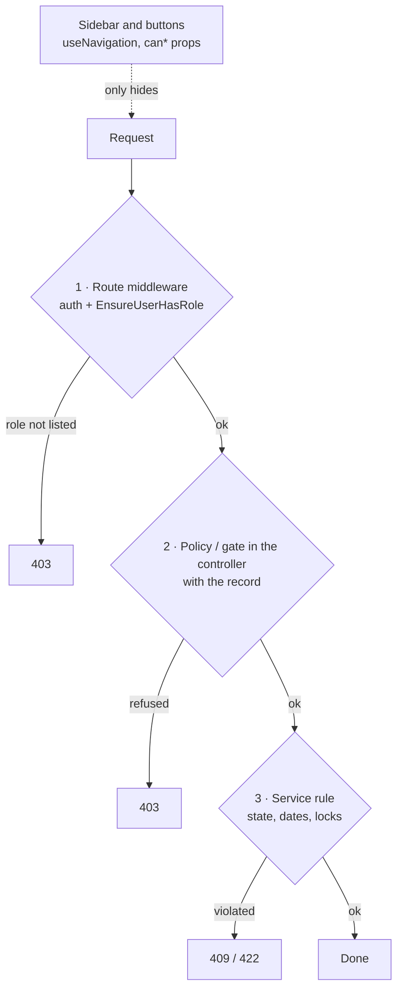
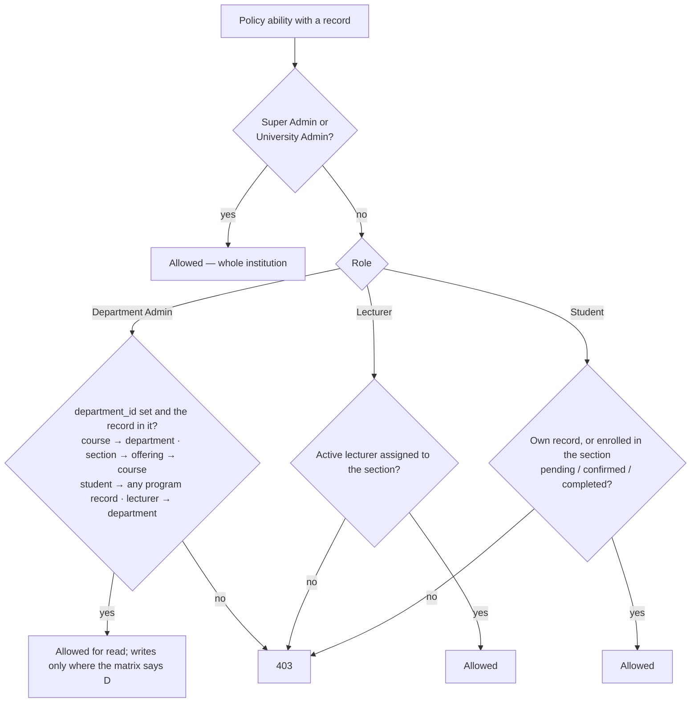

# Authorization and RBAC Flow

- **Validated against the code:** 2026-10-14 · **Status:** `[Implemented]`
- **Code:** `EnsureUserHasRole` (route middleware), `app/Policies/*` (25 policies),
  `Policies/Concerns/ChecksSectionTeaching`, `Support/DepartmentScope`, `Models/Concerns/BelongsToDepartment`,
  `Gate::define('view-analytics')`
- **Matrices:** [role permission matrix](../audits/role-permission-matrix.md) ·
  [route → authorization matrix](../audits/route-api-permission-matrix.md)

## 1. Three layers

Hiding a link or button is a convenience; the server decides. Roles are the fixed slugs
`super-admin`, `university-admin`, `department-admin`, `lecturer`, `student` on `users.role_id`
(there is no per-user permission set; editable permissions are `[Future]`).

## 2. How a policy scopes a record

- A Department Admin without a department sees nothing (scope `0`).
- Lists are filtered on the server (`visibleTo($user)`), never by a client parameter.
- Self-service resources (profile, inbox, notification preferences, two-factor) have no id in the path:
  they act on the signed-in user.

## 3. Examples

| Request | SA / UA | DA (dept A) | Lecturer of section S | Student enrolled in S |
|---|---|---|---|---|
| `GET /api/sections/S/grades` (S in dept A) | 200 | 200 | 200 | 403 |
| same, section in dept B | 200 | **403** | 403 | 403 |
| `POST /api/sections/S/grades/approve` | 200 | 403 | 403 | 403 |
| `GET /api/students/{other student}/grades` | 200 | 200 if in dept A | 403 | **403** |
| `POST /api/document-requests/{dept A request}/approve` | 200 | 200 | 403 | 403 |
| `POST /api/document-requests/{id}/waive-fee` | 200 | 403 | 403 | 403 |
| `GET /api/audit-logs` | SA 200 · UA 403 | 403 | 403 | 403 |

Every "403" in this table is asserted by `tests/Feature/Audit/RoleIsolationMatrixTest.php` or the
module tests.

## 4. Known scope decisions

- A department's students are those with **any** program record in it (report 32), so a transferred
  student stays visible to the former department — documented as a business decision (BD-05).
- University Admins are not bound to a university; EduCore runs one institution (BD-03).
