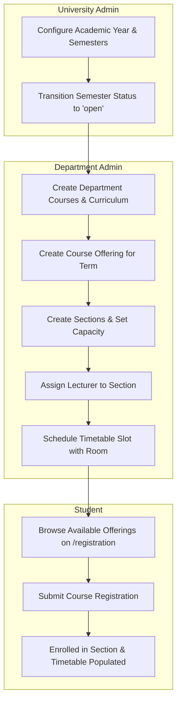
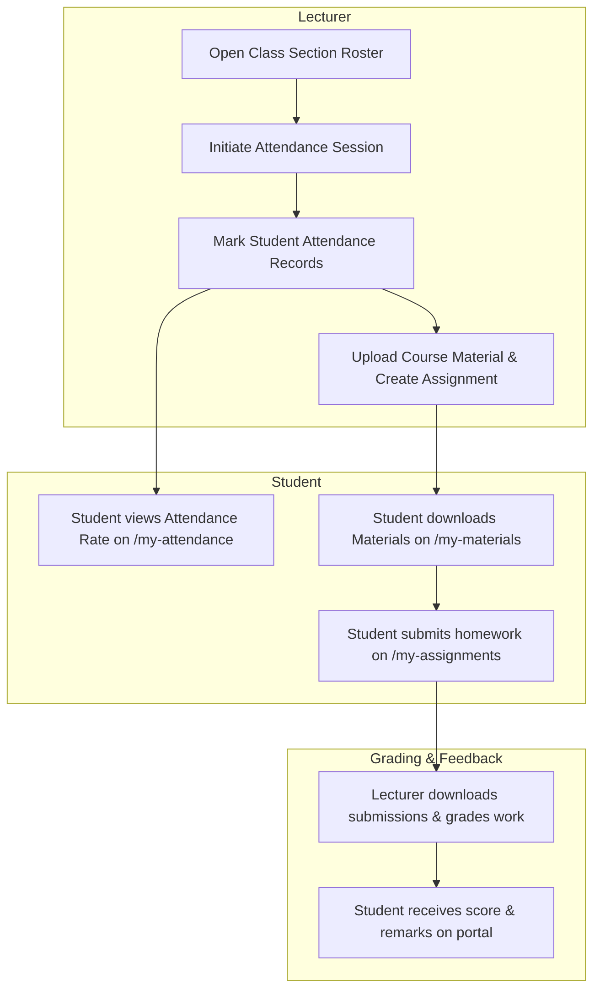

# EduCore — Cross-Role Collaborative Workflows

This document illustrates how all five roles (**Super Admin, University Admin, Department Admin, Lecturer, Student**) interact across foundational institutional lifecycles using swimlane-style diagrams.

- **Status:** `[Implemented]`
- **Primary Processes Covered:**
  1. Academic Structure Setup → Course Offering → Student Enrollment
  2. Course Teaching → Attendance Recording → Student Attendance Tracking
  3. Coursework Creation → Student Submission → Lecturer Review & Marking
  4. Examination Scheduling → Grade Entry → Department Approval → Grade Finalization
  5. Document Request → Admin Review & Waiver → PDF Issuance → Public QR Verification
  6. Tuition Generation → Student Review → Offline Cashier Payment Recording
- **PlantUML Equivalent:** [`puml/cross-role-workflows.puml`](puml/cross-role-workflows.puml)

---

## 1. Academic Setup, Course Offering & Enrollment Cross-Role Workflow



---

## 2. Teaching, Attendance & Coursework Cross-Role Workflow



---

## 3. Examination, Grade Approval & GPA Finalization Workflow

```mermaid
flowchart TD
    subgraph LecturerStep["1. Lecturer"]
        EnterMarks[Enter Coursework, Midterm, and Final Marks] --> AutoCalculate[Compute Weighted Final Grades]
        AutoCalculate --> SubmitGrades[Submit Grade Sheet for Approval]
    end

    subgraph DeptStep["2. Department Admin"]
        SubmitGrades --> ReviewSheet[Inspect Department Section Grades]
        ReviewSheet --> DecideApprove{Grades Approved?}
        DecideApprove -- Revisions Needed --> ReturnDraft[Return to Draft with Feedback]
        ReturnDraft --> EnterMarks
        DecideApprove -- Approved --> ApproveGrades[Approve Section Grades]
    end

    subgraph UniStep["3. University Admin"]
        ApproveGrades --> FinalizeLock[Finalize Grades (Permanent Lock)]
        FinalizeLock --> ComputeGPA[Recalculate Semester & Cumulative GPA]
    end

    subgraph StudentStep["4. Student"]
        ComputeGPA --> ViewGrades[View Published Grades & Cumulative GPA]
        ViewGrades --> DownloadTranscript[Download Official Transcript]
    end
```

---

## 4. Document Request, Billing & Verification Cross-Role Workflow

```mermaid
flowchart TD
    subgraph StudentReq["Student"]
        OpenReq[Submit Document Request on /my-documents] --> CheckBilling{Fee Required?}
    end

    subgraph AdminDesk["University Cashier / Dept Admin"]
        CheckBilling -- Fee > 0 --> PayCashier[Student pays cashier offline]
        PayCashier --> RecordPay[Admin records payment in /invoices]
        RecordPay --> ReviewReq[Dept Admin reviews request]
        CheckBilling -- Free / Waived --> ReviewReq
        ReviewReq --> ApproveDoc[Approve & Generate PDF with embedded QR Code]
        ApproveDoc --> StoreS3[Save signed document to MinIO]
    end

    subgraph VerificationLane["Public Verifier / Third Party"]
        StoreS3 --> StudentGetPDF[Student downloads Certificate PDF]
        StudentGetPDF --> PresentToEmployer[Student presents document to Employer / Embassy]
        PresentToEmployer --> ScanQR[Verifier scans QR code to /verify/{token}]
        ScanQR --> PublicPortal[EduCore displays official verified credential badge]
    end
```
