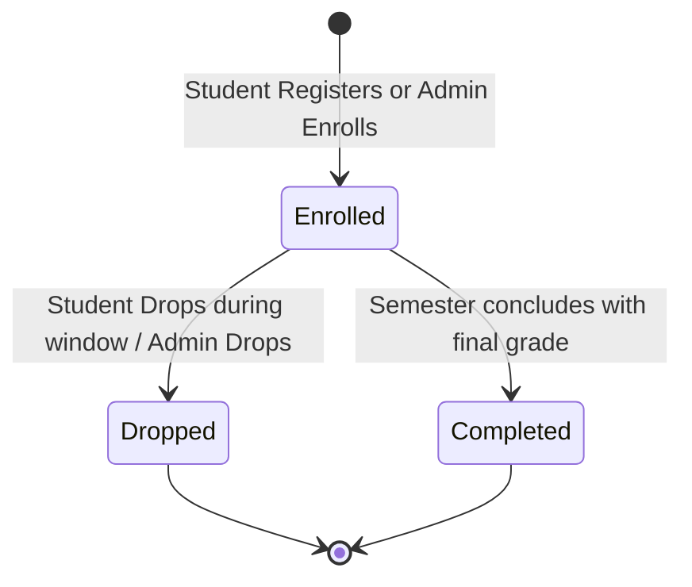

# EduCore — Course Registration & Enrollment Flow

This document details the complete course registration and enrollment lifecycle, covering student self-registration, administrative enrollment, prerequisite checking, capacity locks, timetable clash prevention, and the add/drop process.

- **Status:** `[Implemented]`
- **Source Code Reference:** `RegistrationController.php`, `EnrollmentController.php`, `EnrollmentService.php`, `backend/routes/web.php`
- **PlantUML Equivalent:** [`puml/enrollment-flow.puml`](puml/enrollment-flow.puml)

---

## 1. Registration Decision Engine

When an enrollment is submitted (either by a student via `/registration` or by an administrator via `/enrollments`), EduCore executes a multi-step validation engine:

```mermaid
flowchart TD
    Start([Enrollment Request Initiated]) --> WindowCheck{Registration Window Open?<br/>semesters.status == 'open'<br/>(Bypassed for Admins)}

    WindowCheck -- No --> WindowErr[Abort 422: Registration period closed]
    WindowErr --> EndFail([Request Denied])

    WindowCheck -- Yes --> DuplicateCheck{Already Enrolled in this Course?<br/>Existing enrollment in same semester?}
    DuplicateCheck -- Yes --> DupErr[Abort 422: Student is already enrolled in this course]
    DupErr --> EndFail

    DuplicateCheck -- No --> PrereqCheck{Prerequisites Satisfied?<br/>Completed all prerequisite courses with passing grade?}
    PrereqCheck -- Unmet --> PrereqErr[Abort 422: Missing required prerequisites]
    PrereqErr --> EndFail

    PrereqCheck -- Satisfied --> CapCheck{"Section Has Free Capacity?<br/>enrolled_count < capacity"}
    CapCheck -- Section Full --> CapErr[Abort 422: Section has reached maximum capacity]
    CapErr --> EndFail

    CapCheck -- Has Seat --> ClashCheck{Timetable Clash Check:<br/>Does section schedule overlap with any<br/>existing active enrolled section?}
    ClashCheck -- Overlap Detected --> ClashErr[Abort 422: Schedule conflict with another class]
    ClashErr --> EndFail

    ClashCheck -- Clear --> CreditCheck{"Credit Limit Exceeded?<br/>current_credits + course_credits <= term_limit"}
    CreditCheck -- Exceeded --> CreditErr[Abort 422: Exceeds semester maximum credit limit]
    CreditErr --> EndFail

    CreditCheck -- OK --> WriteDB[DB Transaction:<br/>1. Insert into enrollments (status: 'enrolled')<br/>2. Increment sections.enrolled_count<br/>3. Log Audit Event: enrollment.created]
    WriteDB --> EndSuccess([Enrollment Completed Successfully])
```

---

## 2. Course Add / Drop Lifecycle


