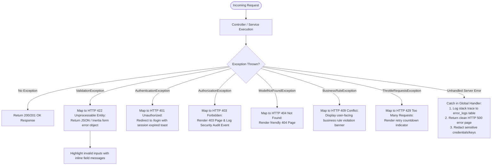
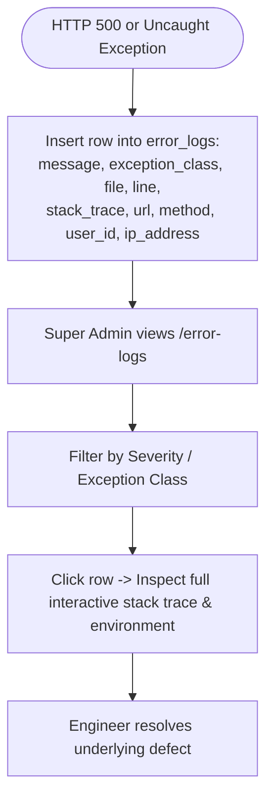

# EduCore — Error & Exception Handling Flows

This document details how HTTP exceptions, domain business rule violations, validation errors, and unexpected server failures are handled, logged, and presented to users.

- **Status:** `[Implemented]`
- **Source Code Reference:** `ErrorLogController.php`, `backend/bootstrap/app.php`, `BusinessRuleException.php`, `backend/routes/web.php`
- **PlantUML Equivalent:** [`puml/error-and-exception-flows.puml`](puml/error-and-exception-flows.puml)

---

## 1. Exception Routing & Recovery Pipeline

---

## 2. Super Admin System Error Diagnostics

When an unexpected exception occurs, it is persisted to `error_logs` (retained for 90 days per Report 50):

