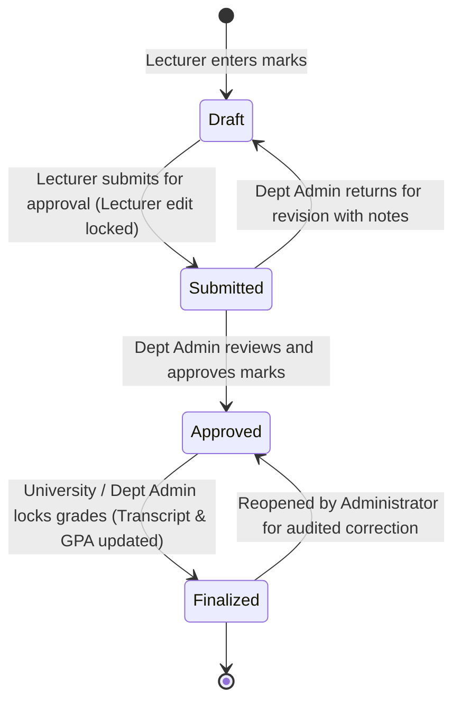

# EduCore — Examination & Grading Flow

This document details the multi-stage grading lifecycle, covering component mark entry, automated letter grade calculation, submission, department review, grade finalization, and GPA computation.

- **Status:** `[Implemented]`
- **Source Code Reference:** `GradesController.php`, `ExamsController.php`, `GradeCalculationService.php`, `backend/app/Models/Grade.php`
- **PlantUML Equivalent:** [`puml/exam-and-grading-flow.puml`](puml/exam-and-grading-flow.puml)

---

## 1. Multi-Stage Grade Workflow & Lock States

To protect academic integrity, grade sheets progress through four distinct states. Lecturers cannot edit once submitted, and finalized grades can only be reopened by authorized administrators.



---

## 2. Grade Calculation & Scale Mapping Algorithm

```mermaid
flowchart TD
    Start([Lecturer inputs raw marks]) --> Weights[Read Course Weightings:<br/>Continuous Assessment e.g. 30%,<br/>Midterm Exam e.g. 30%,<br/>Final Exam e.g. 40%]
    Weights --> CalcTotal[Compute Weighted Total: 0.00 - 100.00]
    CalcTotal --> ScaleMap{Lookup against grading_scales table}
    
    ScaleMap -- 85.0 - 100.0 --> GradeA[Letter: 'A' | Grade Point: 4.00 | Status: Passed]
    ScaleMap -- 80.0 - 84.9 --> GradeBPlus[Letter: 'B+' | Grade Point: 3.50 | Status: Passed]
    ScaleMap -- 70.0 - 79.9 --> GradeB[Letter: 'B' | Grade Point: 3.00 | Status: Passed]
    ScaleMap -- 65.0 - 69.9 --> GradeCPlus[Letter: 'C+' | Grade Point: 2.50 | Status: Passed]
    ScaleMap -- 50.0 - 64.9 --> GradeC[Letter: 'C' | Grade Point: 2.00 | Status: Passed]
    ScaleMap -- 0.0 - 49.9 --> GradeF[Letter: 'F' | Grade Point: 0.00 | Status: Failed]

    GradeA --> StoreGrades[Save to grades table]
    GradeBPlus --> StoreGrades
    GradeB --> StoreGrades
    GradeCPlus --> StoreGrades
    GradeC --> StoreGrades
    GradeF --> StoreGrades

    StoreGrades --> FinalizeCheck{Section Finalized?}
    FinalizeCheck -- Yes --> GPAJob[Trigger GPACalculationJob:<br/>Term GPA = Sum(Credits * GradePoint) / Sum(Credits)<br/>Update cumulative_gpa on student_profiles]
    GPAJob --> StudentPortal[Grades Visible on Student Portal & Official Transcript]
    FinalizeCheck -- No --> HiddenFromStudent[Grades Hidden from Student until Finalized]
```
