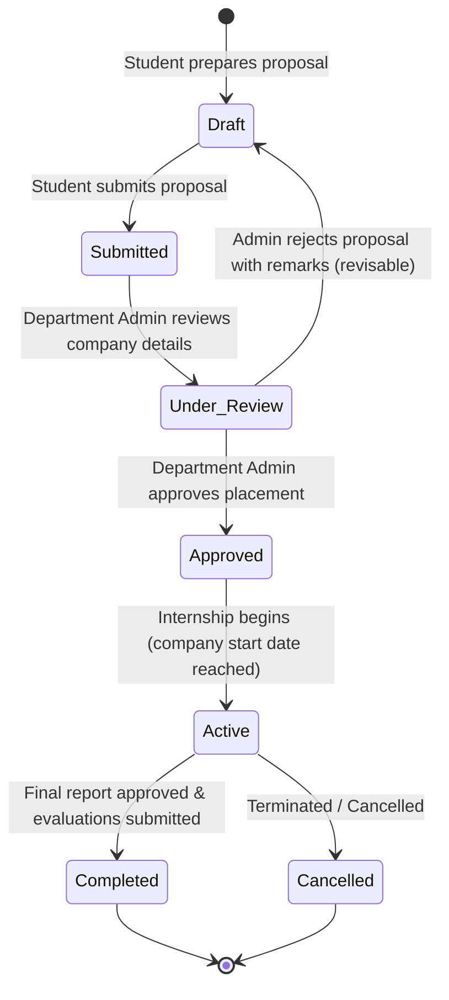

# EduCore — Internship Management Flow

This document details how student internships are proposed, reviewed, approved, monitored through weekly progress reports, evaluated by academic and company supervisors, and formally completed.

- **Status:** `[Implemented]`
- **Source Code Reference:** `InternshipsController.php`, `InternshipService.php`, `backend/app/Models/Internship.php`, `backend/routes/web.php`
- **PlantUML Equivalent:** [`puml/internship-flow.puml`](puml/internship-flow.puml)

---

## 1. Internship Lifecycle State Machine



---

## 2. Weekly Reporting & Supervisor Evaluation Flow

```mermaid
flowchart TD
    StartActive([Internship is Active]) --> WeeklyCycle[Student conducts weekly internship work]
    WeeklyCycle --> UploadReport[Student uploads Weekly Report PDF on /my-internships]
    UploadReport --> SubmitReport[POST /internships/{id}/reports]
    SubmitReport --> SaveMinIO[Store file in MinIO & insert internship_reports record]
    SaveMinIO --> NotifySupervisor[Notify Academic Supervisor & Company Evaluator]

    NotifySupervisor --> EvaluateTerm{End of Placement Reached?}
    EvaluateTerm -- No --> WeeklyCycle
    EvaluateTerm -- Yes --> UploadFinalReport[Student submits Final Internship Summary Report]
    
    UploadFinalReport --> AcademicEval[Academic Supervisor completes Evaluation Rubric (1-100)]
    AcademicEval --> CompanyEval[Company Supervisor submits Employer Feedback Form]
    
    CompanyEval --> AdminSignoff[Department Admin reviews evaluations & reports]
    AdminSignoff --> CompleteInternship[Submit POST /internships/{id}/complete]
    CompleteInternship --> IssueCredits[Grant Program Internship Credits & Update Student Record]
    IssueCredits --> EndDone([Internship Completed])
```
