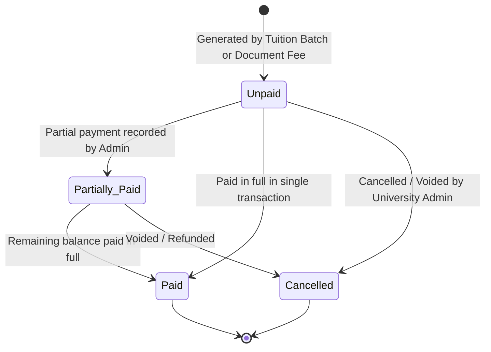

# EduCore — Invoice & Payment Record Flow

This document details how student tuition and document fee invoices are generated, reviewed by students, recorded offline by university cashiers, and tracked across status states without online card payment gateways.

- **Status:** `[Implemented]`
- **Source Code Reference:** `InvoicesController.php`, `InvoiceService.php`, `backend/app/Models/Invoice.php`, `backend/app/Models/Payment.php`
- **PlantUML Equivalent:** [`puml/invoice-and-payment-record-flow.puml`](puml/invoice-and-payment-record-flow.puml)

---

## 1. Invoice Lifecycle & Manual Payment Flow



---

## 2. Invoicing & Cashier Payment Recording Process

```mermaid
flowchart TD
    subgraph InvoiceCreation["Invoice Generation Workflow"]
        TriggerType{Invoice Source}
        TriggerType -- Batch Semester Tuition --> UniAdminBatch[University Admin generates tuition for Semester:<br/>Calculates credit fees for enrolled students]
        TriggerType -- Document Request --> DocFeeGen[Document request with configured fee submitted]
        TriggerType -- Ad-hoc Fee --> ManualInvoice[Admin manually creates invoice in /invoices/create]
        
        UniAdminBatch --> InsertInvoices[Insert invoice records: status 'unpaid']
        DocFeeGen --> InsertInvoices
        ManualInvoice --> InsertInvoices
        InsertInvoices --> InvoiceNotif[Dispatch Notification to Student]
    end

    subgraph StudentReview["Student Action"]
        InvoiceNotif --> ViewPortal[Student opens /my-invoices]
        ViewPortal --> DownloadInvPDF[Download Official Invoice PDF with Bank Transfer Details]
        DownloadInvPDF --> OfflineTransfer[Student pays via Cambodian Bank Transfer (e.g. ABA/Bakong) or In-Person Cashier]
    end

    subgraph CashierRecording["Cashier / Admin Payment Recording"]
        OfflineTransfer --> CashierDesk[Cashier receives bank proof or physical cash]
        CashierDesk --> FindInv[Admin opens /invoices/{id}]
        FindInv --> ClickRecordPay[Click 'Record Payment']
        ClickRecordPay --> EnterPayData[Enter Amount Received, Payment Method (Cash, Bank Transfer), Reference / Transaction Code]
        EnterPayData --> SubmitPay[Submit POST /invoices/{id}/payments]
        
        SubmitPay --> BalanceCheck{Total Paid >= Invoice Total?}
        BalanceCheck -- Yes --> SetPaid[Set invoice status: 'paid']
        BalanceCheck -- No --> SetPartial[Set invoice status: 'partially_paid']
        
        SetPaid --> GenReceipt[Generate Official Payment Receipt PDF]
        SetPartial --> GenReceipt
        GenReceipt --> StudentPortalReceipt[Receipt available for Student Download]
    end
```
