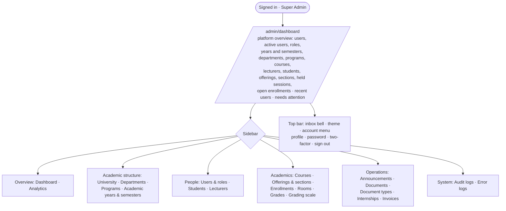
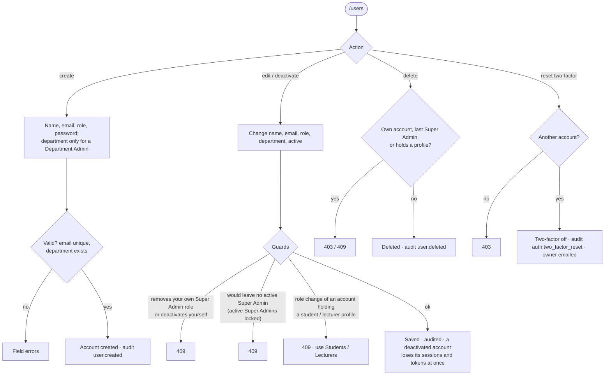
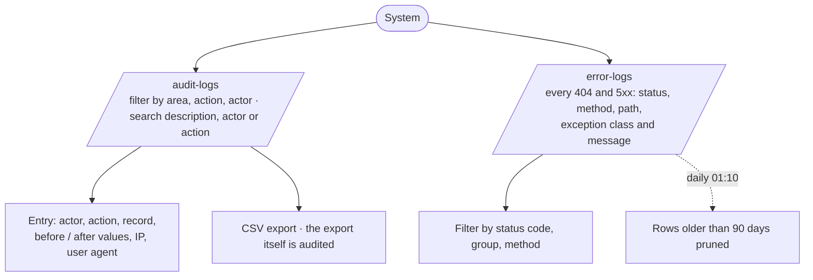

# Super Admin Flow

- **Validated against the code:** 2026-10-14 · **Status:** `[Implemented]`
- **Entry:** `/admin/dashboard` (`Admin/Dashboard`) · **Policies:** `UserPolicy`, `AuditLogPolicy`,
  `ErrorLogPolicy`, `GradePolicy::reopen`, plus every University Admin ability
- **Scope:** the whole platform. Matrix: [role permission matrix](../audits/role-permission-matrix.md)

## 1. Dashboard and navigation

Only the Super Admin uses `/admin/dashboard`; `/dashboard` is for the other four roles.

## 2. Users and roles (Super Admin only)

## 3. Structure and calendar

Same as the University Admin ([university-admin-flow](university-admin-flow.md) §2): universities
(one current), departments (archive vs delete with guards), programs, courses, rooms, academic years
(`planned → active → completed`) and semesters (`planned → open → closed → completed`, forward only).

## 4. Audit and error logs

The audit log is append-only (database trigger); nothing can edit or delete it. Error logs have no
write endpoint.

## 5. Grades: reopening finalized grades

Only the Super Admin may move a section's **finalized** grades back to approved, with a reason
(`grades.reopened` audit). See [exam-and-grading-flow](exam-and-grading-flow.md).

## 6. Sign-out

Account menu → *Sign out* (`POST /logout`). See [authentication-flow](authentication-flow.md) §6.
