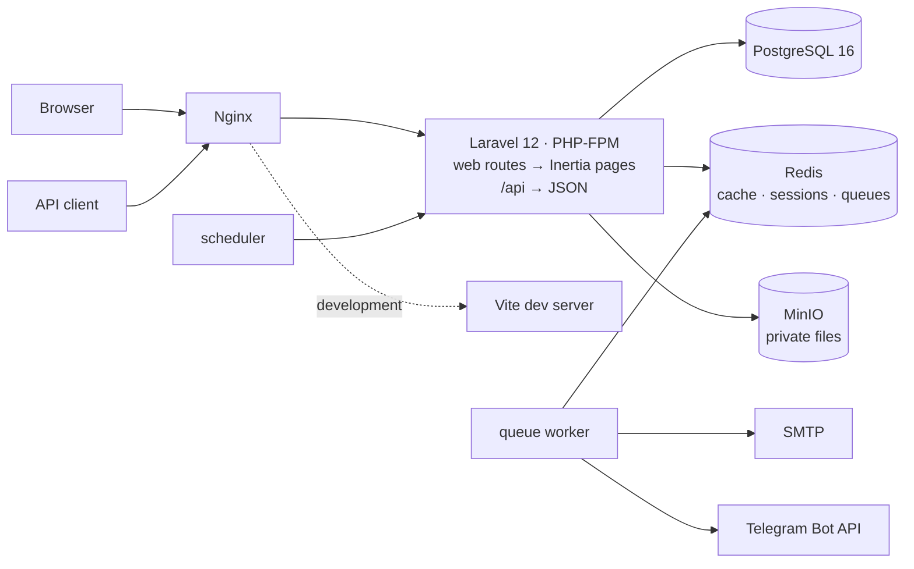
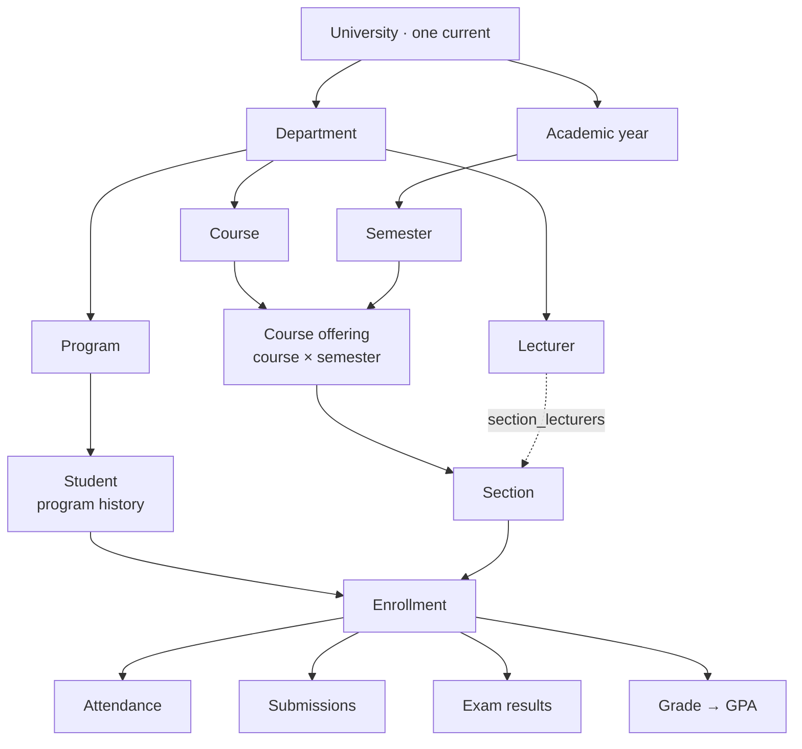
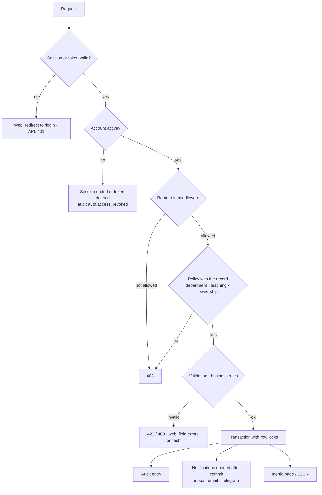

# EduCore — System Overview

- **Validated against the code:** 2026-10-14 (post-login audit, `docs/audits/post-login-audit.md`)
- **Status:** `[Implemented]` unless marked otherwise
- **Related:** [authentication](authentication-flow.md) · [authorization / RBAC](authorization-rbac-flow.md) ·
  [cross-role workflows](cross-role-workflows.md) · [role permission matrix](../audits/role-permission-matrix.md)

## 1. Platform

EduCore is a **modular monolith**: one Laravel 12 (PHP 8.4) application and one Vue 3 application in
plain JavaScript, rendered through **Inertia.js** — every page is a server route, there is no
client-side router. A REST API (`/api`, Laravel Sanctum tokens, OpenAPI) exposes the same services and
policies for integrations. PostgreSQL 16 holds the data, Redis the cache, sessions and queues, MinIO
the private files; Nginx fronts everything in Docker Compose. Pinia is registered but holds no store.

## 2. Academic model

There is no faculty level (removed in report 39): departments sit directly under the university.

## 3. Roles

| Role | Signs in to | Scope |
|---|---|---|
| Super Admin | `/admin/dashboard` | Everything a University Admin does, plus users and roles, audit and error logs, reopening finalized grades |
| University Admin | `/dashboard` (university) | The whole institution: structure, calendar, people, teaching, grades approval, documents, finance, internships, announcements, analytics |
| Department Admin | `/dashboard` (department) | Their department (`users.department_id`): read structure and people, run its offerings / sections / schedules, process its students' document requests and internships, announce to it, its analytics |
| Lecturer | `/dashboard` (teaching) | Sections they teach: attendance, coursework, materials, exams, grade sheets, announcements to those sections / courses |
| Student | `/dashboard` (student) | Their own records: registration, timetable, attendance, coursework, exams, approved grades and GPA, documents, invoices, internship |

Full matrix: [role-permission-matrix](../audits/role-permission-matrix.md).

## 4. Request lifecycle

## 5. Scheduled jobs (`scheduler` container)

| Time | Command | Purpose |
|---|---|---|
| every minute | `announcements:publish-scheduled` | Publish due scheduled announcements (report 51) |
| every 5 min | `notifications:class-reminders` | Telegram reminder ~30 min before each class (report 48) |
| 00:10 | `invoices:refresh-statuses` | Mark overdue invoices |
| 01:00 | `notifications:prune` | Inbox retention 180 days |
| 01:10 | `error-logs:prune` | Error-log retention 90 days |
| 01:20 | `sanctum:prune-expired --hours=24` | Remove expired API tokens (audit SEC-01) |
| 07:00 | `notifications:assignment-reminders` | Assignments due soon |

## 6. Out of scope

Online payment gateway, native mobile apps, AI assistants, OCR, predictive analytics, timetable
optimisation, microservices (`docs/3_business-overview.md`).
