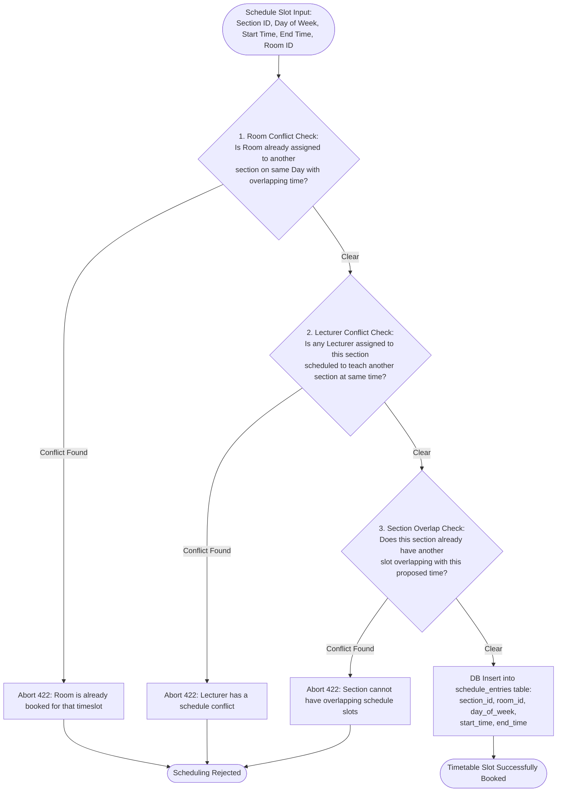
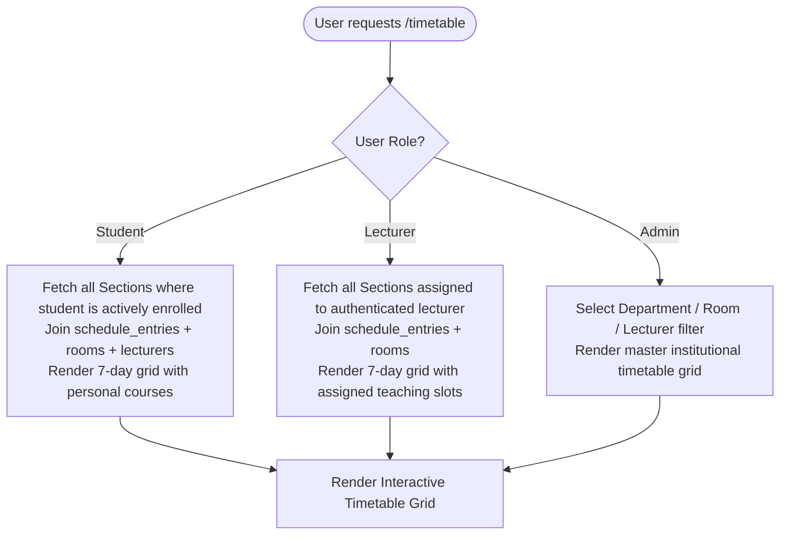

# EduCore — Timetable Management & Conflict Detection Flow

This document details how class schedules, rooms, and weekly timetables are configured, and explains the 3-way conflict detection algorithm that guarantees room, instructor, and student consistency.

- **Status:** `[Implemented]`
- **Source Code Reference:** `TimetableController.php`, `TimetableService.php`, `backend/app/Models/ScheduleEntry.php`, `backend/routes/web.php`
- **PlantUML Equivalent:** [`puml/timetable-flow.puml`](puml/timetable-flow.puml)

---

## 1. 3-Way Schedule Conflict Detection Engine

When an administrator adds a weekly schedule slot to a section (`POST /sections/{id}/schedule`), EduCore evaluates three distinct physical and temporal constraints:

---

## 2. Timetable Generation Views

Once scheduled, weekly timetables are rendered dynamically based on the actor's context:

