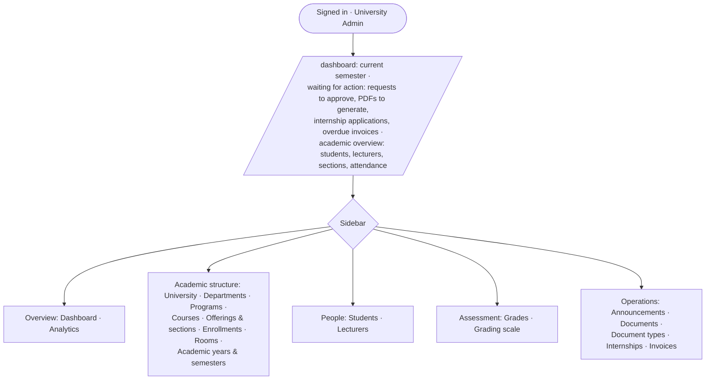
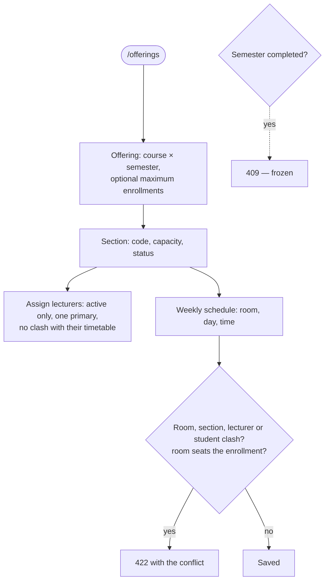
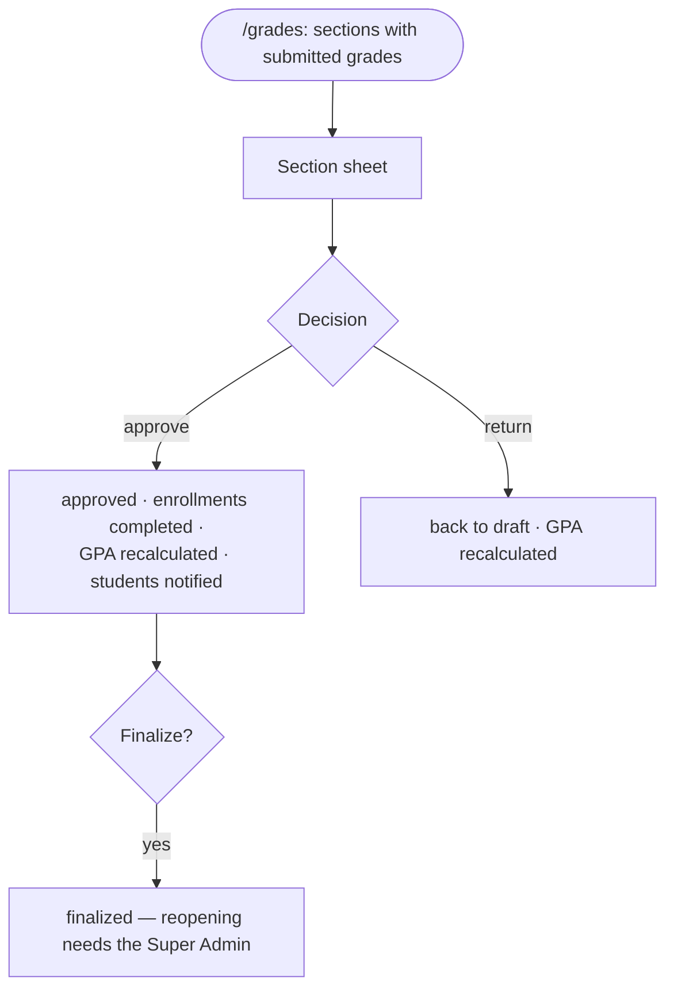

# University Admin Flow

- **Validated against the code:** 2026-10-14 · **Status:** `[Implemented]`
- **Entry:** `/dashboard` → `UniversityAdmin/Dashboard` (`UniversityDashboardService`)
- **Scope:** the whole institution (one current university). Cannot manage users, read audit or error
  logs, or reopen finalized grades (Super Admin). Matrix:
  [role permission matrix](../audits/role-permission-matrix.md)

## 1. Dashboard and navigation



## 2. Structure and calendar

```mermaid
flowchart TD
    A([Set up a semester]) --> Y[Academic year: code, dates<br/>planned → active, one current year]
    Y --> SE[Semester inside the year's dates:<br/>enrollment window, exam window]
    SE --> ST{Status}
    ST -- planned → open --> OPN[Registration possible inside the window]
    OPN -- open → closed --> CL[No new registrations]
    CL -- closed → completed --> CP[Attendance, coursework, exams,<br/>timetable and section lecturers frozen]
    ST -- any backward move --> X[409 — forward only]
    A --> STR[Departments · programs + curriculum ·<br/>courses + prerequisites (no cycles) · rooms]
    STR --> GD{Delete?}
    GD -- referenced (incl. soft-deleted children) --> AR[409 · archive instead]
    GD -- unreferenced --> DEL[Deleted]
```

## 3. Teaching setup



## 4. People

- **Students** (`/students`): create with a first active program (opens `student_programs`), edit,
  status `active → inactive / suspended / graduated / withdrawn` (audited), program transfer (active
  students without open enrollments; the old period closes as `transferred`), delete only without
  history. Accounts with no profile are listed with a *Create profile* action.
- **Lecturers** (`/lecturers`): create with a new or existing Lecturer-role account, home department,
  deactivate / reactivate (mirrored on the account), delete only without teaching history.

## 5. Enrollment oversight

`/enrollments`: list and CSV export; **enroll** a student (same rules as self-registration —
[enrollment-flow](enrollment-flow.md)), **drop / withdraw** (refused once the grade is submitted for
approval), **complete** a confirmed enrollment.

## 6. Grades approval



## 7. Documents, finance, internships, announcements

| Area | Actions | Rules |
|---|---|---|
| Documents (`/documents`) | approve, reject (reason), generate PDF, revoke, waive fee | Fee-bearing types get an invoice at approval unless waived; PDF only once paid or waived; [document flow](document-request-and-verification-flow.md) |
| Document types | create, edit fee, delete | — |
| Invoices (`/invoices`) | create itemised (USD / KHR), record payment, reverse payment, cancel, tuition run, CSV | Payments ≤ balance; no edit or cancel with payments; [invoice flow](invoice-and-payment-record-flow.md) |
| Internships | review, approve, reject, start, complete, cancel, evaluate, review reports, companies | [internship flow](internship-flow.md) |
| Announcements | any audience; schedule; read receipts | [announcement flow](announcement-and-notification-flow.md) |
| Analytics | whole university or one department; trends; CSV / PDF | [analytics flow](analytics-and-reporting-flow.md) |

## 8. Sign-out

Account menu → *Sign out*.
